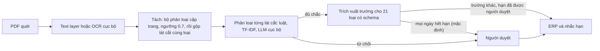

# sdh-phanloaitailieu — phân loại và trích xuất hồ sơ quét cho doanh nghiệp xăng dầu

Đề tài doanh nghiệp: một công ty kinh doanh xăng dầu quét hồ sơ giấy thành PDF và cần một hệ thống **chạy tại chỗ (on-premise)** để đọc chữ (OCR), tách tệp ghép thành từng tài liệu, nhận loại tài liệu, và lấy các trường quan trọng — trước hết là ngày hết hạn — đưa vào ERP. Đây là ứng dụng thật, không phải bài báo: mục tiêu là một thiết kế tốt nhất về **độ chính xác, chi phí và quyền riêng tư**, và mọi con số trong kho đều phải truy được về một phép đo.

Kho này dành cho sinh viên năm cuối ngành AI tiếp tục đề tài. Trạng thái mô tả dưới đây là của ngày 2026-10-16: giai đoạn 2 (đo cả bốn khâu và toàn trình, 2026-10-12) cộng giai đoạn 3 (mở rộng sang 21 loại có trường, thêm hai tùy chọn tách/phân loại, ảnh trang cho VLM, review độc lập và thiết kế triển khai; xem mục "Giai đoạn 3" bên dưới). Người mới bắt đầu ở [`docs/HANDBOOK_FOR_RESEARCHERS.md`](docs/HANDBOOK_FOR_RESEARCHERS.md); hướng đi ban đầu của đề tài (19 danh mục, Jev/Kev, OCR Apple Vision...) được giữ nguyên văn và đối chiếu với kết quả ở [`docs/original_direction/README.md`](docs/original_direction/README.md); muốn biết nên triển khai thế nào và còn gì phải làm thì đọc [`reports/04_phase3_review_and_deployment.md`](teams/00_data_and_eval/reports/04_phase3_review_and_deployment.md).

> **Lưu ý đọc trước mọi con số.** Ba loại đáp án đều do máy tạo và **chưa có nhân viên công ty kiểm**: nhãn loại tài liệu (`data/labels_v2.csv`, do hai lượt gán của mô hình AI), đáp án ranh giới tách trang (`boundary_gold_v0.csv`, một mô hình xem đủ trang), và đáp án trường (silver: Haiku đọc cả 104 đơn vị, Sonnet đọc lại 40, Opus phân xử 58 trường). "Đúng" trong kho này nghĩa là "khớp đáp án máy". Ngoài ra "dev" là phần dùng để chọn tham số (số hơi lạc quan), "TEST" là phần khóa chỉ chấm một lần; mỗi con số dưới đây ghi rõ thuộc phần nào và cỡ mẫu n.

## Hiện trạng

Bộ mẫu: 336 tệp PDF, tức 304 tài liệu duy nhất sau khi gộp bản trùng. Khoảng trong ngoặc vuông là khoảng tin cậy 95%. Mọi số dùng văn bản OCR cục bộ, trừ khi ghi khác.

| Khâu | Đã đo gì | Kết quả | Còn thiếu |
|---|---|---|---|
| Dữ liệu và nhãn | Trùng lặp, nhóm biểu mẫu, đồng thuận giữa hai lượt gán nhãn | 27 trong 30 nhóm tệp trùng nằm ở nhiều thư mục cũ, nên thư mục cũ là tủ hồ sơ chứ không phải loại tài liệu. Taxonomy mới: 34 loại theo nội dung + `OTHER` + `UNREADABLE`, trong 8 nhóm; chỉ 10 loại có từ 10 tài liệu trở lên. Hai lượt gán của mô hình trùng nhau 304/304 | Người của công ty kiểm nhãn; thêm mẫu cho 24 loại hiếm |
| OCR | So sánh engine; chạy cả kho; so với bản chép của LLM; kiểm engine trong `src/` so với bộ dữ liệu | Engine cũ làm mất dấu tiếng Việt (từ điển nhận dạng chỉ có 9/67 chữ cái thường có dấu). Engine chọn (phát hiện dòng PP-OCRv5 + VietOCR): CER 0,082 trên trang số hóa sạch, giữ 97,8% ký tự có dấu; 0,39 trang/giây khi chạy cả kho. Mã trong `src/ocr/` trên GPU cho lại đúng `data/ocr_v2.jsonl` (8/8 trang thử), trên CPU lệch nhẹ ở 3/8 trang ([`07_src_engine`](teams/team1_ocr/experiments/07_src_engine/RESULTS.md)). Giai đoạn 3: tự xoay trang đúng hướng 30/32 trang bị xoay (Wilson [79,9%; 98,3%]) và không sót trang nào trong 280 trang thẳng có chữ (cận trên Wilson 2,1–3,8%), đáp án hướng do mô hình xem ảnh ([`05_rotation`](teams/team1_ocr/experiments/05_rotation/RESULTS.md)); cổng kiểm lô bản chép của LLM (`validate_batch.py`, 14 test; [`03_llm_silver`](teams/team1_ocr/experiments/03_llm_silver/RESULTS.md)); thông lượng `src/ocr` 0,17–0,22 trang/giây (53 trang, 4–6 worker) trên GPU dùng chung, một lần chạy mỗi cấu hình, không khoảng tin cậy; thấp hơn 0,39 trang/giây của lần chạy cả kho nhưng hai số không so được với nhau ([`08_throughput`](teams/team1_ocr/experiments/08_throughput/RESULTS.md)) | CER trên bản quét thật (chưa có đáp án do người gõ); chữ viết tay; sửa chọn nhầm 90/270 ở sổ theo dõi PCCC (2/32 trang); thông lượng trên máy riêng; chạy hoàn toàn không mạng (mới kiểm bằng cách chặn kết nối trong tiến trình) |
| Tách tệp ghép | Bộ luật có sẵn, bộ luật sửa, phân loại từng trang rồi gộp, bộ phân loại cặp trang, LLM cục bộ hỏi có/không — trên đáp án ranh giới do máy dựng, dev (số của phương pháp có học là cross-validated); sau đó đo cả chuỗi theo tệp (xem hàng "Toàn trình") | Vấn đề chính là **tách nhầm tài liệu nhiều trang không ghép** (155 tệp dev): số tệp còn nguyên là bộ luật có sẵn 50/155, luật sửa 85/155, bộ phân loại cặp trang (ngưỡng 0,5) 129/155. Trên 8 tệp ghép khác loại (20 ranh giới): bộ luật 19/20 kèm 2 tách nhầm, bộ phân loại cặp trang 20/20 không tách nhầm; các phương pháp **không tách được** với nhau ở nhóm này. Tệp ghép cùng loại (ngoài biên bản lấy mẫu): không phương pháp nào quá 4/7 ranh giới. Giai đoạn 3: quy tắc "bản khác" (`id`: đầu trang giống nhau, số hiệu "Số ..." khác nhau) nâng nhóm cùng loại từ 0/7 lên 4/7 ranh giới (n = 6 tệp, 4 ranh giới nằm ở 3 tệp; recall +0,571, CI [0,167; 0,889]) mà không làm tăng tách nhầm ở mẫu âm (0/448 cặp bị kích hoạt); quy tắc được nghĩ ra sau khi đọc chính các tệp này và TEST không có tệp loại này nên **chưa có kiểm giữ ngoài** ([`06_same_type`](teams/team2_splitting/experiments/06_same_type/RESULTS.md)) Qwen3.5-4B hỏi có/không với một prompt gần như không bao giờ nói "tài liệu mới" (0/20, 0/7, 1/46) ([README nhóm 2](teams/team2_splitting/README.md)) | Đáp án ranh giới do người kiểm; bộ chứng từ của nhà cung cấp khác; hiệu chỉnh `boundary_confidence`; tệp trên 30 trang; prompt thứ hai cho LLM chưa chạy xong |
| Phân loại | Baseline cổ điển; LLM cục bộ không huấn luyện; cascade có từ chối; mã cascade trong `src/` so với thí nghiệm | TF-IDF: macro-F1 0,946 [0,847; 1,000], tự xếp hồ sơ 61–64% tài liệu ở mức sai ≤ 1%. Qwen3.5-4B cục bộ, chỉ đọc mô tả loại: accuracy 0,983 [0,949; 1,000]. Cascade luật → TF-IDF → LLM → người: tự xếp 96,6–100% với 0–1 lỗi trong 59 (TEST; benchmark phân loại đã loại 8 tệp ghép khác loại nên **không có tệp ghép khác loại nào**). Mã trong `src/classification/doc_classifier.py` trùng 237/237 quyết định trên DEV với thí nghiệm ([`03_src_cascade`](teams/team3_classification/experiments/03_src_cascade/RESULTS.md)). Giai đoạn 3: cross-fit trên 237 tài liệu DEV tự nhận 235, **0 sai** (cận trên một phía 1,27%); mọi mức biên an toàn đều 0 lỗi nên dữ liệu chưa đủ để chọn giữa các mức, và đồng thuận hai nguồn chỉ làm giảm độ phủ 1,7–5,9 điểm ([`04_safety_margin`](teams/team3_classification/experiments/04_safety_margin/RESULTS.md)). Lỗi biên bản giao nhận bị gán `PHIEU_XUAT_KHO` trong tệp ghép (6/6 lát một trang) do luật mơ hồ + ngưỡng TF-IDF dễ; tùy chọn `rule_title_tiebreak` sửa 28/28 lát của 8 tệp một nhà cung cấp, đổi tầng ở 25/237 tài liệu DEV, 0 đổi nhãn, **tắt mặc định** ([`05_composite_slices`](teams/team3_classification/experiments/05_composite_slices/RESULTS.md)) | Chứng minh mức sai ≤ 1% (cần khoảng 300 tài liệu tự nhận liên tiếp không lỗi); biểu mẫu và khách hàng mới; kiểm giữ ngoài của `tiebreak` |
| Trích xuất trường | Trên 4 loại tài liệu (104 đơn vị; chỉnh trên 76 DEV, chấm một lần trên 22 TEST): luật/regex, GLiNER, LLM cục bộ đọc văn bản OCR, LLM cục bộ đọc ảnh trang. Đáp án silver như trên | Tốt nhất khi chỉ dùng OCR cục bộ: luật cho ngày/số/mã, LLM cho văn bản — F1 0,90 [0,83; 0,96] khi so khớp nới lỏng, 0,72 [0,59; 0,82] khi so từng ký tự (TEST, n = 22). GLiNER yếu (0,46). **Ngày hết hạn:** mọi phương pháp dựa OCR đều ra sai giá trị ở khoảng 6% số trường (TEST n = 16), nên không tự nhận từ một nguồn. Quy tắc chọn trên DEV — chỉ nhận khi một mô hình đọc trùng ngày trong tên tệp — tự nhận 12/16 trường hạn trên TEST, sai 0 (cận trên 95% của tỉ lệ sai: 22%); DEV nhận 37/64, sai 0 (cận trên 8%). Phần còn lại chuyển người duyệt kèm ngày gợi ý ([kết quả](teams/team4_extraction/experiments/02_methods/RESULTS.md)). Mã đã vào `src/extraction/field_extractor.py`. Giai đoạn 3: (1) ảnh trang đưa vào pipeline cho nguồn VLM: hạn đúng và tự nhận 37/66 so với 32/66 không ảnh, thêm 5, mất 0, sai 0 (82 đơn vị dev; kiểm định dấu p = 0,0625, tức ở mức biên; [`02_chain_with_images`](teams/00_data_and_eval/experiments/02_chain_with_images/RESULTS.md)); (2) **17 loại mới** (84 đơn vị silver v2): cấu hình giai đoạn 2 không chỉnh cho F1 mềm 0,75 [0,70; 0,79] (LLM) và 0,83 [0,80; 0,86] (VLM); luật giai đoạn 2 trống cho loại mới; quy tắc `any-model=filename` chỉ tự nhận 24/62 trường hạn (0 sai); sau một vòng chỉnh trên DEV (luật ngày chung + `regex=llm`), phần không chỉnh tự nhận 12/17, 0 sai (cận trên 22%) ([`03_unseen_types`](teams/team4_extraction/experiments/03_unseen_types/RESULTS.md)); hai người chú thích silver v2 đồng thuận 0,896 [0,842; 0,933] ở trường ngày (n = 173 cặp) ([`silver_report_v2.md`](teams/team4_extraction/gold/v2/silver_report_v2.md)). Nay `src/` hỗ trợ **21 loại**; **tự nhận ngày hết hạn TẮT mặc định** (xem "Giai đoạn 3") | Người kiểm đáp án; chứng minh mức sai ≤ 1% (cần ít nhất 299 ngày tự nhận không lỗi **theo từng quy tắc**: có 49 cho 4 loại cũ, 12 ngoài mẫu chỉnh cho 17 loại mới); thay quy tắc tự nhận dùng tên tệp (công ty đã quyết định ngày 2026-10-16: tên tệp không mặc nhiên là hạn); biểu mẫu mới; bảng hàng hóa; trường văn bản dài (42 lỗi `llm_miss` ở DEV v2) |
| Toàn trình | Tách + phân loại đo theo **tệp** (dev: 245 tệp, 11 biến thể; TEST: 59 tệp, chấm một lần); chi phí; chuỗi tới ngày hết hạn (82 đơn vị dev) ([báo cáo](teams/00_data_and_eval/experiments/01_end_to_end/RESULTS.md)) | Tách trang **không làm tăng** tỉ lệ tệp đúng hoàn toàn so với không tách (dev: 91,9% so với 92,3%, hiệu −0,4 điểm [−2,9; +1,9], không tách được; TEST: cùng 56/59), nhưng giao đúng thêm tài liệu của tệp ghép (dev: 87,7% so với 70,4% tài liệu đáp án) và giảm sai lặng lẽ (4,9% so với 7,3% tổng số tệp). **Không biến thể nào đạt mục tiêu sai lặng lẽ ≤ 1%.** Mặc định của pipeline: `model+merge`. Giai đoạn 3 ([`03_end_to_end_v2`](teams/00_data_and_eval/experiments/03_end_to_end_v2/RESULTS.md)): thêm `id` và `tiebreak` cho dev 223 → 232/245 tệp đúng hoàn toàn, sai lặng lẽ 14 → 5, tài liệu giao đúng 279 → 293/318; TEST (59 tệp) giống hệt `model+merge` (56/59, 2 sai lặng lẽ) vì không có tệp ghép loại này. **Số dev là mức trần lạc quan** (hai tùy chọn được nghĩ ra sau khi đọc chính các tệp composite), nên **không** được đặt làm mặc định (xem "Giai đoạn 3"). Chi phí có OCR thật (30 tệp, 90 trang): ~500 trang/giờ trên một RTX 3060 dùng chung (khoảng 250–860), OCR 45%, trích xuất 52% | Đo OCR trong toàn trình; mẫu composite lớn hơn (dev chỉ 19 tệp, TEST chỉ 2); đáp án người kiểm; mẫu ngẫu nhiên phần tự xử lý |

"Tự xếp hồ sơ" là tỉ lệ tài liệu hệ thống tự nhận, không cần người xem, trong khi tỉ lệ sai trên phần đã nhận không vượt mức đặt trước. "Sai lặng lẽ" là tệp hệ thống tự xử lý hoàn toàn nhưng kết quả sai. Nguồn của từng con số: README của từng nhóm trong [`teams/`](teams/README.md) và các `RESULTS.md` được liên kết.

## Thiết kế đo được

Đường ống đo được, toàn bộ chạy cục bộ: OCR cục bộ → **chính sách tách `model+merge`** → cascade phân loại từng lát cắt → trích xuất trường cho 21 loại có schema → hàng đợi người duyệt (ngày hết hạn luôn qua người duyệt trừ khi bật `--auto-accept-expiry`).



(Sơ đồ chưa được dựng thử bằng một công cụ vẽ mermaid thật; cú pháp được giữ đơn giản để dễ kiểm.)

- **Chính sách tách** (`src/splitting/policy.py`): bộ phân loại cặp trang (gradient boosting) đánh dấu ranh giới ở ngưỡng 0,7; sau khi phân loại, gộp các lát cắt liền kề được gán cùng loại, trừ loại "một tờ = một tài liệu" (`BB_LAY_MAU`) và trừ ranh giới có điểm từ 0,99. Chọn trên dev, không chỉnh theo TEST.
- **Phương án thay thế `triage`** (`--splitter triage`): không tách; tệp nghi là ghép thì chuyển người. Trên dev: 77,9% tệp tự xử lý hoàn toàn (22% về người), sai lặng lẽ 1,45% tổng số tệp (1,86% trong phần tự xử lý), so với `model+merge` 96,8% tự xử lý và 4,94% sai lặng lẽ. Chọn giữa hai phương án là **quyết định của doanh nghiệp**: sai lặng lẽ đắt hơn hay nhân sự duyệt đắt hơn.
- **Phân loại**: cổng luật từ khóa (3 ms) → TF-IDF (3 ms) → Qwen3.5-4B qua Ollama (khoảng 1,2 giây, chỉ chạy cho 5–7% tài liệu) → người ([`02_llm_and_cascade`](teams/team3_classification/experiments/02_llm_and_cascade/RESULTS.md) §9).
- **Trích xuất**: luật/regex cho ngày, số, mã (4 loại có luật riêng; 17 loại còn lại dùng luật ngày chung); LLM cục bộ cho văn bản; VLM đọc ảnh trang cho trường hạn (bật mặc định). **Mặc định không tự nhận ngày hết hạn nào**: mọi hạn là `needs_review` kèm ngày gợi ý, còn quy tắc tự nhận (4 loại cũ: một mô hình đọc trùng ngày trong tên tệp; 17 loại mới: luật chung trùng LLM) vẫn chạy và ghi "sẽ nhận hay không" (`_expiry_would_accept`) để đo trong chạy bóng; bật tự nhận bằng `--auto-accept-expiry`. Số định danh và ngày sinh tắt mặc định.

Năm phát hiện chính của phép đo toàn trình (dev n = 245 tệp, TEST n = 59 tệp; [báo cáo](teams/00_data_and_eval/experiments/01_end_to_end/RESULTS.md)):

1. **Ở cấp tệp, tách và không tách không phân biệt được.** Khoảng 92% tệp là tài liệu đơn hoặc nhiều trang không ghép, nên bộ tách nào cắt nhầm một tệp loại này là làm hỏng một tệp đã đúng. Bộ luật cũ làm hỏng 104/155 tệp nhiều trang vốn đúng khi để nguyên (tệp đúng hoàn toàn chỉ còn 53,4%), luật v2 70/155 (67,5%); `model+merge` hỏng 6/155 (91,9%). Trên TEST: `model+merge` và không tách cùng 56/59 tệp đúng; `model+merge` hỏng 2/36 tệp nhiều trang và sửa 2/2 tệp `BB_LAY_MAU`.
2. **Ở cấp tài liệu, tách có lợi.** Dev: `model+merge` giao đúng và tự động 279/318 tài liệu đáp án (87,7% [83,2%; 92,6%]), không tách 224/318 (70,4% [56,3%; 84,7%]); trong 92 tài liệu thuộc tệp ghép, không tách giao đúng 0, `model+merge` giao đúng 61. TEST: 65/68 so với 56/68, nhưng TEST chỉ có 2 tệp ghép (cả hai là `BB_LAY_MAU`) nên không nói được gì về tệp ghép khác loại.
3. **Mục tiêu sai lặng lẽ ≤ 1% chưa đạt, và con số này khác với ấn tượng từ số phân loại riêng.** Phân loại riêng cho 0–1 lỗi trong 59 tài liệu TEST, nhưng benchmark đó đã loại các tệp ghép khác loại và không đo lỗi tách; toàn trình tính cả hai, nên `model+merge` còn 4,94% [3,37%; 6,49%] tổng số tệp (thô: 14/237 tệp tự xử lý, 5,9% [3,3%; 9,7%]) và không tách 7,31% [6,91%; 8,12%]. Chỉ các biến thể đẩy nhiều tệp về người (`triage` 1,45%, một biến thể định tuyến khác 1,97%) xuống dưới 2%.
4. **Với tệp ghép khác loại, điểm nghẽn là phân loại lát cắt, không phải tách.** Tách đúng 8/8 tệp nhưng chỉ 2/8 tệp có mọi tài liệu đúng loại, vì biên bản giao nhận bị gán `PHIEU_XUAT_KHO` (6/7 lần). Đây là kết quả trên 8 tệp của một nhà cung cấp, nên là **giả thuyết**, không phải kết luận.
5. **Ngày hết hạn qua cả chuỗi:** trên 82 đơn vị dev có schema, loại đúng 82/82; hạn đúng và tự nhận 32/66, bỏ trống (về người) 34/66, **sai 0** (cận trên 95% của tỉ lệ sai: 8,9%); tự nhận chỉ 48,5% (so với 58% ở thí nghiệm trích xuất) vì pipeline lúc đó chưa đưa ảnh trang cho nguồn đọc ảnh; giai đoạn 3 đã đưa ảnh vào và tự nhận lên 37/66 (56,1%), sai vẫn 0. Luật và prompt đã chỉnh trên chính các đơn vị này nên số lạc quan; "sai 0" này còn dựa vào quy ước tên tệp (xem "Giai đoạn 3").

Ba trục đánh giá thiết kế:

- **Chính xác.** Đo bằng tỉ lệ tự xếp hồ sơ ở mức sai cho trước, trên tập TEST khóa chấm một lần, kèm khoảng tin cậy; ở toàn trình thêm "tệp đúng hoàn toàn", "tài liệu giao đúng và tự động" và "sai lặng lẽ".
- **Chi phí.** Tách và phân loại tốn mili-giây (tách trung vị 28 ms, p95 86 ms; phân loại trung vị 12 ms, p95 859 ms khi có lời gọi LLM). Trích xuất khoảng 4,2 giây mỗi lát cắt có schema (một lời gọi Qwen3.5-4B) và chiếm hơn 98% thời gian sau OCR (14 tệp, tổng trung vị 4,3 giây, p95 12,1 giây). OCR vẫn là nút cổ chai: 0,39 trang/giây khi chạy cả kho. Tất cả vừa một GPU 12 GB nếu không chạy Kev và Ollama cùng lúc; thời gian đo trên GPU dùng chung nên chỉ cho bậc độ lớn ([chi tiết](docs/VISUAL_ARCHITECTURE.md)).
- **Riêng tư.** Đường chạy thật không gửi gì ra ngoài. Các LLM bên ngoài (Claude Haiku, Sonnet, Opus) chỉ được dùng để dựng dữ liệu tham chiếu (bản chép, nhãn, đáp án trường) trên chính bộ mẫu này, với sự đồng ý rõ ràng của chủ dự án; ngoại lệ đó **không** áp dụng cho tài liệu mới. OCR cục bộ cho chất lượng phân loại ngang bản chép của LLM đám mây trong khoảng nhiễu, nên phân loại không cần gửi gì ra ngoài; với trích xuất, OCR cục bộ mất nhiều ở chữ viết tay và chữ dưới con dấu (luật đúng 0,53 và 0,35, so với 0,82 và 0,95 trên bản chép của LLM đám mây; [mục 3](teams/team4_extraction/experiments/02_methods/RESULTS.md)).

## Giai đoạn 3 (2026-10-15 đến 16): đã làm gì, mặc định hiện tại, còn gì

Đáp án vẫn do máy tạo; TEST (59 tệp) **đã mòn** sau nhiều lần mở hợp lệ từng lần, nên các số TEST dưới đây chỉ là đối chiếu "không hại", không phải ước lượng triển khai.

**Đã làm** (mỗi mục có `RESULTS.md`; số ở các hàng tương ứng của bảng "Hiện trạng"):

| Việc | Số chính (so với đáp án máy) |
|---|---|
| Quy tắc `id` cho tệp ghép cùng loại ([nhóm 2, 06](teams/team2_splitting/experiments/06_same_type/RESULTS.md)) | ranh giới cùng loại 0/7 → 4/7 (n = 6 tệp), mẫu âm không đổi; chưa có kiểm giữ ngoài |
| Biên an toàn cascade và kiểm mẫu ([nhóm 3, 04](teams/team3_classification/experiments/04_safety_margin/RESULTS.md)) | 0/235 sai cross-fit, cận trên 1,27%; chọn mức biên: dữ liệu chưa đủ |
| Lỗi biên bản giao nhận → phiếu xuất kho, `rule_title_tiebreak` ([nhóm 3, 05](teams/team3_classification/experiments/05_composite_slices/RESULTS.md)) | 28/28 lát đúng trên 8 tệp (1 nhà cung cấp); DEV 237 tài liệu: đổi tầng 25, đổi nhãn 0 |
| 17 loại tài liệu mới có trường ([nhóm 4, 03](teams/team4_extraction/experiments/03_unseen_types/RESULTS.md); silver v2: 84 đơn vị, hai người chú thích + Opus phân xử) | F1 mềm 0,75 (LLM) và 0,83 (VLM); tự nhận hạn ngoài mẫu chỉnh 12/17, 0 sai |
| Ảnh trang cho VLM trong pipeline ([00, 02](teams/00_data_and_eval/experiments/02_chain_with_images/RESULTS.md)) | hạn đúng và tự nhận 32 → 37/66, sai 0, p dấu = 0,0625 |
| Toàn trình v2 và chi phí có OCR thật ([00, 03](teams/00_data_and_eval/experiments/03_end_to_end_v2/RESULTS.md)) | dev 223 → 232/245 (id+tb, mức trần); TEST 56/59 không đổi; ~500 trang/giờ/máy |
| OCR: tự xoay, kiểm lô bản chép, thông lượng ([nhóm 1](teams/team1_ocr/README.md)) | xoay đúng 30/32; thông lượng 0,17–0,22 trang/giây (không khoảng tin cậy) |
| **Review độc lập và thiết kế triển khai** ([báo cáo 04](teams/00_data_and_eval/reports/04_phase3_review_and_deployment.md)) | tính lại được mọi số chính; tìm ra 4 vấn đề nghiêm trọng, 10 vấn đề trung bình |

**Mặc định hiện tại và lý do.** Các tùy chọn của giai đoạn 3 ban đầu được bật mặc định, rồi review (báo cáo 04) khuyên tắt vì chúng được thiết kế từ chính các tệp dùng để đo, còn TEST không có tệp ghép loại đó nên không thể kiểm ngoài mẫu. Mã hiện tại (là chuẩn; đối chiếu `src/pipeline.py`, `src/splitting/policy.py`, `src/extraction/field_extractor.py`):

| Tùy chọn | Mặc định | Ghi chú |
|---|---|---|
| Tách | `model+merge` (S10) | `--splitter model+merge+id` để bật `id` |
| `rule_title_tiebreak` | **tắt**, nhưng ghi nhãn nó sẽ chọn (`routing[i].shadow`) | `--title-tiebreak` để bật |
| Quy tắc `id` | chạy **bóng**: không tách, nhưng tệp mà nó muốn thêm ranh giới được chuyển người (lý do `id_rule_boundary`) | dev: kích hoạt ở 3/245 tệp |
| VLM cho trường hạn | bật | `--no-vlm` để tắt |
| Tự nhận ngày hết hạn | **tắt**: mọi hạn là `needs_review` kèm gợi ý; `_expiry_would_accept` ghi quy tắc SẼ nhận không | `--auto-accept-expiry` để bật; 21 loại có schema (17 loại mới dùng luật ngày chung + quy tắc `regex=llm` khi bật tự nhận) |
| Tệp > 30 trang | cả tệp chuyển người (lý do `truncated_pages`), không cắt âm thầm | |
| Kiểm mẫu (`audit_rate`) | tắt; khóa kiểm theo tệp (đã sửa lỗi băm theo `slice_id` trùng giữa các tệp) | |

Số dev của S10 + `id` + `tiebreak` (232/245, lỗi lặng lẽ 5) vẫn được báo, kèm cảnh báo: là mức trần lạc quan. Số dev + TEST của cấu hình đó là 7/295 = 2,4% sai lặng lẽ (Clopper–Pearson 95% hai phía [0,96%; 4,8%]); mục tiêu ≤ 1% cần ≥ 299 tệp tự xử lý liên tiếp không lỗi (hoặc ≥ 473 tệp với ≤ 1 lỗi), nên **chưa đạt**; doanh nghiệp phải chọn giữa thêm người duyệt (`--splitter triage`: lỗi lặng lẽ 4/189 tự xử lý nhưng 22% tệp về người) và chấp nhận mức lỗi cao hơn.

**Sáu điều review tìm ra mà một sinh viên mới dễ bỏ qua** (chi tiết ở báo cáo 04):

1. Tự nhận ngày hết hạn của 4 loại cũ dựa vào quy ước "ngày trong tên tệp = ngày hết hạn" của kho mẫu; **công ty đã trả lời ngày 2026-10-16 rằng ngày trong tên tệp không mặc nhiên là ngày hết hạn** (xem "Quyết định của công ty"), nên quy tắc này không còn là nguồn xác nhận độc lập; với 17 loại mới ngày trong tên tệp đứng một mình sai 17/40 lần có ngày (DEV v2). Nếu máy quét đặt tên kiểu `scan_0001.pdf`, tỉ lệ tự nhận 56% không còn.
2. Luật ngày chung và LLM của loại mới đọc **cùng một bản OCR** nên không độc lập; ngoài mẫu chỉnh mới có 12 lần tự nhận (cận trên 22%).
3. Dữ liệu thật nằm trong git (306 PDF gốc, toàn văn OCR, silver trường): cần xác nhận của công ty và dọn khỏi lịch sử trước khi push, và mọi tài liệu mới chỉ đi qua mô hình cục bộ.
4. Thông lượng 500 trang/giờ có sai số ít nhất ±50% (GPU dùng chung, một lần chạy); với 17 loại mới gọi VLM cho 53% tài liệu, ước lượng giảm còn ~365 trang/giờ nếu không đổi cách dựng ảnh. Một máy RTX 3060 12 GB đủ cho 500 và 2.000 trang/ngày (chạy ca đêm); 10.000 trang/ngày cần ~3 máy. Thời gian người duyệt chưa có số (~300 mục/ngày ở 2.000 trang/ngày là ước lượng).
5. Số đo "đúng" luôn là "khớp đáp án máy"; silver v2 hai người chú thích đồng thuận 0,896 ở trường ngày, và hàng phân xử ưu tiên trường lệch tên tệp nên đáp án nghiêng nhẹ về phía quy tắc dùng tên tệp.
6. Khi cải tiến một quy tắc bằng cách đọc các tệp lỗi, số trên chính các tệp đó chỉ là "mức sửa đúng thứ đã thấy". Chỉ bật tự động khi có ≥ 30 tệp composite mỗi loại từ ≥ 3 nhà cung cấp chưa từng xem.

**Việc còn lại (15 việc ưu tiên của báo cáo 04, mục 11):**

| # | Việc | Nhóm | Ước lượng |
|---|---|---|---|
| 1 | Xác nhận quyền dùng dữ liệu và trạng thái repo; gỡ dữ liệu thật khỏi git nếu cần; hook chặn `*.pdf`, `*.jsonl` | 00 + chủ phiên | 1–2 ngày |
| 2 | Chốt mặc định (S10, `tiebreak` tắt nhưng chạy bóng, `id` thành cờ chuyển người) và đồng bộ tài liệu | 00, 2, 3 | 1 ngày (tài liệu: xong ở lượt cập nhật này) |
| 3 | Tắt tự nhận hạn cho 17 loại mới (chỉ gợi ý) | 4 | đã làm trong mã (`auto_accept_expiry=False`) |
| 4 | Sửa khóa kiểm mẫu theo tệp + test | 3 | đã làm trong mã |
| 5 | Tệp > 30 trang → người, có test | 00/1 | đã làm trong mã |
| 6 | Chỉ dựng ảnh khi quy tắc dùng VLM; xếp trang có từ khóa hạn vào 4 ảnh gửi đi; đo lại trên DEV | 4 | 2–3 ngày |
| 7 | ~~Hỏi công ty quy ước tên tệp~~ (đã trả lời 2026-10-16); bỏ/thay quy tắc `any-model=filename` bằng quy tắc không dùng tên tệp: đo `regex=vlm` / `regex=llm=vlm` cho 4 loại cũ | 4 | 2 ngày |
| 8 | Dựng hệ chạy bóng: bộ nạp, hàng đợi, giao diện duyệt có đo thời gian, bảng giám sát | 00 + mọi nhóm | 2–3 tuần |
| 9 | Đo thông lượng trên máy riêng (3 lần lặp, 200 tệp), thử chồng OCR/LLM | 1 | 3 ngày |
| 10 | Nhân viên kiểm đáp án: 19 tệp composite, 59 tệp TEST, 100 trường hạn ngẫu nhiên | 00 + công ty | 1 tuần |
| 11 | Thu thêm tệp ghép từ ≥ 3 nhà cung cấp; đo lại `id`/`tiebreak` giữ ngoài | 2, 3 | theo dữ liệu |
| 12 | Thêm digest mô hình Ollama vào khóa cache; chạy lại 02 sau khi đổi khóa VLM | 3, 4 | 1 ngày |
| 13 | Sửa chọn nhầm 90/270 ở sổ PCCC; OCR lại 10 trang gần trống | 1 | 2 ngày |
| 14 | Hỏi LLM khi luật mơ hồ (thay `tiebreak`) khi GPU rảnh | 3 | 2 ngày |
| 15 | Cải tiến prompt cho trường văn bản dài (42 lỗi `llm_miss` DEV v2) | 4 | 1 tuần |

(Các mục 3–5 được ghi "đã làm trong mã" theo trạng thái `src/` ở thời điểm cập nhật này; mục 2 chỉ là phần tài liệu.)

**Cần gì từ công ty** (không thể tự làm bằng thí nghiệm): (1) văn bản xác nhận việc lưu dữ liệu mẫu trên dịch vụ git (việc dùng LLM đám mây để dựng đáp án đã được cho phép ngày 2026-10-16, nhưng nên có văn bản); (2) ~~quy trình đặt tên tệp thật~~ đã có quyết định về ngày hết hạn (xem "Quyết định của công ty"); nếu muốn dùng tên tệp làm tín hiệu phụ thì cần khoảng 100 tên tệp thật, không cần nội dung; (3) nhân viên kiểm đáp án máy và chấp nhận mức lỗi lặng lẽ mục tiêu (1%? 2%?); (4) tệp ghép từ ít nhất 3 nhà cung cấp; (5) 6–8 tuần chạy bóng với một người thứ hai duyệt mọi tệp bất đồng cộng 5% tệp đồng thuận; (6) quyết định chi phí: người duyệt (`triage`) hay lỗi lặng lẽ; (7) pháp chế xác nhận phương án đám mây nếu cần (báo cáo 04 không phải ý kiến pháp lý).

## Quyết định của công ty

Ngày 2026-10-16, do chủ dự án truyền đạt (chưa có văn bản; nên xin xác nhận bằng văn bản):

1. **LLM bên ngoài để tạo đáp án.** Được phép dùng LLM bên ngoài (đám mây) để **tạo đáp án** (silver/gold) trên tài liệu mẫu. **Sản xuất vẫn on-premise**; mọi khuyến nghị riêng tư khác (tài liệu mới chỉ qua mô hình cục bộ, dữ liệu thật không nằm trong git công khai, nhật ký không chứa văn bản/giá trị trường) giữ nguyên.
2. **Ngày hết hạn.** Nguyên ý chủ dự án (nói tắt): *"ngày trong tệp phải cụ thể là ngày gì thì mới là ngày hết hạn"*. **Diễn giải của nhóm** (cần xác nhận lại nếu khác ý chủ dự án): một ngày chỉ được coi là ngày hết hạn khi **tài liệu ghi cụ thể đó là ngày gì** (ví dụ "có hiệu lực đến ngày…", "ngày hết hạn…"); ngày trong **tên tệp** không mặc nhiên là ngày hết hạn; một số giấy tờ **không có** ngày hết hạn. Hệ quả:
   * quy tắc tự nhận dựa trên khớp ngày tên tệp (`any-model=filename`) **không được dùng như nguồn xác nhận độc lập**; cần bỏ hoặc thay bằng quy tắc không dựa tên tệp (việc 7 ở bảng trên; kế hoạch ở [README nhóm 4](teams/team4_extraction/README.md));
   * giữ `auto_accept_expiry=False` (mặc định hiện tại);
   * trường `ngay_het_han` = `not_present` là **kết quả hợp lệ**, không phải lỗi, với loại giấy tờ không có hạn; không đếm là "bỏ sót";
   * quy ước phân xử "kể từ ngày ký" → `not_present` (không tự tính hạn) là phù hợp với quyết định này.

Ghi nhận ở: [`docs/RESEARCH_GUIDE.md`](docs/RESEARCH_GUIDE.md) mục 8 (câu hỏi đã trả lời), [`teams/team4_extraction/README.md`](teams/team4_extraction/README.md), [phụ lục báo cáo 04](teams/00_data_and_eval/reports/04_phase3_review_and_deployment.md), [ghi chú cho lượt silver sau](teams/team4_extraction/gold/v2/SILVER_PROMPT_v2.md). Các số "tự nhận hạn" cũ ở trên vẫn đúng như phép đo của thời điểm đó, nhưng quy tắc sinh ra chúng không còn được khuyến nghị.

## Cài đặt và chạy nhanh

Máy mẫu: Windows, Python 3.13; GPU không bắt buộc trừ khi chạy OCR cả kho hoặc LLM cục bộ. Chạy từ gốc kho, PowerShell, luôn có `-X utf8`.

```powershell
python -m venv --system-site-packages .venv
.venv\Scripts\python.exe -m pip install -r requirements.txt
# torch bản CUDA cài riêng theo máy; xem ghi chú trong requirements.txt cho vietocr và easyocr

.venv\Scripts\python.exe -X utf8 -m pytest -q                               # test của src/
.venv\Scripts\python.exe -X utf8 -m pytest teams\00_data_and_eval\tests -q   # test của bộ chấm và manifest
```

Lần chạy gần nhất (2026-10-16, bản làm việc cuối giai đoạn 3, trên máy mẫu): 327 test qua ở lệnh đầu, 33 test qua ở lệnh thứ hai. Nhóm trích xuất có bộ test riêng (`teams\team4_extraction\tests`): 223 test qua. Các test này không cần GPU, mạng hay thư mục `models/`. Lệnh cài trên máy sạch chưa được chạy lại (xem handbook mục 2).

**Chạy cả đường ống trên một tệp PDF.** Cần có sẵn trước (không commit, máy triển khai không có mạng):

| Cần có | Ở đâu | Cách có |
|---|---|---|
| Trọng số OCR `models/ocr/vietocr/vgg_seq2seq.pth` và `models/ocr/rapidocr/ch_PP-OCRv5_det_mobile.onnx` | `models/ocr/` | `.venv\Scripts\python.exe -X utf8 scripts\setup_ocr_models.py` (in OK/THIẾU; xem [`models/README.md`](models/README.md)) |
| Bộ TF-IDF `models/classification/tfidf_word_cnb_raw_C0.1/` | `models/classification/` | `.venv\Scripts\python.exe -X utf8 scripts\train_tfidf_classifier.py` (vài giây, CPU) |
| Mô hình cặp trang `pair_gb_v0.joblib` | `teams/team2_splitting/models/` (có trong kho; **không** nằm trong `models/`) | `teams/team2_splitting/experiments/04_pair_classifier/save_model.py` để huấn luyện lại |
| Ollama ở `127.0.0.1:11434` có `qwen3.5:4b` | ngoài kho | `ollama pull qwen3.5:4b` một lần khi có mạng; không có Ollama thì thêm `--no-llm` (tài liệu chưa nhận → người) và trích xuất sẽ lỗi một phần |

```powershell
.venv\Scripts\python.exe -X utf8 scripts\run_pipeline.py "data\classified_v2\_COMPOSITE_KHAC_LOAI\20260109-04.pdf" --out output\pipeline
```

Lệnh ghi `output\pipeline\<tên tệp>.pipeline.json` (văn bản OCR, lát cắt, phân loại, trích xuất, quyết định từng lát cắt, thời gian từng khâu — **chứa nội dung tài liệu thật, không đưa lên nơi công khai**) và in bản tóm tắt. Cờ hữu ích (đối chiếu với `scripts/run_pipeline.py`): `--splitter {model+merge (mặc định), triage, none, rule, rule_v2, model}`, `--no-llm`, `--no-extract`, `--no-vlm`, `--title-tiebreak`, `--auto-accept-expiry` (hai cờ sau mặc định tắt; xem "Giai đoạn 3"), `--max-pages` (mặc định 30; tệp dài hơn chuyển người), `--device {auto,cpu,cuda:0}`, `--llm-timeout` (mặc định 45 giây mỗi lời gọi), `--llm-file-budget` (mặc định 90 giây mỗi tệp). Hai chính sách để so sánh với nhau trên cùng một tệp: `--splitter model+merge` và `--splitter triage`.

Chạy lại một thí nghiệm — baseline phân loại cổ điển, chỉ cần CPU (báo cáo ghi khoảng 8 phút khi chạy với `--jobs 28`):

```powershell
.venv\Scripts\python.exe -X utf8 teams\team3_classification\experiments\01_classical_baselines\run_all.py --labels data\labels_v2.csv --jobs 16
```

Lệnh này chạy giai đoạn DEV: đọc tập chia đã khóa trong `data/splits/` (không chia lại), sinh lại bảng và hình trong `teams/team3_classification/results/01_classical_baselines/`, và thêm dòng mới vào bảng kết quả chung. Nó **không** mở tập TEST; TEST đã được chấm một lần và lệnh chấm (`--final-test`) sẽ từ chối chạy lại. Lệnh của các thí nghiệm khác (tách, trích xuất, toàn trình): mục "Cách chạy lại" trong README của từng nhóm và mục "Lệnh" của từng `RESULTS.md`.

Hai điều cần biết trước khi chạy bất cứ thứ gì: `scripts/generate_baseline_ocr.py` ghi đè dữ liệu OCR cũ (nay từ chối chạy nếu không có `--force`; đừng chạy); và bộ PDF mẫu là hồ sơ thật có thông tin cá nhân (xem quy tắc 9 ở mục 7 của handbook).

## Cấu trúc thư mục

| Đường dẫn | Nội dung |
|---|---|
| `data/` | `manifest.csv` (danh mục 336 tệp), `taxonomy_v2.json`, `labels_v2.csv` (nhãn), `splits/` (chia DEV/TEST đã khóa), `ocr_v2.jsonl` (OCR cục bộ), `ocr_llm_haiku.jsonl` (bản chép của LLM, hai trang đầu), `classified_v2/` (bộ mẫu xếp theo loại để xem bằng mắt) |
| `docs/` | tài liệu, và `_chot_samples_phanloaitailieu/` chứa PDF gốc |
| `scripts/` | các script dựng dữ liệu (manifest, nhãn, tập OCR, thư mục đã phân loại) và hai lệnh vận hành: `run_pipeline.py`, `setup_ocr_models.py` |
| `src/` | mã dùng lại được: `common/` (hợp đồng dữ liệu giữa các khâu), `ocr/`, `splitting/`, `classification/`, `extraction/`, và `pipeline.py` (chạy cả chuỗi) |
| `models/` | trọng số để chạy không cần mạng (không commit; cách đặt: `models/README.md`). Riêng mô hình tách trang nằm ở `teams/team2_splitting/models/` |
| `teams/` | thư mục từng nhóm: `00_data_and_eval`, `team1_ocr`, `team2_splitting`, `team3_classification`, `team4_extraction`; mỗi nhóm có `README.md`, `experiments/NN_ten/RESULTS.md`, `results/` |
| `tests/` | pytest cho `src/` |

## Bản đồ tài liệu

| Muốn | Đọc |
|---|---|
| Bắt đầu: dựng môi trường, bản đồ kho, cái nào là mã thật | [`docs/HANDBOOK_FOR_RESEARCHERS.md`](docs/HANDBOOK_FOR_RESEARCHERS.md) |
| **Hướng đi ban đầu của đề tài (bản nguyên văn) và bảng đối chiếu: giữ / đổi / bỏ / chưa kiểm, kèm số đo** | [`docs/original_direction/README.md`](docs/original_direction/README.md) |
| Hiểu phương pháp luận, tự làm một thí nghiệm đúng chuẩn, cách dựng đáp án trường bằng LLM | [`docs/RESEARCH_GUIDE.md`](docs/RESEARCH_GUIDE.md) |
| Quy tắc đánh giá đầy đủ (chia dữ liệu, TEST khóa, khoảng tin cậy) | [`teams/00_data_and_eval/reports/03_evaluation_protocol.md`](teams/00_data_and_eval/reports/03_evaluation_protocol.md) |
| Xem kiến trúc đo được, chi phí, riêng tư, cái nào đã vào `src/` | [`docs/VISUAL_ARCHITECTURE.md`](docs/VISUAL_ARCHITECTURE.md) |
| Biết nhóm nào làm gì, giao diện dữ liệu giữa các nhóm | [`teams/README.md`](teams/README.md) |
| Kế hoạch, giả thuyết, điểm tích hợp, định nghĩa hoàn thành | [`docs/PARALLEL_RESEARCH_PLAN.md`](docs/PARALLEL_RESEARCH_PLAN.md) |
| Hiểu một loại tài liệu, quy tắc gán nhãn | [`docs/LABELING_GUIDELINE.md`](docs/LABELING_GUIDELINE.md), [`data/classified_v2/README.md`](data/classified_v2/README.md) |
| Vì sao bỏ nhãn thư mục; trùng lặp trong bộ mẫu | [`01_duplicates.md`](teams/00_data_and_eval/reports/01_duplicates.md), [`02_taxonomy_design.md`](teams/00_data_and_eval/reports/02_taxonomy_design.md) |
| Việc của nhóm dữ liệu và đánh giá, câu hỏi cho doanh nghiệp | [`teams/00_data_and_eval/README.md`](teams/00_data_and_eval/README.md) |
| OCR: engine, tốc độ, chữ viết tay | [`teams/team1_ocr/README.md`](teams/team1_ocr/README.md); engine trong `src/`: [`07_src_engine/RESULTS.md`](teams/team1_ocr/experiments/07_src_engine/RESULTS.md) |
| Tệp ghép và tách tài liệu | [`docs/COMPOSITE_DOCUMENTS_AND_SPLITTING.md`](docs/COMPOSITE_DOCUMENTS_AND_SPLITTING.md), [`teams/team2_splitting/README.md`](teams/team2_splitting/README.md) |
| Kết quả tách: luật cũ, luật v2, gộp theo loại trang, bộ phân loại cặp trang, LLM hỏi có/không | [`01_rule_baseline`](teams/team2_splitting/experiments/01_rule_baseline/RESULTS.md), [`02_rule_v2`](teams/team2_splitting/experiments/02_rule_v2/RESULTS.md), [`03_type_merge`](teams/team2_splitting/experiments/03_type_merge/RESULTS.md), [`04_pair_classifier`](teams/team2_splitting/experiments/04_pair_classifier/RESULTS.md), [`05_llm_zero_shot`](teams/team2_splitting/experiments/05_llm_zero_shot/RESULTS.md), [tài liệu TEST](teams/team2_splitting/experiments/RESULTS_test_docs_only.md) |
| Phân loại: số đo, cách chạy lại, việc tiếp theo | [`teams/team3_classification/README.md`](teams/team3_classification/README.md) |
| Kết quả phân loại chi tiết | [`01_classical_baselines/RESULTS.md`](teams/team3_classification/experiments/01_classical_baselines/RESULTS.md), [`02_llm_and_cascade/RESULTS.md`](teams/team3_classification/experiments/02_llm_and_cascade/RESULTS.md), cascade trong `src/`: [`03_src_cascade/RESULTS.md`](teams/team3_classification/experiments/03_src_cascade/RESULTS.md) |
| Trích xuất trường và đáp án trường | [`teams/team4_extraction/README.md`](teams/team4_extraction/README.md), [`02_methods/RESULTS.md`](teams/team4_extraction/experiments/02_methods/RESULTS.md), [`gold/README.md`](teams/team4_extraction/gold/README.md), [`gold/silver_report.md`](teams/team4_extraction/gold/silver_report.md) |
| Toàn trình: tách + phân loại theo tệp, chi phí, chuỗi tới ngày hết hạn, vì sao có lần chạy 195 giây | [`01_end_to_end/RESULTS.md`](teams/00_data_and_eval/experiments/01_end_to_end/RESULTS.md) |
| Giai đoạn 3: ảnh trang cho VLM; toàn trình v2 (`id`, `tiebreak`, chi phí có OCR thật) | [`02_chain_with_images/RESULTS.md`](teams/00_data_and_eval/experiments/02_chain_with_images/RESULTS.md), [`03_end_to_end_v2/RESULTS.md`](teams/00_data_and_eval/experiments/03_end_to_end_v2/RESULTS.md) |
| Giai đoạn 3: tệp ghép cùng loại, biên an toàn, biên bản trong tệp ghép | [`06_same_type`](teams/team2_splitting/experiments/06_same_type/RESULTS.md), [`04_safety_margin`](teams/team3_classification/experiments/04_safety_margin/RESULTS.md), [`05_composite_slices`](teams/team3_classification/experiments/05_composite_slices/RESULTS.md) |
| Giai đoạn 3: 17 loại mới, silver v2, xoay trang, kiểm lô bản chép, thông lượng OCR | [`03_unseen_types`](teams/team4_extraction/experiments/03_unseen_types/RESULTS.md), [`silver_report_v2.md`](teams/team4_extraction/gold/v2/silver_report_v2.md), [`05_rotation`](teams/team1_ocr/experiments/05_rotation/RESULTS.md), [`03_llm_silver`](teams/team1_ocr/experiments/03_llm_silver/RESULTS.md), [`08_throughput`](teams/team1_ocr/experiments/08_throughput/RESULTS.md) |
| **Review độc lập giai đoạn 3 và thiết kế triển khai** (kiến trúc chạy thật, cấu hình, chi phí máy, quyền riêng tư, kế hoạch chạy bóng, 15 việc ưu tiên) | [`reports/04_phase3_review_and_deployment.md`](teams/00_data_and_eval/reports/04_phase3_review_and_deployment.md) |

## Những điều chưa được chứng minh

1. **Mức sai ≤ 1% khi tự xử lý.** Không biến thể nào của toàn trình đạt (tốt nhất cho mặc định `model+merge`: 4,94% tổng số tệp trên dev; `triage`: 1,45%; với `id` + `tiebreak`, dev + TEST gộp 7/295 = 2,4% [0,96%; 4,8%] nhưng là số lạc quan), và chưa đo trên mẫu ngẫu nhiên phần tự xử lý. Với phân loại riêng, TEST 59 tài liệu cho cận trên 95% của tỉ lệ sai khoảng 5–8%; với ngày hết hạn tự nhận, 0 sai trong 49 (37 dev + 12 TEST) cho cận trên 8% và 22%. Cần khoảng 300 lần tự nhận liên tiếp không lỗi.
2. **Nhãn, ranh giới và đáp án trường đúng với con người.** Cả ba đều do mô hình AI tạo (nhãn: hai lượt gán cùng họ trùng 304/304; ranh giới: một mô hình xem đủ trang, 5 tệp ghép còn ở trạng thái `check_composite`; trường: Haiku, Sonnet, Opus phân xử, không trường nào `human_verified`). Haiku bị người phân xử coi là sai ở 17,2% [9,6%; 28,9%] số mục được đưa vào hàng đợi phân xử (10/58).
3. **Điểm của LLM và của cổng luật không lạc quan.** Mô tả loại và từ khóa được viết sau khi xem chính bộ mẫu, và nhãn do mô hình gán theo chính các mô tả đó.
4. **Tổng quát hóa** sang khách hàng, biểu mẫu và loại tài liệu chưa từng thấy; dữ liệu là của một công ty, một giai đoạn. Tệp ghép khác loại trong dev chỉ có 8 tệp, thuộc vài bộ chứng từ cùng dạng của một nhà cung cấp; TEST không có tệp ghép khác loại nào.
5. **Chuỗi trích xuất:** luật và prompt chỉnh trên chính các đơn vị dev; quy ước "ngày trong tên tệp = ngày hết hạn" mà quy tắc tự nhận của 4 loại cũ dựa vào đã bị công ty bác (2026-10-16: ngày chỉ là hạn khi tài liệu ghi rõ; xem "Quyết định của công ty") và đã hỏng ở loại mới; 17 loại mới chỉ có 12 lần tự nhận ngoài mẫu chỉnh, và luật chung với LLM đọc cùng một bản OCR; vì vậy tự nhận ngày hết hạn đang **tắt** mặc định. Ảnh trang giúp thêm 5/66 trường (p dấu = 0,0625, biên).
6. **Chữ viết tay và chữ dưới con dấu:** OCR cục bộ sai nhiều nhất ở đây (trích xuất bằng luật chỉ đúng 0,53 ở chữ viết tay và 0,35 ở chữ dưới con dấu); chưa có CER do người gõ.
7. **Vận hành thật:** thông lượng trên máy đích khi GPU không dùng chung (mọi độ trễ đo trên GPU dùng chung, có lần Ollama bị nạp lại mô hình 18–32 giây mỗi lời gọi), nhiều người dùng, chạy không cần mạng, giấy phép của trọng số và thư viện OCR; tệp trên 30 trang chỉ được OCR và chấm 30 trang đầu.
8. **Các tùy chọn giai đoạn 3 chưa có kiểm giữ ngoài:** `id` và `tiebreak` được thiết kế từ chính các tệp composite của dev (14 tệp, một vài nhà cung cấp), TEST không có tệp loại đó; +3,0 điểm [+2,0; +3,9] là mức sửa đúng thứ đã thấy. Cần ≥ 30 tệp composite mỗi loại từ ≥ 3 nhà cung cấp chưa từng xem.
9. **Dữ liệu thật trong git và đã qua mô hình đám mây** (306 PDF gốc, toàn văn OCR, silver): cần văn bản duyệt của công ty; chưa xử lý trong repo này.

Danh sách thí nghiệm để chứng minh từng điều, kèm cỡ mẫu: [`docs/RESEARCH_GUIDE.md`](docs/RESEARCH_GUIDE.md) mục 8.
