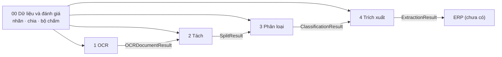

# Kế hoạch phối hợp các nhóm (6–8 tuần)

> Thay thế bản kế hoạch 4 tuần cũ (bản nguyên văn lưu ở [`original_direction/`](original_direction/README.md), kèm bảng đối chiếu hướng đi ban đầu và hiện trạng). Ý tưởng của `DECOUPLED_PARALLEL_METHODOLOGY.md` được gộp vào mục 3–4 dưới đây; tệp đó vẫn còn như tài liệu sống ([`DECOUPLED_PARALLEL_METHODOLOGY.md`](DECOUPLED_PARALLEL_METHODOLOGY.md), có khung "đã thay đổi gì"). Cấu trúc thư mục và giao diện giữa các nhóm: [`teams/README.md`](../teams/README.md). Việc cụ thể của từng nhóm: README trong thư mục nhóm. Người mới đọc [`HANDBOOK_FOR_RESEARCHERS.md`](HANDBOOK_FOR_RESEARCHERS.md) trước.
> Mọi mục "công sức" và mốc tuần dưới đây là **kế hoạch ước lượng**, không phải số đo.
> **Cập nhật 2026-10-16 (giai đoạn 3):** đã mở rộng sang 21 loại có trường, thêm ảnh trang cho VLM, hai tùy chọn tách/phân loại cho tệp ghép, và có review độc lập kèm thiết kế triển khai ([báo cáo 04](../teams/00_data_and_eval/reports/04_phase3_review_and_deployment.md)); xem mục 7c, giả thuyết H12–H14 ở mục 6 và hàng "Giai đoạn 3" ở mục 5. Câu chữ bên dưới ghi trạng thái ngày 2026-10-12 trừ khi nói khác.
> **Trạng thái ngày 2026-10-12:** cả bốn khâu và phép đo toàn trình đã có kết quả đầu tiên (mục 5), giả thuyết H1–H11 đã được đối chiếu với số đo (mục 6), điểm tích hợp CP3 đã được thực hiện dưới dạng thí nghiệm toàn trình (mục 7). Điều còn thiếu lớn nhất vẫn là **người của công ty kiểm đáp án** (nhãn loại, ranh giới, trường: cả ba đều do máy tạo) và **mẫu lớn hơn, nhất là tệp ghép**. Lịch 6–8 tuần ở mục 7 là kế hoạch ban đầu; mục 7b ghi phần đã làm và phần còn lại.

## 1. Vì sao viết lại

Kiểm tra ngày 2026-10-11 thấy phương pháp ban đầu không đứng vững: nhãn là tên thư mục (tủ hồ sơ, không phải loại tài liệu); 30 nhóm tệp trùng byte, 27 nhóm nằm ở hai thư mục khác nhau (hai "đáp án" cho một tờ giấy); OCR chỉ trang 1 và mất dấu tiếng Việt (nguyên nhân: từ điển nhận dạng thiếu 58/67 chữ cái thường có dấu); không có đáp án cho 3 trong 4 khâu; con số hiệu năng được nêu trước khi có thí nghiệm; và một "baseline Kev" thực ra chạy luật từ khóa mà vẫn tự gọi là Kev. Từ đó đã dựng: nhãn theo nội dung, chia dữ liệu có nhóm, bộ chấm với TEST khóa, OCR cục bộ giữ dấu, và mã báo lỗi rõ ràng.

**Các mục tiêu cũ đã bỏ** vì không dựa trên phép đo: "Macro-F1 > 97%" (phân loại 19 thư mục), "F1-boundary > 95%", "CER chữ in > 99% và viết tay > 92%", "trích xuất chính xác 100% thực thể", lộ trình 4 tuần. Thay bằng: các mức đã đo (mục 5) và các giả thuyết cần kiểm chứng kèm cỡ mẫu cần có (mục 6).

## 2. Nhóm và sở hữu

| Nhóm | Thư mục | Sản phẩm | Module trong `src/` |
|---|---|---|---|
| Dữ liệu và đánh giá | `teams/00_data_and_eval/` | nhãn đã kiểm, chia đóng băng, bộ chấm, câu trả lời của doanh nghiệp, quản trị dữ liệu | `eval/` (trong thư mục nhóm) |
| OCR | `teams/team1_ocr/` | `OCRDocumentResult`, gold OCR, chạy offline | `src/ocr/` |
| Tách tài liệu | `teams/team2_splitting/` | `SplitResult`, đáp án ranh giới | `src/splitting/` |
| Phân loại | `teams/team3_classification/` | `ClassificationResult`, tỉ lệ tự xếp hồ sơ | `src/classification/` |
| Trích xuất | `teams/team4_extraction/` | `ExtractionResult`, đáp án trường | `src/extraction/` |

Nhóm 00 là nhóm "chặn": nhãn và chia dữ liệu của nó quyết định mọi con số của bốn nhóm còn lại.

## 3. Phụ thuộc và cách mỗi nhóm làm việc mà không phải chờ nhau

Nguyên tắc (gộp từ tài liệu phương pháp luận cũ, chỉnh theo thực tế): **phát triển theo hợp đồng và tách rời bằng đầu vào tham chiếu.** Nếu làm tuần tự (chờ OCR xong mới tách, chờ tách xong mới phân loại…) thì ba nhóm đứng chờ, và khi kết quả cuối sai không biết khâu nào gây ra. Giải pháp: mỗi nhóm có **đầu vào tham chiếu** lấy từ đáp án đã biết, đo thành phần của mình trên đó, rồi mới ghép với thành phần thật của khâu trước.

| Nhóm | Đầu vào tham chiếu có ngay hôm nay | Không phải chờ ai | Phụ thuộc thật |
|---|---|---|---|
| 1 OCR | PDF gốc; 25 trang gold (cần người sửa bản nháp của LLM; 5 trang gõ từ đầu) | OCR chạy được từ bây giờ | cần nhóm 00 cho bản chép LLM và người gõ; nhóm 4 cho trường cần đọc |
| 2 Tách | `data/ocr_v2.jsonl` (mọi trang ≤ 30); đáp án ranh giới dựng từ `segments` của `labels_v2.csv` | dùng văn bản OCR sẵn có, không đợi OCR tốt hơn | đáp án đã kiểm (nhóm 00, cần người); phân loại theo trang cần nhóm 3 |
| 3 Phân loại | `ocr_v2_p12`, `haiku_p12`, nhãn `labels_v2.csv`, chia DEV/TEST | không chờ tách: dùng tài liệu đơn | nhãn đã kiểm (tập chia đã khóa, sửa nhãn không làm tài liệu đổi tập); tệp ghép cần nhóm 2 |
| 4 Trích xuất | **đoạn trang và loại đúng** của tài liệu (từ `labels_v2.csv`), văn bản LLM/OCR | không chờ phân loại | đáp án trường (tự dựng, T2 của nhóm 4); câu trả lời nghiệp vụ |

Kỹ thuật dùng chung: `src/common/contracts.py` (Pydantic) và các fixture giả ở `tests/fixtures/sample_pipeline_fixtures.py` để mọi nhóm chạy được code của mình mà không cần khâu trước. Một thành phần có thể được thay (ví dụ OCR cũ → OCR mới) mà không làm gãy khâu sau chừng nào kiểu đầu ra không đổi.

## 4. Đánh giá hai pha: từng thành phần, rồi toàn trình

**Pha 1 — từng thành phần trên đầu vào tham chiếu** (hai nhóm 3 và 4 đã có thể làm ngay; hai nhóm 1 và 2 sau khi có gold): cho cận trên của từng khâu khi các khâu trước hoàn hảo. Mỗi `RESULTS.md` nêu rõ đầu vào tham chiếu là gì.

**Pha 2 — toàn trình trên các thành phần thật**, rồi thay dần để tìm điểm nghẽn. Nếu gọi M₀ là điểm khi mọi khâu trước dùng đáp án và Mₖ là điểm khi khâu k đã dùng thành phần thật, thì **ΔF₁ của khâu k = Mₖ₋₁ − Mₖ** cho biết khâu đó làm mất bao nhiêu:

| Cấu hình | Văn bản | Tách | Loại | Trường | Đọc |
|---|---|---|---|---|---|
| E0 | bản chép tham chiếu (text layer hoặc LLM) | đáp án | đáp án | mô hình thật | cận trên của nhóm 4 |
| E1 | `ocr_v2` | đáp án | đáp án | mô hình thật | E0 − E1 = cái giá của OCR đối với trường |
| E2 | `ocr_v2` | mô hình thật | đáp án | mô hình thật | E1 − E2 = cái giá của việc tách |
| E3 | `ocr_v2` | mô hình thật | mô hình thật | mô hình thật | E2 − E3 = cái giá của phân loại. E3 là hệ thống thật |

Đơn vị đo toàn trình đề xuất: "tài liệu đúng" = ranh giới đúng ∧ loại đúng ∧ trường hạn đúng (và báo riêng tỉ lệ được tự xếp hồ sơ ở mức sai đã định). Với mỗi ΔF₁ phải có khoảng tin cậy (bootstrap theo tài liệu); khoảng chứa 0 thì ghi "không tách được". Bộ điều phối `src/pipeline.py` (chạy bằng `scripts/run_pipeline.py`) đã có từ 2026-10-12. Điểm tích hợp CP3 đã được làm dưới dạng khác với bảng E0–E3: [thí nghiệm toàn trình](../teams/00_data_and_eval/experiments/01_end_to_end/RESULTS.md) thay đổi **chính sách tách** (11 biến thể) với văn bản OCR có sẵn và phân loại thật, đo theo tệp và theo tài liệu. Nó trả lời "tách có đáng không" nhưng **không** thay bảng E0–E3: OCR chưa được đo lại trong toàn trình và khâu trường chỉ được đo ở chuỗi tới ngày hết hạn (82 đơn vị dev). Bảng E0–E3 vẫn **chưa làm**.

## 5. Các mức đã đo cho tới nay (đừng trích dẫn mức nào mà không đọc hạn chế ở nguồn)

"Dev" là phần dùng để chọn tham số; "TEST" là phần chấm một lần. Mọi số về tách, trích xuất và toàn trình là so với **đáp án máy** (ranh giới `boundary_gold_v0.csv`; trường silver), chưa người kiểm.

| Khâu | Đã đo | Nguồn | Chưa đo |
|---|---|---|---|
| Dữ liệu | 336 PDF → 304 tài liệu duy nhất; 10 loại có ≥ 10 tài liệu, 24 loại (74 tài liệu) hiếm | `data/labels_v2.csv`, [`01_duplicates.md`](../teams/00_data_and_eval/reports/01_duplicates.md) | độ đúng của nhãn so với nhân viên công ty |
| OCR | engine đã chọn: CER 0,082 trên trang số sạch (10 trang), 0,185 khi xuống cấp; chữ có dấu ở trang 1 từ 0,022 lên 0,265; 0,39 trang/giây khi chạy cả kho (GPU, 6 worker). Mã trong `src/ocr/`: 8/8 trang giống bộ dữ liệu từng ký tự trên GPU, 3/8 trang lệch nhẹ trên CPU | [`01_engine_bakeoff/RESULTS.md`](../teams/team1_ocr/experiments/01_engine_bakeoff/RESULTS.md), [`02_dataset_v2/RESULTS.md`](../teams/team1_ocr/experiments/02_dataset_v2/RESULTS.md), [`07_src_engine/RESULTS.md`](../teams/team1_ocr/experiments/07_src_engine/RESULTS.md) | CER trên scan thật; chữ viết tay; xoay trang; chạy offline ở mức hệ điều hành; OCR trong toàn trình |
| Phân loại (59 tài liệu TEST) | TF-IDF + ComplementNB, 10 loại + `RARE_OR_OTHER`: macro-F1 0,946 [0,847; 1,000] trên OCR cục bộ `ocr_v2` (trang 1–2), 0,974 [0,928; 1,000] trên văn bản Haiku, 0,918 [0,831; 0,991] trên OCR cũ; các nguồn **không tách được**. Tự xếp hồ sơ với sai ≤ 1% bằng TF-IDF đơn: 61,0% [49,2; 72,9] trên OCR cục bộ (0 lỗi trong 36 tài liệu nhận), 64,4% [52,5; 76,3] trên Haiku (trần 81,4%). Qwen3.5-4B cục bộ, zero-shot trên toàn taxonomy: accuracy 0,983 [0,949; 1,000]. Cascade luật → TF-IDF → LLM → người: tự xếp 96,6–100% với 0–1 lỗi trong 59 (cận trên 95% của tỉ lệ sai: 5–8%). Mã trong `src/`: trùng 237/237 quyết định trên DEV | [`01_classical_baselines/RESULTS.md`](../teams/team3_classification/experiments/01_classical_baselines/RESULTS.md) §0, §6, §9; [`02_llm_and_cascade/RESULTS.md`](../teams/team3_classification/experiments/02_llm_and_cascade/RESULTS.md) §5, §7; [`03_src_cascade/RESULTS.md`](../teams/team3_classification/experiments/03_src_cascade/RESULTS.md) | mức sai ≤ 1% (cần ≈ 300 tài liệu tự nhận liên tiếp không lỗi); biểu mẫu, khách hàng và loại chưa thấy; nhãn do người kiểm |
| Tách (dev, 155 tệp nhiều trang không ghép + 19 tệp ghép; số của phương pháp có học là cross-validated) | số tệp nhiều trang còn nguyên: luật cũ 50/155, luật v2 85/155, bộ phân loại cặp trang (ngưỡng 0,5) 129/155; tệp ghép khác loại (20 ranh giới): 19/20 kèm 2 tách nhầm, 19/20, 20/20 — không tách được với nhau; cùng loại ngoài `BB_LAY_MAU`: tối đa 4/7; Qwen3.5-4B hỏi có/không với một prompt: 0/20, 0/7, 1/46. TEST (2 tệp `BB_LAY_MAU`, 36 tệp âm): 9/9 ranh giới, 5 tách nhầm trên 74 vị trí | [`team2_splitting/README.md`](../teams/team2_splitting/README.md) "Đã đo", báo cáo `experiments/01` … `05`, [`RESULTS_test_docs_only.md`](../teams/team2_splitting/experiments/RESULTS_test_docs_only.md) | đáp án ranh giới do người kiểm; hiệu chỉnh `boundary_confidence`; bộ chứng từ nhà cung cấp khác; tệp > 30 trang; prompt thứ hai cho LLM |
| Trích xuất (4 loại, 104 đơn vị: dev 76, TEST 22) | tốt nhất với OCR cục bộ: luật + LLM ghép theo kiểu, F1 nới lỏng TEST 0,90 [0,83; 0,96], chặt 0,72 [0,59; 0,82]; GLiNER 0,46. Hạn: mọi phương pháp dựa OCR sai giá trị ở 0,05–0,06 số trường; quy tắc tự nhận "một mô hình đọc trùng ngày trong tên tệp": dev 37/64 sai 0, TEST 12/16 sai 0. Đáp án silver: Haiku–Sonnet đồng thuận ngày 0,944; Haiku bị phân xử coi sai 10/58 mục nghi | [`02_methods/RESULTS.md`](../teams/team4_extraction/experiments/02_methods/RESULTS.md), [`gold/silver_report.md`](../teams/team4_extraction/gold/silver_report.md) | đáp án do người kiểm; sai ≤ 1% của hạn tự nhận (cần ≥ 299, có 49); biểu mẫu mới; quy ước tên tệp; 30 loại chưa có schema; bảng hàng hóa |
| Toàn trình (tách + phân loại theo tệp; dev 245 tệp, TEST 59 tệp) | tệp đúng hoàn toàn: không tách 92,3%, `model+merge` 91,9% (hiệu −0,4 [−2,9; +1,9], không tách được), luật cũ 53,4%, luật v2 67,5%; tài liệu giao đúng và tự động 87,7% so với 70,4%; sai lặng lẽ 4,94% so với 7,31% tổng số tệp, không biến thể nào ≤ 1%; TEST cùng 56/59 tệp. Chuỗi tới ngày hết hạn (82 đơn vị dev): loại đúng 82/82, hạn tự nhận đúng 32/66, sai 0. Chi phí: tách 28 ms, phân loại 12 ms, trích xuất khoảng 4,2 giây mỗi lát cắt | [`01_end_to_end/RESULTS.md`](../teams/00_data_and_eval/experiments/01_end_to_end/RESULTS.md) | OCR trong toàn trình; bảng E0–E3; mẫu ngẫu nhiên phần tự xử lý; mẫu tệp ghép lớn hơn (dev 19, TEST 2); thông lượng khi GPU không dùng chung |
| Giai đoạn 3 (2026-10-15 đến 16) | quy tắc `id` cho tệp ghép cùng loại 0/7 → 4/7 ranh giới (6 tệp); biên an toàn cascade 0/235 sai cross-fit (cận trên 1,27%); `tiebreak` 22/28 → 28/28 lát đúng trên 8 tệp một nhà cung cấp; 17 loại mới (84 đơn vị): F1 mềm 0,75 (LLM) / 0,83 (VLM), tự nhận hạn ngoài mẫu chỉnh 12/17, 0 sai; ảnh trang: hạn tự nhận 32 → 37/66, sai 0 (p dấu 0,0625); toàn trình v2: dev 223 → 232/245 (mức trần), TEST 56/59 không đổi; xoay trang 30/32; ~500 trang/giờ/máy | [`TACH-06`](../teams/team2_splitting/experiments/06_same_type/RESULTS.md), [`PL-04`](../teams/team3_classification/experiments/04_safety_margin/RESULTS.md), [`PL-05`](../teams/team3_classification/experiments/05_composite_slices/RESULTS.md), [`TX-03`](../teams/team4_extraction/experiments/03_unseen_types/RESULTS.md), [`E2E-02`](../teams/00_data_and_eval/experiments/02_chain_with_images/RESULTS.md), [`E2E-03`](../teams/00_data_and_eval/experiments/03_end_to_end_v2/RESULTS.md), [`R04`](../teams/00_data_and_eval/reports/04_phase3_review_and_deployment.md) | kiểm giữ ngoài của `id` và `tiebreak` (TEST không có tệp loại này); đáp án người kiểm; thông lượng trên máy riêng; thời gian người duyệt |

Thí nghiệm LLM/cascade/embedding đã xong; tóm tắt ở mục 0, thiết kế đề xuất và danh sách thí nghiệm tiếp theo kèm cỡ mẫu ở mục 10 của [`02_llm_and_cascade/RESULTS.md`](../teams/team3_classification/experiments/02_llm_and_cascade/RESULTS.md). Việc tiếp theo của từng nhóm: README trong thư mục nhóm.

## 6. Mục tiêu viết thành giả thuyết cần kiểm chứng

Mỗi dòng: điều tin là đúng, trạng thái hiện tại (ủng hộ / không ủng hộ / không tách được / chưa đo) kèm số đo và nguồn, cỡ mẫu còn cần (và cách tính), và quyết định nếu đúng/sai. Không dòng nào là cam kết. H8–H11 được đặt **sau khi đã có số đo toàn trình**, nên chúng ghi lại điều đã quan sát, không phải giả thuyết đặt trước.

| # | Giả thuyết | Trạng thái và số đo | Cỡ mẫu còn cần | Quyết định |
|---|---|---|---|---|
| H1 | Với OCR cục bộ (`ocr_v2`), tỉ lệ tự xếp hồ sơ ở mức sai ≤ 1% không kém đáng kể so với nguồn Haiku | **Ủng hộ một phần (không tách được); mức ≤ 1% chưa chứng minh.** TF-IDF đơn trên TEST: `ocr_v2` 61,0% [49,2; 72,9], Haiku 64,4% [52,5; 76,3]; trên DEV 65,0% ở cả hai nguồn. Cascade: cả hai nguồn 98,3% (DEV cross-fit) và 59/59 (TEST). Khoảng tin cậy chồng nhau; chưa có so sánh ghép cặp cho riêng chỉ số này ([PL-01](../teams/team3_classification/experiments/01_classical_baselines/RESULTS.md), [PL-02](../teams/team3_classification/experiments/02_llm_and_cascade/RESULTS.md)) | để **chứng minh** sai < 1% cần ≈ 300 tài liệu được nhận liên tiếp không lỗi (quy tắc ba, cận trên ≈ 3/n); nếu tự nhận ~65% thì cần chấm ≈ 460 tài liệu (300 / 0,65). Hiện TEST chỉ có 59 | thu thêm mẫu (nhóm 00, T3) trước khi khẳng định bất kỳ mức sai nào |
| H2 | CER của `ocr_v2` trên trang **in** thật nằm trong khoảng giữa số sạch và số xuống cấp đã đo (0,08–0,19) | **Chưa đo** trên scan thật. Gián tiếp: luật trích xuất đúng 0,82 trên chữ in với OCR cục bộ so với 0,89 trên bản chép của LLM đám mây (không phải CER; [TX §3](../teams/team4_extraction/experiments/02_methods/RESULTS.md)) | gold 25 trang (5 trang mỗi nhóm in/viết tay/dấu/bảng/chất lượng thấp); 5 trang mỗi nhóm cho khoảng rất rộng — dùng để ước lượng độ lệch chuẩn rồi tính cỡ mẫu | nếu cao hơn, ưu tiên cải OCR theo hướng nào gây ra lỗi nhiều nhất (nhóm 1, T1–T3) |
| H3 | Phân loại theo trang rồi gộp (hoặc bộ phân loại cặp trang) tách tốt hơn bộ luật trên composite khác loại | **Không tách được ở tệp ghép; ủng hộ ở tệp thường.** Composite khác loại (8 tệp, 20 ranh giới): bộ phân loại cặp trang 20/20, 0 tách nhầm, so với luật cũ 19/20 và 2 tách nhầm: mọi CI ghép cặp chứa 0. "Chỉ đổi loại giữa hai trang" kém hơn rõ: 13/20, 0/7, 0/46 ranh giới. Ở 155 tệp nhiều trang không ghép: tách nhầm 9,58 so với 46,71 trên 100 vị trí (−37,1 điểm [−43,9; −32,0], tách được) ([nhóm 2](../teams/team2_splitting/README.md), [`04_pair_classifier`](../teams/team2_splitting/experiments/04_pair_classifier/RESULTS.md)) | 20 ranh giới / 8 tệp khác loại, 27 ngoài `BB_LAY_MAU`; khoảng Wilson 95% của recall 24/27 là [0,72; 0,96]. Muốn khoảng ±7 điểm tại recall ≈ 0,9 cần ≈ 71 ranh giới (1,96²·0,9·0,1/0,07²) | đã chọn bộ phân loại cặp trang làm nền của chính sách mặc định; thu thêm bộ chứng từ thật (hỏi doanh nghiệp, câu 9 và nhóm 2) |
| H4 | LLM cục bộ có đầu ra ràng buộc JSON không thua luật/regex và GLiNER trên trường hạn | **Ủng hộ (không thua; hơn GLiNER về F1 chung); riêng trường hạn không tách được.** Trường hạn đúng / bỏ trống / sai giá trị, TEST n = 16: luật 0,81 / 0,12 / 0,06, LLM 0,81 / 0,12 / 0,06, GLiNER 0,88 / 0,06 / 0,06; dev n = 64: 0,83 / 0,12 / 0,05, 0,81 / 0,12 / 0,06, 0,84 / 0,11 / 0,05. F1 nới lỏng toàn bộ trường TEST: LLM 0,89, luật 0,83, GLiNER 0,46 ([TX §0](../teams/team4_extraction/experiments/02_methods/RESULTS.md)) | 83 giá trị hạn (27 + 24 + 32) → khoảng ±6,5 điểm tại tỉ lệ ≈ 0,9; mỗi loại riêng ±11 điểm. Hiện n = 16 (TEST) và 64 (dev) | chọn phương pháp theo loại trường (luật cho ngày/số/mã, LLM cho văn bản); báo cáo "không tách được" nếu khoảng tin cậy chứa 0 |
| H5 | Chất lượng OCR ảnh hưởng đến trích xuất nhiều hơn đến phân loại | **Ủng hộ theo chiều hướng; chưa có CI ghép cặp cho trích xuất.** Phân loại: Δ macro-F1 +0,056, CI [−0,004; 0,122] (không tách được). Trích xuất (dev, trường ở trang ≤ 2, OCR cục bộ → bản chép Haiku, F1 nới lỏng): luật 0,84 → 0,92, LLM 0,85 → 0,91; luật đúng ở chữ viết tay 0,53 → 0,82, dưới con dấu 0,35 → 0,95, chữ in 0,82 → 0,89 ([TX §3](../teams/team4_extraction/experiments/02_methods/RESULTS.md)) | như H4 (so cùng bộ trích xuất trên ba nguồn văn bản); nguồn text layer không đo được vì trùng `ocr_v2` ở các trang số hóa | nếu đúng: dồn công sức OCR vào chữ viết tay và chữ dưới con dấu hoặc cho mô hình đọc ảnh trang; nếu sai: dừng cải OCR |
| H6 | Điểm nghẽn toàn trình nằm ở OCR → trường, không ở phân loại | **Chưa trả lời bằng bảng E0–E3; số hiện có cho thấy điểm nghẽn khác nhau theo loại tệp.** Thời gian: trích xuất chiếm hơn 98% thời gian sau OCR (E2E). Độ chính xác với tệp ghép khác loại: tách đúng 8/8 nhưng chỉ 2/8 tệp có mọi tài liệu đúng loại — điểm nghẽn là phân loại lát cắt (giả thuyết, 8 tệp một nhà cung cấp). Với ngày hết hạn: đọc sai chữ số trên OCR (khoảng 6% trường) và thiếu ảnh trang trong pipeline | ΔF₁ của E0−E1, E1−E2, E2−E3 với khoảng tin cậy | quyết định phân bổ công sức giai đoạn cuối; chưa đủ cơ sở bỏ phân loại khỏi danh sách ưu tiên |
| H7 | Thông lượng OCR hiện tại đủ cho khối lượng thật | **Chưa đo trên máy rảnh.** 0,39 trang/giây trên máy dev dùng chung; sau OCR, trung vị 4,3 giây mỗi tệp (14 tệp, E2E) | chưa biết khối lượng thật | trả lời câu hỏi 1 của nhóm 1; nếu không đủ thì tối ưu hoặc thêm máy |
| H8 | Tách trang làm tăng tỉ lệ **tệp** đúng hoàn toàn so với không tách | **Không ủng hộ; không tách được.** Dev n = 245 tệp: `model+merge` 91,9% so với 92,3%, hiệu −0,4 điểm [−2,9; +1,9]. Luật cũ 53,4% (hiệu −38,9 [−43,6; −34,3], kém hơn), luật v2 67,5% (−24,8 [−29,6; −19,4]). TEST n = 59: cùng 56/59, hiệu −1,2 [−6,7; +2,4] ([E2E](../teams/00_data_and_eval/experiments/01_end_to_end/RESULTS.md)) | TEST có 2 tệp ghép nên không kết luận được cho tệp ghép khác loại | giữ `model+merge` vì không hại tệp thường (cận dưới −2,9 trong ngưỡng −3 đặt trước), không phải vì thắng ở cấp tệp |
| H9 | Tách trang làm tăng số **tài liệu** giao đúng và tự động | **Ủng hộ trên dev; TEST quá nhỏ.** Dev: 87,7% [83,2%; 92,6%] so với 70,4% [56,3%; 84,7%]; trong 92 tài liệu thuộc tệp ghép: 61 so với 0. TEST: 65/68 so với 56/68 (11/11 tài liệu của tệp ghép so với 0/11, nhưng cả hai tệp ghép là `BB_LAY_MAU`) ([E2E](../teams/00_data_and_eval/experiments/01_end_to_end/RESULTS.md)) | thêm tệp ghép khác loại, nhà cung cấp khác | cơ sở chính để chọn `model+merge` làm mặc định |
| H10 | Quy tắc tự nhận hạn "một mô hình đọc trùng ngày trong tên tệp" có tỉ lệ sai ≤ 1% | **Chưa chứng minh; từ giai đoạn 3 tự nhận tắt mặc định (xem H14).** 0 sai trong 49 lần tự nhận (dev 37, TEST 12): cận trên 95% một phía 8% (dev) và 22% (TEST); qua cả chuỗi dev 32 tự nhận, 0 sai, cận trên 8,9%. Quy tắc phụ thuộc quy ước đặt tên tệp. **Quyết định của công ty 2026-10-16:** ngày trong tên tệp không mặc nhiên là ngày hết hạn (chỉ ngày mà tài liệu ghi cụ thể là hạn mới là hạn), nên quy tắc này không còn được dùng làm nguồn xác nhận độc lập; giữ tự nhận tắt ([README gốc](../README.md) mục "Quyết định của công ty") ([TX §4](../teams/team4_extraction/experiments/02_methods/RESULTS.md), [E2E](../teams/00_data_and_eval/experiments/01_end_to_end/RESULTS.md)) | ≥ 299 lần tự nhận đúng liên tiếp cho ≤ 1% (59 cho ≤ 5%) | nếu quy ước đúng và mẫu đủ: giữ; nếu không: hầu hết hạn vào hàng duyệt tay |
| H11 | Toàn trình tự xử lý đạt sai lặng lẽ ≤ 1% | **Không biến thể nào đạt.** Dev: `model+merge` 4,94% tổng số tệp, không tách 7,31%, `triage` 1,45%, định tuyến theo dải điểm không chắc 1,97% (chỉ hai biến thể này xuống dưới 2%, và phải đưa 22% và 38% tệp về người). Chưa đo trên mẫu ngẫu nhiên phần tự xử lý ([E2E](../teams/00_data_and_eval/experiments/01_end_to_end/RESULTS.md)) | ≥ 1000 tài liệu thật chạy bóng; ≈ 300 tự nhận liên tiếp không lỗi | doanh nghiệp quyết định mức sai chấp nhận và giữa `model+merge` và `triage` |
| H12 | Ảnh trang cho nguồn VLM làm tăng số hạn tự nhận đúng mà không thêm sai | **Ủng hộ ở mức biên.** 82 đơn vị dev, 66 trường hạn: 32 → 37/66, thêm 5, mất 0, sai 0; kiểm định dấu chính xác p = 0,0625; bootstrap theo đơn vị hiệu +7,5 điểm [+1,5; +15,2] lạc quan hơn ([E2E-02](../teams/00_data_and_eval/experiments/02_chain_with_images/RESULTS.md); review R04 mục 4) | đáp án người kiểm; chạy lại sau khi đổi khóa cache VLM | giữ VLM bật (chi phí ~4 s dựng ảnh + ~15 s VLM mỗi lát cắt) |
| H13 | Quy tắc `id` và `tiebreak` làm tăng tệp đúng hoàn toàn trên tệp ghép mà không hại tệp thường | **Dev ủng hộ nhưng không tổng quát hóa được từ đó.** 223 → 232/245, lỗi lặng lẽ 14 → 5, 0 tệp hỏng, hiệu +3,0 [+2,0; +3,9]; cả hai thiết kế sau khi đọc chính 14 tệp composite, TEST không có tệp loại này (chỉ kiểm được "không hại": 56/59 không đổi). Review R04 (N1): bằng chứng nằm trong mẫu thiết kế ([E2E-03](../teams/00_data_and_eval/experiments/03_end_to_end_v2/RESULTS.md), [TACH-06](../teams/team2_splitting/experiments/06_same_type/RESULTS.md), [PL-05](../teams/team3_classification/experiments/05_composite_slices/RESULTS.md)) | ≥ 30 tệp composite mỗi loại từ ≥ 3 nhà cung cấp chưa từng xem; ≥ 100 tài liệu mà `tiebreak` đổi quyết định | không bật mặc định: `tiebreak` tắt nhưng ghi bóng, `id` chạy bóng và chuyển người |
| H14 | Cấu hình trích xuất giai đoạn 2 dùng được cho loại tài liệu mới | **Một phần.** 84 đơn vị, 17 loại: F1 mềm 0,75 [0,70; 0,79] (LLM), 0,83 [0,80; 0,86] (VLM); `any-model=filename` chỉ nhận 24/62 hạn (ngày trong tên tệp đứng một mình sai 17/40); `regex=llm` ngoài mẫu chỉnh 12/17, 0 sai, cận trên 22%; luật chung và LLM cùng nguồn OCR ([TX-03](../teams/team4_extraction/experiments/03_unseen_types/RESULTS.md); R04 N2, N3) | ≥ 299 lần tự nhận không lỗi theo từng quy tắc; quy ước tên tệp thật của công ty | tự nhận hạn tắt mặc định; chỉ bật quy tắc nào đạt ngưỡng trong chạy bóng |

## 7. Lộ trình 8 tuần (bản tối thiểu 6 tuần: bỏ tuần 7–8, chấm TEST ở tuần 6)

| Tuần | 00 Dữ liệu và đánh giá | 1 OCR | 2 Tách | 3 Phân loại | 4 Trích xuất |
|---|---|---|---|---|---|
| 1 | gửi phiếu kiểm nhãn (T1) và danh sách 17 câu hỏi (T2); kiểm chế độ riêng tư của kho (T7) | bắt đầu gold: 10 trang rủi ro nhất (T1); bắt đầu đưa engine vào `src/ocr` (T4) | dựng đáp án ranh giới v0 (T1) | nhóm hiện có tiếp tục; đọc giao thức | dựng schema 4 loại (T1) |
| 2 | nhân viên kiểm xong; sửa nhãn qua `adjudication.csv`; **hoàn tất đóng băng chia (T5: chỗ cho tài liệu mới)** | gold 25 trang sửa và gõ xong | đo baseline bộ luật (T2) trên chia/đáp án đã đóng băng | chạy lại với nhãn đã kiểm và `ocr_v2` | chạy hai mô hình tạo bản nháp trường (T2) |
| **CP1** | **nhãn đã kiểm, chia đóng băng, mọi nhóm chạy được `pytest -q`** | | | | |
| 3 | báo cáo kiểm nhãn; kiểm tra bảng kết quả (T6) | `eval_on_gold.py` + so nháp LLM (T1); đánh giá xoay (T2) | phân loại theo trang + gộp (T3.1); composite tổng hợp (T4) | thí nghiệm theo kế hoạch của nhóm | người kiểm trường; đáp án trường v1 |
| 4 | trả lời nghiệp vụ → cập nhật taxonomy nếu cần | thông lượng, offline (T4) | bộ phân loại cặp trang (T3.2) | | bộ chấm trường (T3); luật/regex (T4) |
| **CP2** | **mỗi nhóm có `RESULTS.md` với số đo thành phần trên đầu vào tham chiếu, đã vào bảng chung** | | | | |
| 5 | thu mẫu mới (T3), nếu có | vùng viết tay/dấu (T3) | Kev `Noul` (T3.3) | | GLiNER và LLM JSON (T4); cái giá của OCR |
| 6 | | cái giá của OCR lên trường (T5) | ca khó cùng loại (T5) | | PII (T5); nối `src/extraction` |
| **CP3** | **bộ điều phối `src/pipeline.py` chạy E1–E3 trên DEV; bảng ΔF₁ theo khâu** | | | | |
| 7 | | sửa điểm nghẽn lớn nhất theo ΔF₁ | | | |
| 8 | chốt cấu hình; **chấm TEST một lần**; báo cáo cuối | | | | |
| **CP4** | **báo cáo cuối, bàn giao, đánh giá theo "định nghĩa hoàn thành"** | | | | |

Nếu thiếu tuần: cắt theo thứ tự — vùng viết tay/dấu (nhóm 1), ca khó cùng loại (nhóm 2), ERP/bảng hàng hóa (nhóm 4), rồi mới tới 6 tuần; **không cắt** kiểm nhãn bởi người, đóng băng chia, đáp án ranh giới và đáp án trường.

### Điểm tích hợp (kiểm tra bằng lệnh, không bằng lời)

- **CP1:** `pytest -q` (327 test qua ngày 2026-10-16) và `pytest teams/00_data_and_eval/tests -q` (33 test) qua; tập chia đã khóa trong `data/splits/` giữ nguyên thành viên DEV/TEST sau khi sửa nhãn (bộ chấm chỉ cảnh báo mã băm nhãn đã khác); `reports/04_label_audit.md` có số sửa và khoảng tin cậy; nhóm 3 đã chạy lại kết quả cũ trên nhãn mới (hoặc ghi rõ kết quả cũ hết hiệu lực).
- **CP2:** mỗi nhóm có `experiments/NN_*/RESULTS.md` theo mẫu ở `teams/README.md` mục 2; bảng chung không có dòng gắn nhãn cũ chưa đánh dấu.
- **CP3:** một lệnh chạy chuỗi OCR → tách → phân loại → trích xuất trên mọi tài liệu DEV, ghi `DocumentProcessingPipelineResult`; không bước nào im lặng bỏ qua lỗi; bảng E0–E3 có khoảng tin cậy. (Đã làm một phần: xem mục 7b.)
- **CP4:** TEST chấm đúng một lần cho cấu hình đã chốt trên DEV; báo cáo cuối nêu cái đã đo, cái chưa đo, và giới hạn.

### 7b. Tiến độ so với lộ trình (ngày 2026-10-12) và phần còn lại

Phần lớn công việc kỹ thuật của các nhóm 1–4 đã xong trong một đợt (lộ trình 6–8 tuần ở trên là kế hoạch ban đầu, không phải lịch đã chạy). Trạng thái từng điểm tích hợp:

| Điểm | Trạng thái | Chi tiết |
|---|---|---|
| CP1 | **Chưa đạt** | Chia dữ liệu đã đóng băng và test chạy được; nhưng **chưa có nhân viên công ty kiểm nhãn** (cũng chưa kiểm ranh giới và đáp án trường); `reports/04_label_audit.md` chưa có |
| CP2 | **Phần lớn đạt về hình thức** | Nhóm 00, 1, 2, 3, 4 đều có `RESULTS.md` với lệnh chạy, đáp án máy được ghi rõ. Chưa kiểm điều kiện "bảng chung không có dòng gắn nhãn cũ chưa đánh dấu" |
| CP3 | **Đạt một phần** | Có một lệnh chạy cả chuỗi (`scripts/run_pipeline.py`) và thí nghiệm toàn trình theo tệp; bảng E0–E3 (ΔF₁ theo khâu, gồm cả OCR) chưa làm |
| CP4 | **Chưa** | TEST đã chấm một lần cho từng khâu và cho chuỗi tách + phân loại, nhưng chưa có lần chấm cuối cho cấu hình chốt của cả đường ống; chưa có "định nghĩa hoàn thành" nào được kiểm đủ (mục 9) |

Phần còn lại theo thứ tự ưu tiên (chi tiết, cỡ mẫu và người phụ trách: [`RESEARCH_GUIDE.md`](RESEARCH_GUIDE.md) mục 8; công sức do README từng nhóm ước lượng, chưa đo):

1. Người của công ty kiểm đáp án (nhãn, ranh giới, trường) — chặn CP1 và mọi kết luận cuối.
2. ~~Công ty xác nhận quy ước ngày trong tên tệp (câu hỏi 16)~~ **đã trả lời ngày 2026-10-16** (ngày trong tên tệp không mặc nhiên là ngày hết hạn; xem [README gốc](../README.md) mục "Quyết định của công ty"; còn cần xin ~100 tên tệp thật nếu muốn dùng tên tệp làm tín hiệu phụ); còn lại: công ty quyết định `model+merge` hay `triage` (sai lặng lẽ đắt hơn hay nhân sự duyệt đắt hơn).
3. ~~Đưa ảnh trang vào `extract_fields`~~ **đã làm ở giai đoạn 3** (32 → 37/66, H12); còn lại: chỉ dựng ảnh khi quy tắc hạn dùng VLM và đo lại.
4. Thêm bộ chứng từ nhà cung cấp khác và luật/ví dụ cho `BB_GIAO_NHAN_HANG_HOA` so với `PHIEU_XUAT_KHO`.
5. Chạy bóng toàn trình trên tài liệu thật để đo sai lặng lẽ thật; thống nhất cấu hình Ollama giữa các client.
6. Bảng E0–E3 có OCR; đáp án OCR do người gõ; mở rộng schema và biểu mẫu mới; định tuyến, giao diện người duyệt, ERP (cần quyết định của doanh nghiệp).

### 7c. Giai đoạn 3 (2026-10-15 đến 16): đã làm, mặc định hiện tại, việc còn lại

**Đã làm** (số và cỡ mẫu ở mục 5, H12–H14; mỗi mục có `RESULTS.md`): `id` cho tệp ghép cùng loại (nhóm 2); biên an toàn và `rule_title_tiebreak` (nhóm 3); 17 loại mới với silver v2 (nhóm 4); ảnh trang cho VLM, toàn trình v2 và chi phí có OCR thật (nhóm 00); tự xoay trang, kiểm lô bản chép, thông lượng OCR (nhóm 1); review độc lập và thiết kế triển khai ([báo cáo 04](../teams/00_data_and_eval/reports/04_phase3_review_and_deployment.md)).

**Mặc định hiện tại và vì sao đổi lại sau review.** Ban đầu `id` và `tiebreak` được bật mặc định vì dev cho 232/245. Review thấy hai tùy chọn được thiết kế từ chính các tệp dùng để đo và TEST không có tệp ghép loại đó nên cổng "TEST không hại" không thể trượt; tự nhận hạn dựa vào quy ước tên tệp chưa được công ty xác nhận. Mã hiện tại: tách `model+merge`; `tiebreak` tắt nhưng ghi bóng; `id` chạy bóng và chuyển tệp sang người; VLM bật; **tự nhận ngày hết hạn tắt** (`--auto-accept-expiry` để bật; vẫn ghi gợi ý và `_expiry_would_accept`); 21 loại có schema; tệp > 30 trang chuyển người; khóa kiểm mẫu theo tệp. Số dev của S10+id+tiebreak (232/245, lỗi lặng lẽ 5) vẫn được báo kèm cảnh báo mức trần. Dev + TEST gộp của cấu hình đó: 7/295 = 2,4% lỗi lặng lẽ, chưa đạt 1%.

**Còn lại** (15 việc ưu tiên của báo cáo 04 mục 11; bản đầy đủ có nhóm phụ trách và ước lượng ở đó, bản rút gọn trong [`README.md`](../README.md)): (1) xác nhận quyền dùng dữ liệu và dọn dữ liệu thật khỏi git; (2) đồng bộ mặc định và tài liệu; (3) tắt tự nhận hạn cho loại mới; (4) sửa khóa kiểm mẫu; (5) tệp > 30 trang về người; (6) chỉ dựng ảnh khi quy tắc dùng VLM, đo lại; (7) hỏi công ty quy ước tên tệp, đo `regex=vlm`; (8) dựng hệ chạy bóng (bộ nạp, hàng đợi, giao diện duyệt có đo thời gian, giám sát); (9) đo thông lượng trên máy riêng; (10) nhân viên kiểm đáp án (19 tệp composite, 59 tệp TEST, 100 trường hạn); (11) thu tệp ghép từ ≥ 3 nhà cung cấp; (12) digest mô hình trong khóa cache; (13) sửa chọn nhầm 90/270 ở sổ PCCC; (14) hỏi LLM khi luật mơ hồ; (15) cải tiến prompt cho trường văn bản dài. Các việc 2–5 đã được thực hiện trong mã/tài liệu ở thời điểm cập nhật này.

**Quyết định của công ty (2026-10-16, do chủ dự án truyền đạt):** (a) được dùng LLM đám mây để **tạo đáp án** trên tài liệu mẫu, sản xuất vẫn on-premise; (b) ngày hết hạn chỉ là ngày hết hạn khi tài liệu ghi cụ thể đó là ngày gì, ngày trong tên tệp không mặc nhiên là hạn, có giấy tờ không có hạn (diễn giải của nhóm; chi tiết ở [README gốc](../README.md)).

**Cần gì từ công ty:** văn bản xác nhận việc lưu dữ liệu trên dịch vụ git (việc gửi ảnh cho API để dựng đáp án đã được cho phép, mục (a), nhưng nên có văn bản); tên tệp thật (~100 tên, tùy chọn sau quyết định (b)); nhân viên kiểm đáp án máy và mức lỗi lặng lẽ chấp nhận được; tệp ghép từ ≥ 3 nhà cung cấp; 6–8 tuần chạy bóng (≥ 299 tệp tự xử lý liên tiếp không lỗi, hoặc ≥ 473 với ≤ 1 lỗi); quyết định chi phí giữa người duyệt (`triage`) và lỗi lặng lẽ; pháp chế nếu cân nhắc phương án đám mây.

## 8. Rủi ro và phụ thuộc

| Rủi ro | Hậu quả | Giảm nhẹ |
|---|---|---|
| Nhân viên công ty chưa kiểm nhãn kịp tuần 2 | CP1 trễ; mọi kết quả trên nhãn chưa kiểm | cho phép chạy tiếp trên nhãn hiện tại nhưng gắn nhãn "tạm thời" và `labels_sha`; không chấm TEST mới |
| Nhãn đổi sau khi nhiều nhóm đã chạy | kết quả cũ hết hiệu lực (thành viên DEV/TEST không đổi vì tập chia đã khóa; tài liệu mới làm bộ chấm dừng với `SplitsOutOfDateError`) | không chia lại trừ khi có chủ ý (`rebuild=True` hoặc `--rebuild-splits`); nhóm 00 T5 cho tài liệu mới; mọi kết quả sinh từ script để chạy lại bằng một lệnh |
| GPU dùng chung | số tốc độ nhiễu, chạy chậm | đo riêng khi máy rảnh; ghi tải của máy |
| Câu trả lời nghiệp vụ muộn | đổi schema/taxonomy giữa chừng | ghi nhật ký thay đổi; các câu 11, 12, 13, 14 chặn nhóm 4, các câu 9, 14, 15 chặn nhóm 2 |
| Cỡ mẫu nhỏ (TEST 59; 27 ranh giới ngoài `BB_LAY_MAU`; 19 tệp ghép ở dev và 2 ở TEST; 64 giá trị hạn ở dev và 16 ở TEST) | khoảng tin cậy rộng, không kết luận được; khoảng bootstrap "toàn bộ" hẹp giả khi nhóm ghép quan sát 0/n | nói thẳng; thu mẫu mới có mục tiêu; không tuyên bố hơn kém khi khoảng chứa 0; dùng Clopper-Pearson cho ô theo nhóm |
| Ollama dùng chung (nhiều client, `num_ctx` khác nhau) | mỗi lời gọi có thể mất 18–32 giây để nạp lại mô hình, hoặc 180 giây trước khi có hết giờ | hết giờ 45 giây mỗi lời gọi, ngân sách 90 giây mỗi tệp, mạch ngắt (đã có trong `src/pipeline.py`); việc còn lại: thống nhất `num_ctx` hoặc tách máy chủ Ollama riêng cho pipeline |
| Chọn tham số sau khi xem số dev (ngưỡng tách, quy tắc chọn mặc định, luật trích xuất) | số dev lạc quan | tách dev và TEST; chấm TEST một lần; nêu rõ trong báo cáo; việc còn lại: TEST lớn hơn với nhiều tệp ghép |
| Dữ liệu cá nhân bị lộ | rủi ro pháp lý | kho riêng tư, không công bố, quy tắc ở nhóm 00 T7. Review giai đoạn 3 (R04 N4): PDF gốc, OCR toàn văn và silver đang trong git (remote GitHub) và ảnh đã qua mô hình đám mây; cần văn bản duyệt của công ty và dọn khỏi lịch sử trước khi push |
| LLM ngoài chép bịa hoặc hai LLM cùng sai | đáp án sai nhưng nhìn như đúng | quy tắc ở nhóm 1 T6 và nhóm 4 T2: chấm bằng đáp án đã biết, người kiểm vùng viết tay/dấu |

## 9. Định nghĩa hoàn thành của dự án (giai đoạn nghiên cứu và nguyên mẫu)

Dự án "xong" khi **tất cả** những điều sau đúng và có tệp chứng minh:

1. **Nhãn đã được nhân viên công ty kiểm** theo quy trình T1 (13 tài liệu bắt buộc + mẫu ngẫu nhiên 10% trở lên), có báo cáo kiểm nêu số sửa và khoảng tin cậy; chia DEV/TEST đóng băng.
2. **Mỗi khâu có `RESULTS.md`** với: nhãn và sha, nguồn văn bản, cỡ mẫu, khoảng tin cậy, hạn chế; mọi số tái lập bằng một lệnh; test của khâu qua.
3. **Chuỗi OCR → tách → phân loại → trích xuất** chạy bằng một lệnh qua `src/pipeline.py` (`scripts/run_pipeline.py`), mọi lỗi hiện ra (không mặc định im lặng), kết quả đúng hợp đồng dữ liệu.
4. **Bảng E0–E3 (ΔF₁ theo khâu) có khoảng tin cậy** và kết luận khâu nào là điểm nghẽn.
5. **TEST chấm một lần** cho cấu hình đã chốt; nêu kết quả cùng giới hạn; tỉ lệ tự xếp hồ sơ ghi kèm **chứng minh được gì** (ví dụ "0 lỗi trong n tài liệu được nhận → cận trên 95% của tỉ lệ sai ≈ 3/n").
6. **Chạy được offline** trên máy đích, không gọi dịch vụ ngoài; trọng số đóng gói; giấy phép của trọng số/thư viện đã được xem xét.
7. **Ngưỡng chấp nhận do doanh nghiệp đặt** (mức sai chấp nhận, trường nào bắt buộc, quy trình người duyệt) trước khi chấm TEST; các câu hỏi 1–17 có câu trả lời hoặc ghi rõ "chưa quyết".
8. **Dữ liệu cá nhân:** quy tắc nhóm 00 T7 và nhóm 4 T5 được thực thi bằng test; báo cáo và log không chứa số định danh.
9. **Bàn giao:** handbook và README nhóm đúng với trạng thái mã; danh sách giới hạn đã biết và việc chưa làm (ERP, giao diện duyệt, vận hành) được ghi rõ.

Cái **không** nằm trong định nghĩa hoàn thành: đạt một con số hiệu năng đặt trước chưa có cơ sở; tích hợp ERP và vận hành sản xuất (cần quyết định của doanh nghiệp).

Trạng thái ngày 2026-10-12 theo từng điều:

| Điều | Trạng thái |
|---|---|
| 1. Nhãn đã người kiểm | **Chưa** |
| 2. Mỗi khâu có `RESULTS.md`, tái lập bằng một lệnh, test qua | Có `RESULTS.md` cho mọi khâu; số test qua của lần chạy đầy đủ 2026-10-16: 327 qua (`tests/`), 33 qua (nhóm 00), 223 qua (nhóm 4) |
| 3. Chuỗi OCR → tách → phân loại → trích xuất bằng một lệnh | **Đạt** (`scripts/run_pipeline.py`); lỗi hiện ra qua `warnings`, `error`, `abstain_reason` |
| 4. Bảng E0–E3 có khoảng tin cậy | **Chưa**; có thí nghiệm toàn trình thay thế một phần |
| 5. TEST chấm một lần cho cấu hình chốt | **Một phần**: từng khâu và chuỗi tách + phân loại đã chấm một lần; chưa có lần chấm cuối cho cả cấu hình; sai ≤ 1% chưa chứng minh được |
| 6. Chạy offline, giấy phép | **Một phần**: kiểm bằng chặn kết nối trong tiến trình; giấy phép VietOCR và PyMuPDF chưa xác nhận |
| 7. Ngưỡng chấp nhận do doanh nghiệp đặt; 17 câu hỏi có câu trả lời | **Chưa** |
| 8. Dữ liệu cá nhân được thực thi bằng test | Phần trích xuất: số định danh và ngày sinh tắt mặc định, có test (nhóm 4, T5); nhóm 00 T7 theo README nhóm |
| 9. Bàn giao | Tài liệu đồng bộ với mã ngày 2026-10-16 (mặc định sau review); danh sách việc chưa làm ở mục 7b và 7c |
