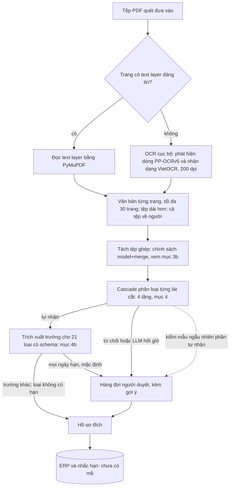
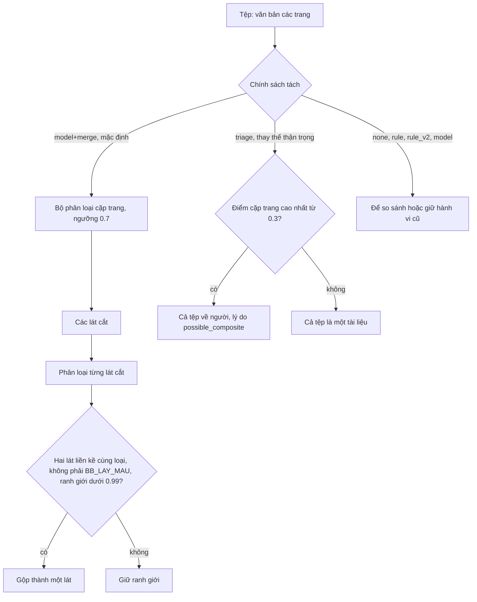
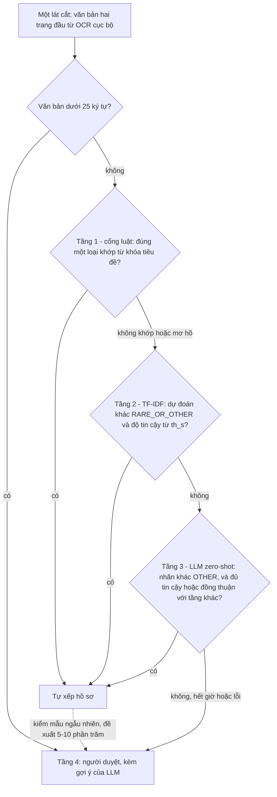
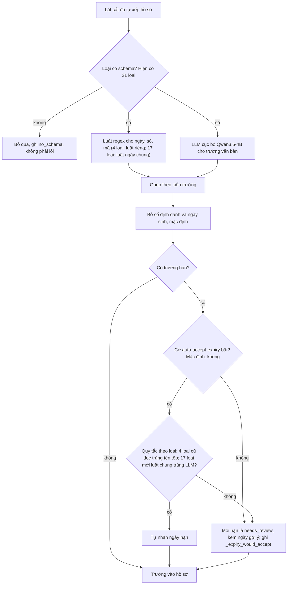
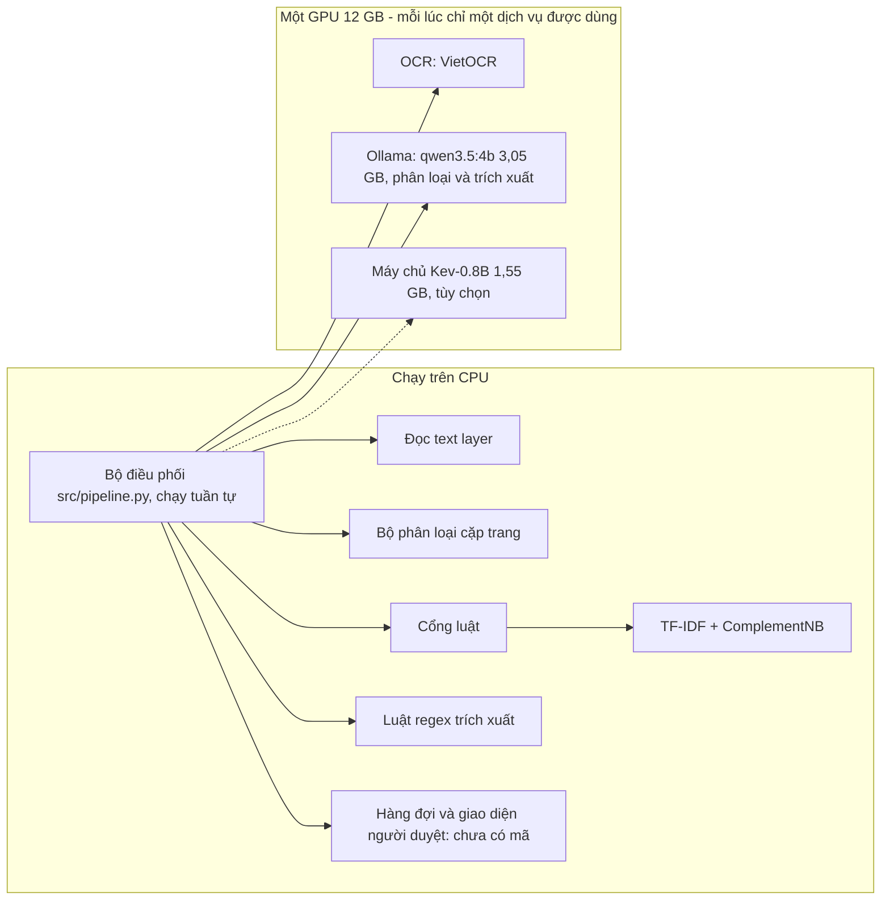
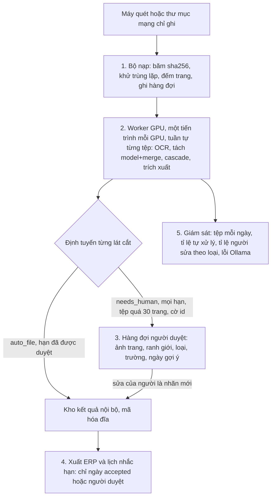

# Kiến trúc hệ thống đo được

> Trạng thái ngày 2026-10-16 (giai đoạn 3 đã xong; mục 9 là kiến trúc chạy thật khuyến nghị). Tài liệu này mô tả đường ống **như đã đo** (tách, phân loại, trích xuất và toàn trình đều đã có số đo, xem các ký hiệu nguồn bên dưới), không mô tả một hệ thống đã chạy ở công ty. Mỗi khối ghi số đo kèm nguồn, hoặc ghi rõ "chưa đo"; mỗi khối cũng ghi mã nằm ở đâu (đã có trong `src/`, mới chỉ là thí nghiệm, hay chưa có).
> **Đáp án của ba loại số liệu (loại tài liệu, ranh giới, trường) đều do máy tạo và chưa có nhân viên công ty kiểm.** Số "dev" là phần dùng để chọn tham số (hơi lạc quan); số "TEST" được chấm một lần.
> Bản trước của tệp này chứa các con số độ chính xác, độ trễ và ngưỡng chưa từng được đo, cùng sơ đồ định tuyến theo 19 thư mục cũ; tất cả đã bị gỡ bỏ. Phương pháp luận: [`RESEARCH_GUIDE.md`](RESEARCH_GUIDE.md). Người mới: [`HANDBOOK_FOR_RESEARCHERS.md`](HANDBOOK_FOR_RESEARCHERS.md).
> **Về các sơ đồ mermaid:** chưa có ai dựng chúng bằng một công cụ vẽ thật (không có công cụ vẽ mermaid trong môi trường viết tài liệu này); cú pháp được giữ đơn giản (nhãn đặt trong dấu nháy kép, không có dấu ngoặc đơn) để dễ kiểm. Nếu một sơ đồ không hiện ra, lỗi nhiều khả năng là cú pháp chứ không phải nội dung.

Ký hiệu nguồn dùng trong tài liệu:

| Ký hiệu | Tệp |
|---|---|
| OCR-01 | [`teams/team1_ocr/experiments/01_engine_bakeoff/RESULTS.md`](../teams/team1_ocr/experiments/01_engine_bakeoff/RESULTS.md) |
| OCR-02 | [`teams/team1_ocr/experiments/02_dataset_v2/RESULTS.md`](../teams/team1_ocr/experiments/02_dataset_v2/RESULTS.md) |
| OCR-07 | [`teams/team1_ocr/experiments/07_src_engine/RESULTS.md`](../teams/team1_ocr/experiments/07_src_engine/RESULTS.md) |
| PL-01 | [`teams/team3_classification/experiments/01_classical_baselines/RESULTS.md`](../teams/team3_classification/experiments/01_classical_baselines/RESULTS.md) |
| PL-02 | [`teams/team3_classification/experiments/02_llm_and_cascade/RESULTS.md`](../teams/team3_classification/experiments/02_llm_and_cascade/RESULTS.md) |
| PL-03 | [`teams/team3_classification/experiments/03_src_cascade/RESULTS.md`](../teams/team3_classification/experiments/03_src_cascade/RESULTS.md) |
| TACH | [README nhóm 2, mục "Đã đo"](../teams/team2_splitting/README.md) và các báo cáo `experiments/01_rule_baseline` … `05_llm_zero_shot` |
| TX | [`teams/team4_extraction/experiments/02_methods/RESULTS.md`](../teams/team4_extraction/experiments/02_methods/RESULTS.md) |
| E2E | [`teams/00_data_and_eval/experiments/01_end_to_end/RESULTS.md`](../teams/00_data_and_eval/experiments/01_end_to_end/RESULTS.md) |
| E2E-02 | [`teams/00_data_and_eval/experiments/02_chain_with_images/RESULTS.md`](../teams/00_data_and_eval/experiments/02_chain_with_images/RESULTS.md) |
| E2E-03 | [`teams/00_data_and_eval/experiments/03_end_to_end_v2/RESULTS.md`](../teams/00_data_and_eval/experiments/03_end_to_end_v2/RESULTS.md) |
| TX-03 | [`teams/team4_extraction/experiments/03_unseen_types/RESULTS.md`](../teams/team4_extraction/experiments/03_unseen_types/RESULTS.md) |
| OCR-05 / OCR-08 | [`05_rotation`](../teams/team1_ocr/experiments/05_rotation/RESULTS.md), [`08_throughput`](../teams/team1_ocr/experiments/08_throughput/RESULTS.md) |
| TACH-06 | [`teams/team2_splitting/experiments/06_same_type/RESULTS.md`](../teams/team2_splitting/experiments/06_same_type/RESULTS.md) |
| PL-04 / PL-05 | [`04_safety_margin`](../teams/team3_classification/experiments/04_safety_margin/RESULTS.md), [`05_composite_slices`](../teams/team3_classification/experiments/05_composite_slices/RESULTS.md) |
| R04 | [`teams/00_data_and_eval/reports/04_phase3_review_and_deployment.md`](../teams/00_data_and_eval/reports/04_phase3_review_and_deployment.md) (review độc lập và thiết kế triển khai) |
| DL-01 | [`teams/00_data_and_eval/reports/01_duplicates.md`](../teams/00_data_and_eval/reports/01_duplicates.md) |

Số phân loại tính trên nhãn `data/labels_v2.csv`, tập TEST khóa **59 tài liệu**, văn bản OCR cục bộ trang 1–2 (`ocr_v2_p12`). Số toàn trình (E2E) tính theo **tệp**: dev 245 tệp, TEST 59 tệp. Khoảng trong ngoặc vuông là khoảng tin cậy 95%.

## 1. Ba ràng buộc quyết định thiết kế

1. **Riêng tư.** Hệ thống chạy thật bắt buộc on-premise: không gọi LLM hay dịch vụ đám mây bên ngoài. Riêng bộ mẫu nghiên cứu này, chủ dự án đã đồng ý cho gửi tới LLM bên ngoài (Claude Haiku, Sonnet, Opus) để tạo dữ liệu tham chiếu (bản chép, nhãn, đáp án trường); đó là ngoại lệ cho nghiên cứu, không phải cho triển khai và không áp dụng cho tài liệu mới. Vì vậy mọi con số trên nguồn văn bản của LLM ngoài chỉ là **cận trên**, không phải con số triển khai.
2. **Chính xác theo nghĩa nghiệp vụ.** Thước đo là tỉ lệ được **tự xếp hồ sơ** ở một mức sai công ty chấp nhận; ở toàn trình thêm "sai lặng lẽ" (tệp tự xử lý hoàn toàn nhưng sai). Phần không đủ chắc phải được **từ chối** và chuyển cho người, không được đoán.
3. **Chi phí.** Một máy có một GPU 12 GB VRAM (máy dev: RTX 3060 12 GB, dùng chung). OCR vẫn là khâu đắt nhất theo từng trang; sau OCR, trích xuất (một lời gọi LLM mỗi lát cắt có schema) chiếm hơn 98% thời gian, còn tách và phân loại tốn mili-giây (mục 6).

## 2. Luồng tổng thể

Khử trùng lặp theo sha256 là bước làm một lần cho bộ mẫu (`scripts/build_manifest.py`), không nằm trong `src/` và không vẽ trong sơ đồ.

**Text layer** là lớp chữ có sẵn trong PDF do máy tính tạo ra; bản quét thường không có. **Tệp ghép** (composite) là một PDF chứa từ hai tài liệu trở lên. **Lát cắt** (slice) là một đoạn trang liên tiếp mà bộ tách coi là một tài liệu.

## 3. Từng khối: số đo, nguồn, và mã nằm ở đâu

| Khối | Thiết kế | Số đo | Mã hiện có |
|---|---|---|---|
| Khử trùng lặp | Gộp tệp giống hệt từng byte trước mọi bước khác | Bộ mẫu: 336 tệp → 304 tài liệu duy nhất; 30 nhóm trùng (62 tệp), 27 nhóm nằm ở từ hai thư mục cũ trở lên (DL-01 §1) | `scripts/build_manifest.py` (script cho bộ mẫu); **chưa có** trong `src/` |
| Chọn text layer hay OCR | Dùng text layer khi trang có ≥ 30 chữ cái, chữ hiển thị ≥ 50%, trang không phải một ảnh phủ ≥ 80% diện tích kèm lớp chữ, ký tự rác < 2%; ngược lại OCR | 1182/1246 trang của kho (94,9%) không có text layer (OCR-01 §3). Trong tập `ocr_v2`: 61 trang dùng text layer, 1020 trang OCR, 3 trang có lớp chữ vô hình do máy quét nhúng bị loại và OCR lại (OCR-02 §2) | `src/ocr/pdf_ocr.py` (hàm `assess_text_layer`; `scripts/build_ocr_dataset.py` gọi lại) |
| OCR | Bộ phát hiện dòng DB của PP-OCRv5 (`rapidocr` 3.10) + VietOCR `vgg_seq2seq`, 200 dpi, chuẩn hóa nền khi độ bão hòa trung vị của trang ≥ 15/255 | Trang số hóa sạch: CER 0,082 trên 10 trang chung (0,088 trên 39 trang), giữ lại 97,8% ký tự có dấu; ảnh làm xuống cấp: CER 0,185. 30 trang quét thật: nhớ lại 80,1% số từ so với bản chép Haiku; engine cũ 16,8% (OCR-01 §4). **CER trên bản quét thật: chưa đo** (chưa có đáp án do người gõ). Chữ viết tay và chữ dưới con dấu: OCR cục bộ mất nhiều nhất ở đây (mục "Trích xuất" bên dưới); không có CER | `src/ocr/pdf_ocr.py` + `src/ocr/vietocr_engine.py`; trọng số ở `models/ocr/` (không commit). Trên GPU cho lại đúng `data/ocr_v2.jsonl` (8/8 trang thử giống từng ký tự); trên CPU lệch ở 3/8 trang (7 ký tự đổi trên 7 280) (OCR-07 §3). `src/ocr/rapid_ocr.py` là engine cũ làm mất dấu, chỉ giữ để đối chiếu |
| Tốc độ OCR | Nhiều tiến trình dùng chung GPU | Một tiến trình: 5,9 giây/trang. Cả kho 1084 trang: 46,3 phút, 0,39 trang/giây với GPU, 6 worker × 2 luồng (OCR-02 §3); trong lần thử pipeline 4,6 giây/trang dưới tải (OCR-07 §3). Máy dùng chung nên số tuyệt đối dao động; tốc độ trên máy sản xuất: **chưa đo** | như trên |
| Tự xoay trang | Xoay trang nằm ngang trước khi OCR | 50 trang bị xoay, trong đó 9 trang gần trống bị xoay nhầm (OCR-02 §5). Giai đoạn 3 (OCR-05, đáp án hướng do mô hình xem ảnh): trang bị xoay đúng 30/32, không sót 0/280 trang thẳng có chữ, 2 trang sổ PCCC chọn nhầm 90/270; luật chặn xoay trang gần trống (`min_chars_for_rotation = 30`) | `src/ocr/pdf_ocr.py` |
| Tách tệp ghép | Mặc định `model+merge`: bộ phân loại cặp trang (gradient boosting, 30 đặc trưng) ngưỡng 0,7, rồi gộp lát cắt liền kề được phân loại cùng loại (trừ `BB_LAY_MAU`, và trừ ranh giới điểm ≥ 0,99). Thay thế thận trọng: `triage` (mục 3b) | Từng phương pháp riêng (dev, đáp án ranh giới do máy dựng, số của phương pháp có học là cross-validated; TACH): trên 155 tệp nhiều trang không ghép số tệp còn nguyên là luật cũ 50, luật v2 85, bộ phân loại cặp trang (ngưỡng 0,5) 129; tệp ghép khác loại (8 tệp, 20 ranh giới) 19/20 kèm 2 tách nhầm, 19/20, 20/20 — không tách được với nhau; cùng loại ngoài biên bản lấy mẫu tối đa 4/7; Qwen3.5-4B hỏi có/không 0/20, 0/7, 1/46. Toàn trình theo tệp (E2E): tách **không** tăng tỉ lệ tệp đúng hoàn toàn (dev: 91,9% so với 92,3% khi không tách, hiệu −0,4 điểm [−2,9; +1,9], không tách được), nhưng tăng tài liệu giao đúng và tự động (87,7% so với 70,4%). Luật cũ làm hỏng 104/155 tệp nhiều trang vốn đúng. TEST (59 tệp, một lần): cùng 56/59 tệp đúng; 65/68 so với 56/68 tài liệu; TEST chỉ có 2 tệp ghép. Bộ luật cũ cho **5 phần** trên tệp BSR mẫu 5 trang, đáp án đúng là **4**; luật v2 và mô hình cho đúng 4 | `src/splitting/` (`boundary_detector.py`, `rules_v2.py`, `learned.py`, `type_merge.py`, `policy.py`); mô hình ở `teams/team2_splitting/models/pair_gb_v0.joblib` (có trong kho) |
| Phân loại | Cascade luật → TF-IDF → LLM zero-shot → người (mục 4), áp cho từng lát cắt | TEST: tự nhận 59/59 với 1 sai; cận trên 95% của tỉ lệ sai là 7,8% (PL-02 §7); benchmark này **không có tệp ghép khác loại** (đã bị loại). **Mức sai ≤ 1% chưa được chứng minh.** Trên tệp ghép khác loại, dù tách đúng 8/8 chỉ 2/8 tệp có mọi tài liệu đúng loại, vì biên bản giao nhận bị gán `PHIEU_XUAT_KHO` (6/7 lần) — giả thuyết từ 8 tệp của một nhà cung cấp (E2E) | `src/classification/doc_classifier.py`; xem mục 7 |
| Trích xuất trường | Mục 4b: luật/regex cho ngày, số, mã; LLM cục bộ (Qwen3.5-4B, đầu ra ràng buộc theo JSON Schema) cho trường văn bản; **mặc định không tự nhận ngày hết hạn nào**: mọi hạn chuyển người duyệt kèm ngày gợi ý; quy tắc tự nhận (4 loại cũ: một mô hình đọc trùng ngày trong tên tệp; 17 loại mới: `regex=llm`) vẫn chạy và ghi `_expiry_would_accept`, bật bằng `--auto-accept-expiry`; 21 loại có schema; ảnh trang cho VLM bật mặc định; PII tắt mặc định | TEST 22 đơn vị, đáp án do LLM đọc ảnh (chưa người kiểm): F1 0,90 [0,83; 0,96] khi so khớp nới lỏng, 0,72 [0,59; 0,82] khi so từng ký tự. Ngày hết hạn: các phương pháp dựa OCR sai giá trị ở khoảng 6% số trường; quy tắc tự nhận nhận 12/16 trên TEST (sai 0, cận trên 95%: 22%) và 37/64 trên dev (sai 0, cận trên 8%). LLM đọc ảnh trang đạt 0,91 nhưng lạc quan vì đáp án cũng do mô hình đọc ảnh, và pipeline **chưa** đưa ảnh trang vào nên tự nhận qua cả chuỗi chỉ 32/66 = 48,5% (E2E). OCR hỏng nhất ở chữ viết tay và chữ dưới dấu: luật đúng 0,53 và 0,35, so với 0,82 và 0,95 trên bản chép của LLM đám mây (TX §3). GLiNER F1 0,46: không dùng để điền trường. **Mức sai ≤ 1% chưa được chứng minh**; quy ước tên tệp chưa được công ty xác nhận | `src/extraction/field_extractor.py` (`FieldExtractor`), `expiry_rules.py`, `field_rules.py`, `field_llm.py`, `field_vlm.py`; `barb_extractor.py` (GLiNER) giữ lại nhưng không dùng để điền trường |
| Định tuyến | 25 quy tắc "loại + thực thể → hồ sơ đích" | Chưa đo | Chỉ là dữ liệu trong `data/taxonomy_v2.json`; không có mã. Quyết định `auto_file` / `needs_human` cho từng lát cắt và tệp đã có ở `src/pipeline.py` (`SliceRouting`, `FileRoutingSummary`) |
| Người duyệt, ERP, nhắc hạn | Hàng đợi duyệt kèm gợi ý; kiểm mẫu ngẫu nhiên phần tự nhận | Chưa đo; cần quyết định của công ty | Không có mã |
| Điều phối toàn trình | Một lệnh chạy cả chuỗi, mọi lỗi phải hiện ra; ngân sách thời gian cho LLM (mục 3c) | Chạy trên 3 tệp thử (OCR-07 §5) và đo theo tệp trên dev 245 tệp, TEST 59 tệp (E2E); độ chính xác và chi phí ở mục 6. Máy dùng chung GPU khi đo. Giai đoạn 3 thêm: chi phí có OCR thật trên 30 tệp / 90 trang (~500 trang/giờ/máy, OCR 45%, trích xuất 52%; E2E-03), tệp > 30 trang chuyển người, kiểm mẫu theo tệp | `src/pipeline.py`, `scripts/run_pipeline.py` |

Hai điểm thiết kế còn mở:

- **OCR bao nhiêu trang.** Phân loại chỉ cần phần đầu tài liệu (Qwen3.5 với 800 ký tự đầu vẫn đạt accuracy 0,992 trên DEV, PL-02 §5). Tách cần văn bản của **mọi** trang (tối đa 30 trang trong các phép đo; tệp 93 trang chỉ chấm 30 trang đầu) và trích xuất cần các trang chứa trường. Chi phí OCR toàn bộ trang cho luồng đầy đủ chưa được tính, vì phép đo toàn trình dùng văn bản OCR có sẵn thay vì OCR lại (E2E).
- **Thứ tự tách và phân loại.** Pipeline tách trước (bộ phân loại cặp trang), phân loại sau, rồi gộp theo loại; hướng "phân loại từng trang rồi chỉ đổi loại thì tách" đã đo và thua (chỉ bắt 13/20 ranh giới khác loại và 0/46 ranh giới `BB_LAY_MAU`, TACH thí nghiệm 03).

### 3b. Chính sách tách và hai chế độ cần chọn

Hai chế độ cần chọn là **quyết định của doanh nghiệp** (sai lặng lẽ đắt hơn hay nhân sự duyệt đắt hơn). Số đo trên dev (E2E, n = 245 tệp):

| | `model+merge` (mặc định, S10) | `triage` (S9) | không tách (S0) |
|---|---|---|---|
| Tệp đúng hoàn toàn | 91,9% [89,2%; 94,4%] | 92,3% [91,0%; 93,1%] | 92,3% [91,0%; 93,1%] |
| Tệp tự xử lý hoàn toàn | 96,8% | 77,9% (22% về người) | 99,6% |
| Sai lặng lẽ, trên tổng số tệp | 4,94% [3,37%; 6,49%] | 1,45% [0,33%; 2,57%] | 7,31% [6,91%; 8,12%] |
| Sai lặng lẽ, trong phần tự xử lý (thô) | 14/237 = 5,91% [3,27%; 9,71%] | 4/189 = 2,12% [0,58%; 5,33%] | 20/244 = 8,20% [5,08%; 12,38%] |
| Tài liệu đáp án giao đúng và tự động | 279/318 = 87,7% | 185/318 = 58,2% | 224/318 = 70,4% |
| Trong đó thuộc tệp ghép (92 tài liệu) | 61 | 0 | 0 |

Không chế độ nào đạt mục tiêu sai lặng lẽ ≤ 1%. TEST (59 tệp, một lần): `model+merge` và không tách cùng 56/59 tệp đúng; sai lặng lẽ 2/58 tệp tự xử lý so với 3/59; tài liệu giao đúng 65/68 so với 56/68. `triage` không được chấm trên TEST. Các tham số 0,7, 0,99, 0,3 được chọn trên dev bằng một quy tắc đặt **sau khi xem số dev** (E2E), nên đọc là lạc quan.

**Hai tùy chọn giai đoạn 3 (E2E-03, TACH-06, PL-05), KHÔNG phải mặc định.** Quy tắc `id` (`--splitter model+merge+id`: thêm ranh giới khi đầu trang giống nhau mà số hiệu "Số ..." khác nhau) và `rule_title_tiebreak` (`--title-tiebreak`: cổng luật chọn loại có từ khóa sớm nhất trong 400 ký tự đầu khi mơ hồ). Trên 245 tệp dev: S10 → S10+id+tb 223 → 232 tệp đúng hoàn toàn, lỗi lặng lẽ 14 → 5, tài liệu giao đúng 279 → 293/318 (hiệu có trọng số +3,0 điểm, CI [+2,0; +3,9]), 0 tệp bị làm hỏng; TEST (59 tệp) giống hệt S10 vì không có tệp ghép loại này. Cả hai được nghĩ ra sau khi đọc chính 14 tệp composite dev nên số trên là **mức trần lạc quan**. Hiện tại khi tắt, chúng chạy ở chế độ **bóng**: `id` không tách nhưng chuyển tệp sang người duyệt (lý do `id_rule_boundary`, dev kích hoạt ở 3/245 tệp), `tiebreak` chỉ ghi nhãn nó sẽ chọn (`routing[i].shadow`). Chỉ bật tự động khi có ≥ 30 tệp composite mỗi loại từ ≥ 3 nhà cung cấp chưa từng xem.

### 3c. Ngân sách thời gian của LLM

Sự cố gốc: một lát cắt của tệp ghép chờ 180 giây rồi hết giờ; phân tích cho thấy thời gian nằm ở máy chủ Ollama dùng chung (mô hình bị nạp lại 26–32 giây mỗi yêu cầu khi có client khác đẩy mô hình ra vào), không phải do cấu hình của bộ phân loại (E2E, mục "Vì sao lần chạy thử tốn 195 s"). Đã sửa trong `src/classification/llm_backends.py` và `src/pipeline.py`:

| Cơ chế | Giá trị | Ý nghĩa |
|---|---|---|
| Hết giờ mỗi lời gọi phân loại | 45 giây trong pipeline (mặc định thư viện 60 giây; trước đây 180 giây) | `--llm-timeout` |
| Hết giờ mỗi lời gọi trích xuất | 120 giây (`DEFAULT_EXTRACT_TIMEOUT_S` trong `src/pipeline.py`) | prompt và đầu ra dài hơn phân loại |
| Ngân sách LLM mỗi tệp | 90 giây | `--llm-file-budget` |
| Sau một lần hết giờ | các lát cắt còn lại của tệp không gọi LLM nữa, về người (`llm_timeout`, `llm_skipped`) | tránh nhân thời gian chờ với số lát |
| Mạch ngắt | hết giờ ở 2 tệp liên tiếp thì mở 60 giây | tránh xếp hàng sau một máy chủ kẹt |
| Lỗi kết nối | thử lại đúng 1 lần | |

Trường hợp xấu nhất của một tệp giảm từ vài phút xuống khoảng 45–90 giây (E2E; có test với đồng hồ giả). Khuyến nghị vận hành **chưa làm**: mọi client của `qwen3.5:4b` trên cùng Ollama dùng chung `num_ctx` 6144, hoặc tách một máy chủ Ollama riêng cho pipeline.

## 4. Cascade phân loại: điều kiện nhận và từ chối của từng tầng

Mỗi lát cắt do bộ tách trả về (văn bản hai trang đầu của lát cắt, bỏ trang rỗng) đi qua cascade riêng.

| Tầng | Nhận khi | Chuyển tiếp khi | Số đo (PL-01, PL-02) |
|---|---|---|---|
| 1. Cổng luật từ khóa tiêu đề (quét 1500 ký tự đầu, so khớp không dấu) | đúng một loại khớp | không loại nào khớp, hoặc nhiều loại khớp | Quyết định 76,4% tài liệu DEV và 84,7% TEST; đúng 100% trên phần quyết định; trung vị 3 ms. Trên OCR cũ vẫn phủ 80,2% (DEV) |
| 2. TF-IDF (từ 1–2) + ComplementNB, học trên 10 loại lớn + lớp gộp `RARE_OR_OTHER` | dự đoán không phải `RARE_OR_OTHER` **và** độ tin cậy ≥ `th_s` | dự đoán `RARE_OR_OTHER`, hoặc độ tin cậy thấp | Đứng riêng: macro-F1 TEST 0,946 [0,847; 1,000]; tự nhận 61,0% [49,2; 72,9] ở mức sai ≤ 1%. Trong cascade quyết định thêm 8% (TEST) đến 18% (DEV); trung vị 3 ms; huấn luyện lại dưới 0,5 giây |
| 3. Qwen3.5-4B zero-shot qua Ollama, đầu ra ràng buộc bằng JSON schema, chỉ đọc mô tả ngắn của từng loại | nhãn không thuộc `OTHER`/`UNREADABLE`/không trả lời **và** (độ tin cậy ≥ `th_llm` **hoặc** đồng thuận với tầng khác theo chế độ chọn trên DEV) | còn lại; hết giờ hoặc lỗi cũng về người (`llm_error`, `llm_timeout`) | Đứng riêng: accuracy DEV 0,996, TEST 0,983 [0,949; 1,000]; nhớ lại loại hiếm 62/63 DEV, 10/11 TEST. Trong cascade xử lý 5% (DEV) đến 7% (TEST) tài liệu; trung vị 1.193 ms, p95 1.730 ms; 3,05 GB VRAM |
| 4. Người | mọi tài liệu bị từ chối; mọi tài liệu dưới 25 ký tự | — | Với ngưỡng hiện tại: 0–3,4% tài liệu trên TEST tùy ứng viên tầng 3 (TF-IDF đơn: 36%) |

Mã trong `src/` (`DocumentClassifier`) ra cùng quyết định với cascade của thí nghiệm: 237/237 tài liệu DEV trùng bộ ba (tầng, nhãn, được nhận); trên TEST, chạy một lần để tái lập: 59/59 tự nhận, 1 sai (PL-03).

Kết quả đầu-cuối của cấu hình chính (tầng 3 = Qwen3.5-4B, mức sai ≤ 1%; PL-02 §7):

| Tập | Tự nhận | Sai trên phần nhận | Cận trên 95% của tỉ lệ sai | Ghi chú |
|---|---|---|---|---|
| DEV, n = 237, ngưỡng chọn trên chính DEV | 236/237 | 1 | 2,0% | lạc quan |
| DEV, cross-fit (ngưỡng chọn trên 4 fold, áp lên fold thứ 5) | 98,3% | 0 | — | trung thực hơn |
| **TEST, n = 59, chấm một lần** | **59/59**, Clopper–Pearson [0,939; 1,000] | **1** | **7,8%** | so với TF-IDF đơn: +0,356 [0,237; 0,475] về tỉ lệ tự nhận |

Những điều phải biết khi đọc sơ đồ này:

- **Con số phân loại riêng này lạc quan hơn toàn trình.** Nó đo trên tài liệu đơn đã biết ranh giới, không có tệp ghép khác loại và không tính lỗi tách. Toàn trình theo tệp, mặc định `model+merge` còn 4,94% sai lặng lẽ trên tổng số tệp dev (mục 3b), không phải 0–1/59.
- **Ngưỡng hiện tại dễ dãi.** Giá trị chọn trên DEV cho cấu hình chính là `th_s` = 0,282, `th_llm` = 0,548, không dùng đồng thuận (`teams/team3_classification/results/02_llm_and_cascade/tables/dev_selection_02.json`). Vì LLM chỉ sai 1/237 trên DEV nên không còn tín hiệu để đặt ngưỡng chặt; kết quả là gần như không tài liệu nào đến tay người. Hệ thống thật cần biên an toàn và kiểm mẫu ngẫu nhiên; tỉ lệ 5–10% là đề xuất của PL-02 §10, chưa được đo.
- **Cổng luật có thể lạc quan.** Từ khóa được viết sau khi xem chính bộ mẫu. Ước lượng thận trọng hơn cho tài liệu lạ là cascade bỏ cổng luật: DEV cross-fit 97,9% với 0 sai, TEST 98,3% với 1 sai. Cổng luật vì vậy chủ yếu mua tốc độ và độ bền khi OCR kém.
- **TF-IDF gần như thừa về chất lượng khi đã có LLM tốt** (bỏ TF-IDF: 99,2% DEV, 100% TEST với 1 sai); nó được giữ vì rẻ và nhanh.
- **Phương án nhẹ cho tầng 3:** Kev-0.8B chỉ đưa tên loại (1,55 GB VRAM; accuracy 0,962 DEV, 0,932 TEST). Không dùng khi OCR kém (rơi xuống 0,498 trên OCR cũ) và không đưa mô tả dài (0,300). Tầng Kev trong `src/` đã sửa nhưng chưa đo lại (PL-03 §7). Kev-4B: **chưa thử**.
- **Từ chối bằng đồng thuận hai mô hình khác họ** (Kev + Qwen cùng nhãn): nhận 95,8% DEV với 0 sai, 94,9% TEST với 1 sai. Đây là quy tắc không cần ngưỡng, mới đo đứng riêng, chưa là một chế độ của cascade trong `src/`.
- **Loại mới:** thêm mô tả ngắn vào taxonomy thì tầng 3 nhận được mà không huấn luyện lại; đây là suy luận từ độ nhớ lại trên loại hiếm, **chưa kiểm chứng với loại thật sự mới**.

## 4b. Trích xuất trường và quy tắc tự nhận ngày hết hạn

Hai nhóm loại có schema. Bốn loại giai đoạn 2 có luật riêng: `GCN_DDK_BAN_LE_XD`, `CC_TAP_HUAN_VC_HNH`, `HD_MUA_BAN`, `PHIEU_XUAT_KHO` (TX §0). Mười bảy loại giai đoạn 3 (84 đơn vị silver v2) dùng luật ngày chung `src/extraction/generic_date_rules.py` cộng LLM: F1 mềm 0,75 [0,70; 0,79] (LLM) và 0,83 [0,80; 0,86] (VLM), hạn đúng 52/62 (LLM), quy tắc `regex=llm` ngoài mẫu chỉnh tự nhận 12/17, 0 sai, cận trên 22% (TX-03). Pipeline chỉ trích xuất cho lát cắt đã `auto_file`; lát cắt có ngày hạn cần duyệt vẫn `auto_file` nhưng được đánh dấu `field_review` và ngày hạn đi qua người (E2E). Nguồn đọc ảnh trang (VLM, `src/extraction/field_vlm.py`): ở thí nghiệm E2E giai đoạn 2 pipeline chưa dựng ảnh nên tự nhận chỉ 48,5% so với 58%; giai đoạn 3 đã dựng ảnh trong pipeline (PyMuPDF 200 dpi, thư mục tạm, xóa ngay) và tự nhận lên 37/66 = 56,1% (E2E-02). **Mặc định hiện tại không tự nhận hạn nào**, nên bảng dưới đây là số của quy tắc nếu được bật, không phải hành vi mặc định.

Chuỗi tới ngày hết hạn trên 82 đơn vị dev có schema (E2E; luật và prompt chỉnh trên chính các đơn vị này nên số lạc quan; đáp án silver):

| | Cả chuỗi (bộ tách → cascade → trích xuất) |
|---|---|
| Đơn vị có loại đúng | 82/82 |
| Trường hạn tự nhận và đúng (không ảnh trang, E2E) | 32/66 = 48,5% |
| Trường hạn tự nhận và đúng, có ảnh trang (E2E-02) | 37/66 = 56,1%; thêm 5, mất 0, sai 0; kiểm định dấu p = 0,0625 (biên) |
| Bỏ trống, về người (kèm ngày gợi ý) | 34/66 = 51,5% |
| Tự nhận mà sai | 0/66 (cận trên 95% một phía: 8,9%) |
| Ngày gợi ý đúng | 22/25 |

## 5. Triển khai trên một máy, một GPU 12 GB VRAM

| Dịch vụ | VRAM đo được | Độ trễ đo được | Ghi chú vận hành |
|---|---|---|---|
| OCR (VietOCR trên GPU, 6 worker × 2 luồng) | VRAM riêng của 6 worker: **chưa đo**. Với 12 worker, VRAM gần cạn (11,7/12,3 GB) trong lúc 7–10 GB đang bị việc khác chiếm, và chậm hơn (0,28 trang/giây) | 0,35–0,39 trang/giây | Một tiến trình GPU đơn lẻ không nhanh hơn CPU (5,9 giây/trang cả hai); lợi ích của GPU đến từ chạy nhiều worker (OCR-02 §3) |
| Ollama `qwen3.5:4b`, phân loại | 3,05 GB (ngữ cảnh 6144 token) | trung vị 1.193 ms, p95 1.730 ms mỗi tài liệu | Đặt giới hạn số token sinh ra và hết giờ mỗi lời gọi (mục 3c) |
| Ollama `qwen3.5:4b`, trích xuất văn bản | khoảng 3,1 GB (ngữ cảnh 6144, TX §5) | trung vị 4.177 ms mỗi đơn vị (TEST, máy dùng chung) | Cùng mô hình với phân loại, nên không thêm VRAM nếu dùng chung `num_ctx` 6144 |
| Ollama `qwen3.5:4b`, đọc ảnh trang (chưa nối vào pipeline) | khoảng 3,3 GB (ngữ cảnh 12288, 4 ảnh mỗi đơn vị) | trung vị 10.509 ms (TX §5) | Ngữ cảnh khác 6144 nên khiến Ollama nạp lại mô hình khi hai loại lời gọi xen kẽ — rủi ro vận hành đã quan sát |
| Bộ phân loại cặp trang | CPU, không dùng GPU | nạp 236 ms một lần, trung vị 28 ms mỗi tệp, p95 86 ms (20 tệp dev, E2E) | tệp mô hình nằm trong kho, kiểm sha256 khi nạp |
| Ollama `bge-m3` | 0,62 GB | trung vị 73 ms | Chỉ cần nếu dùng embedding ở tầng 3 hoặc để kiểm đồng thuận |
| Máy chủ Kev-0.8B | 1,55 GB cấp phát; tiến trình giữ tới khoảng 6 GB sau các lượt prompt dài (PL-02 §9) | trung vị 860 ms | Xử lý tuần tự trong một luồng: gọi song song không nhanh hơn |

Quy tắc vận hành rút từ sự cố thật (PL-02 §3, §11; E2E): **không cho Kev và Ollama chạy đồng thời trên cùng GPU** (đã xảy ra: Ollama đứng 1–6 phút mỗi lời gọi); các client khác cùng dùng `qwen3.5:4b` với `num_ctx` khác làm mô hình bị nạp lại 18–32 giây mỗi lời gọi (trên 4.366 lời gọi của PL-02: trung vị 858 ms, p99 5,2 giây, 28 lời gọi — 0,6% — mất 15 giây đến 6,8 phút); xếp hàng tuần tự; lưu bộ nhớ đệm theo (mô hình, yêu cầu); ghi log mọi quyết định gồm tầng nào quyết định và độ tin cậy. Mọi con số tốc độ trong tài liệu này đo khi GPU và Ollama dùng chung. Thông lượng thật khi GPU không dùng chung: **chưa đo**.

## 6. Bảng chi phí và riêng tư

### 6a. Chi phí theo khâu (sau OCR, mặc định `model+merge`)

Nguồn: E2E, mục "Chi phí". GPU dùng chung, không tính OCR, lời gọi LLM là thật (cache trống).

| Khâu | Trung vị | Đuôi | Ghi chú |
|---|---|---|---|
| OCR | — | — | 5–12 giây cho hai trang đầu (PL-02 §9); 0,39 trang/giây cả kho (OCR-02 §3); khâu đắt nhất theo từng trang |
| Tách (bộ phân loại cặp trang) | 28 ms | p95 86 ms | 20 tệp dev |
| Phân loại | 12 ms | p95 859 ms | đuôi do 2 lời gọi LLM khoảng 0,9 giây; LLM chỉ chạy khi luật và TF-IDF từ chối (khoảng 5% văn bản) |
| Trích xuất | khoảng 4,2 giây mỗi lát cắt có schema | bộ chứng từ 4 lát cắt (2 lát có schema): khoảng 12 giây | 14 tệp; một lời gọi Qwen3.5-4B mỗi lát |
| Tổng sau OCR | 4,3 giây mỗi tệp | p95 12,1 giây, tối đa 12,2 giây | 14 tệp; trích xuất chiếm hơn 98% |

Ghi chú: mẫu 14 tệp nhỏ, nên đuôi chỉ là bậc độ lớn. Mọi lời gọi LLM đều có hết giờ (mục 3c), nên đuôi xấu nhất của một tệp bị chặn ở khoảng 45–90 giây cho phần phân loại.

### 6b. Số lời gọi LLM phân loại mỗi tệp, theo chính sách tách

Nguồn: E2E, dev 245 tệp, đếm từ lần chạy thật. Tách nhân số lát cắt, và mỗi lát cắt bị luật và TF-IDF từ chối thì tốn một lời gọi.

| Chính sách | Lời gọi LLM mỗi tệp (tổng) | Lát cắt (tổng) |
|---|---|---|
| không tách (`none`) | 0,06 (14) | 245 |
| luật cũ (`rule`) | 0,45 (110) | 552 |
| luật v2 (`rule_v2`) | 0,39 (95) | 466 |
| mô hình cặp trang, ngưỡng 0,5 (`model`) | 0,20 (49) | 362 |
| **`model+merge` (mặc định)** | **0,14 (35)** | 314 |
| `triage` | 14 lời gọi trên 245 tệp | 245 |

Gộp lát cắt không tốn thêm lời gọi (dùng lại kết quả của lát đầu). Luật cũ tốn gấp 7,9 lần số lời gọi của không tách.

### 6c. VRAM

Xem bảng ở mục 5: tất cả cùng vừa một GPU 12 GB (OCR + Ollama `qwen3.5:4b` khoảng 3,05–3,1 GB) nếu không chạy Kev và Ollama đồng thời và dùng chung `num_ctx` 6144.

### 6d. Thiết kế tầng phân loại (rút gọn từ PL-02 §9)

Chất lượng lấy từ TEST (59 tài liệu, nguồn `ocr_v2_p12`). VRAM và độ trễ đo lúc máy rảnh trên 38 tài liệu, một luồng, chỉ riêng bước phân loại. Hai cột "cần dữ liệu có nhãn" và "nhận loại mới không huấn luyện lại" là phán đoán thiết kế có dẫn chứng, chưa được kiểm trên loại thật sự mới.

| Thiết kế | On-premise | Cần dữ liệu có nhãn | Nhận loại mới không huấn luyện lại | VRAM (GB) | Trung vị / p95 (ms) | Chất lượng trên TEST |
|---|---|---|---|---|---|---|
| Cổng luật từ khóa | có | không (người viết từ khóa) | một phần: phải viết từ khóa | 0 | 3 / 4 | phủ 84,7%, đúng 100% trên phần quyết định |
| TF-IDF + ComplementNB | có | có: 5–10 tài liệu mỗi loại | không | 0 | 3 / 5 | macro-F1 0,946 [0,847; 1,000]; tự nhận 61,0% [49,2; 72,9] ở mức sai ≤ 1% |
| Embedding `bge-m3` few-shot | có | rất ít: 2 mẫu mỗi loại | một phần: thêm ≥ 2 mẫu | 0,62 | 73 / 160 | macro-F1 0,913 [0,708; 0,978]; nhớ lại loại hiếm 0,55 |
| Kev-0.8B zero-shot, chỉ tên loại | có | không | có (thêm tên loại) | 1,55 | 860 / 934 | accuracy 0,932 [0,864; 0,983]; nhớ lại loại hiếm 0,73 |
| Qwen2.5-3B zero-shot | có | không | có (thêm mô tả) | 2,80 | 783 / 985 | accuracy 0,797 [0,695; 0,898]; nhớ lại loại hiếm 0,55 |
| Qwen3.5-4B zero-shot | có | không | có (thêm mô tả) | 3,05 | 1.193 / 1.730 | accuracy 0,983 [0,949; 1,000]; nhớ lại loại hiếm 0,91 |
| Cascade luật → TF-IDF → Kev-0.8B → người | có | có (cho TF-IDF) + tên loại | có, ở tầng 3 | 1,55 | 3 / 940 | tự nhận 59/59, 1 sai (cận trên 7,8%) |
| **Cascade luật → TF-IDF → Qwen3.5-4B → người** | có | có (cho TF-IDF) + mô tả loại | có, ở tầng 3 | 3,05 | 3 / 1.737 | tự nhận 59/59, 1 sai (cận trên 7,8%) |
| Cascade luật → TF-IDF → embedding → người | có | có | một phần | 0,62 | 3 / 166 | tự nhận 57/59, 0 sai (cận trên 5,1%) |
| Bản chép LLM đám mây + TF-IDF | **không**: ảnh tài liệu rời khỏi công ty | có | không | 0 | không đo | macro-F1 0,974 [0,928; 1,000] — cận trên, **không phải** số triển khai |

Cách đọc: macro-F1 của các dòng zero-shot trên TEST chỉ tính trên 10 loại có từ 3 tài liệu trở lên nên rất cao và ít thông tin; vì vậy bảng rút gọn này dùng accuracy và độ nhớ lại trên loại hiếm. Phương án đám mây không cho kết quả phân loại tốt hơn OCR cục bộ trong khoảng nhiễu của dữ liệu này (hiệu +0,028, khoảng [0,000; 0,109]: không tách được), nên riêng với bước phân loại không có lý do kỹ thuật để gửi ảnh ra ngoài. Với trích xuất trường thì khác: OCR cục bộ đọc sai nhiều hơn ở chữ viết tay và chữ dưới con dấu (mục 3, hàng "Trích xuất trường"). Không có giá tiền nào trong dự án này.

### 6e. Riêng tư theo từng khâu

| Khâu | Production | Nghiên cứu (chỉ bộ mẫu này) |
|---|---|---|
| OCR, tách, phân loại, trích xuất | hoàn toàn cục bộ: không gửi gì ra ngoài | không dùng LLM ngoài |
| Bản chép (cận trên), nhãn loại, ranh giới, đáp án trường | không dùng | Claude Haiku, Sonnet, Opus nhận ảnh trang của bộ mẫu, với sự đồng ý rõ ràng của chủ dự án; không áp dụng cho tài liệu mới |
| Dữ liệu cá nhân trong đầu ra trích xuất | số định danh và ngày sinh tắt mặc định | — |

## 7. Cái nào là mã trong `src/`, cái nào mới là thí nghiệm, cái nào chưa có

| Thành phần | Trong `src/` | Chỉ ở thí nghiệm hoặc script | Chưa có |
|---|---|---|---|
| OCR engine đã chọn | `src/ocr/pdf_ocr.py`, `src/ocr/vietocr_engine.py` (trọng số ở `models/ocr/`, đặt bằng `scripts/setup_ocr_models.py`) | `scripts/build_ocr_dataset.py` (dựng cả kho, gọi lại `src/ocr/`) | kiểm chạy không mạng ở mức hệ điều hành; đo thông lượng trên máy riêng (OCR-08: 0,17–0,22 trang/giây, GPU dùng chung, một lần chạy) |
| OCR engine cũ (mất dấu) | `src/ocr/rapid_ocr.py` — **đừng dùng để tạo số liệu mới** | — | — |
| Tách tệp ghép | `src/splitting/`: `rule`, `rule_v2`, `model` (bộ phân loại cặp trang), `type_merge.py` (gộp theo loại), `policy.py` (chính sách `model+merge` mặc định, `triage`, `none`, ...) | thí nghiệm 01–05 của nhóm 2; đo toàn trình E2E | đáp án ranh giới do người kiểm; hiệu chỉnh `boundary_confidence` (hiện là điểm thô); nhóm cùng loại ngoài `BB_LAY_MAU` |
| Cổng luật | `src/classification/system_one_classifier.py` (`CascadedClassifier`) | — | — |
| TF-IDF đã chốt | `src/classification/tfidf_classifier.py` (huấn luyện bằng `scripts/train_tfidf_classifier.py`, lưu ở `models/classification/`) | `teams/team3_classification/experiments/01_classical_baselines/methods.py` (bản dùng trong thí nghiệm) | — |
| Gọi Kev và Ollama zero-shot, bộ nhớ đệm, hết giờ | `src/classification/zero_shot.py`, `llm_cache.py`, `llm_backends.py` | — | — |
| Logic nhận/từ chối của cascade, lớp chạy đầu-cuối | `src/classification/cascade.py`, `src/classification/doc_classifier.py` (trùng 237/237 quyết định trên DEV, PL-03) | ghép tín hiệu trong thí nghiệm: `experiments/02_llm_and_cascade/signals.py` | — |
| Tầng Kev trong `CascadedClassifier` | đã sửa: chỉ gửi tên loại, tên mô hình lấy từ máy chủ; tắt mặc định, chọn được làm tầng 3 thay Qwen. Cấu hình trong `src/` **chưa được đo lại** | — | đo lại nếu muốn dùng Kev làm tầng 3 |
| Trích xuất | `src/extraction/field_extractor.py` (luật + LLM cục bộ, quy tắc tự nhận hạn, lọc dữ liệu cá nhân), `generic_date_rules.py` (luật ngày chung cho 17 loại), `field_vlm.py` (nguồn đọc ảnh, pipeline dựng ảnh trang và gọi; 21 loại có schema); `barb_extractor.py` (GLiNER, đã đo: yếu) | schema, bộ chấm, đáp án tham chiếu, so sánh phương pháp: `teams/team4_extraction/` | schema cho 13 loại còn lại; bảng hàng hóa; truy vết trường về trang; đáp án do người kiểm |
| Điều phối toàn trình, chính sách tách, ngân sách LLM | `src/pipeline.py`, `scripts/run_pipeline.py` (`--splitter`, `--llm-timeout`, `--llm-file-budget`, `--no-vlm`, `--title-tiebreak`, `--auto-accept-expiry`) | thí nghiệm E2E (`run.py`, `cost_sample.py`, `chain_extraction.py`, `stall_analysis.py`) | OCR trong phép đo toàn trình (chi phí có OCR thật đã đo trên 30 tệp, E2E-03; độ chính xác chưa); bảng E0–E3 |
| Định tuyến "loại + thực thể → hồ sơ đích", người duyệt, ERP | — | — | tất cả |
| Khử trùng lặp | — | `scripts/build_manifest.py` | trong `src/` |

Việc cụ thể để lấp từng khoảng trống nằm trong README của từng nhóm: [nhóm 1](../teams/team1_ocr/README.md) (T4), [nhóm 2](../teams/team2_splitting/README.md), [nhóm 3](../teams/team3_classification/README.md), [nhóm 4](../teams/team4_extraction/README.md).

## 8. Những điều thiết kế này chưa chứng minh được

1. **Mức sai lặng lẽ ≤ 1%.** Không biến thể toàn trình nào đạt (mặc định 4,94% trên dev, `triage` 1,45%); chưa đo trên mẫu ngẫu nhiên phần tự xử lý. Với phân loại riêng, TEST 59 tài liệu chỉ cho cận trên 5–8%; với ngày hết hạn tự nhận, 0 sai trong 49 chỉ cho cận trên 8% và 22%. Cần khoảng 300 lần tự nhận liên tiếp không lỗi (chạy bóng trên ít nhất 1000 tài liệu thật, PL-02 §10).
2. **Đáp án đúng với con người.** Nhãn loại (hai lượt gán của mô hình AI cùng họ, κ = 1,0), đáp án ranh giới (một mô hình xem đủ trang) và đáp án trường (silver) đều chưa có người của công ty kiểm.
3. **Vòng tròn nhãn/mô tả.** Mô tả loại và từ khóa luật viết sau khi xem bộ mẫu, nhãn do mô hình gán theo chính các mô tả đó: điểm của LLM zero-shot và của cổng luật có thể lạc quan.
4. **Tổng quát hóa** sang khách hàng, biểu mẫu và loại mới; một công ty, một giai đoạn. Hai loại lớn gần như chỉ có một biểu mẫu (PL-01 §8). Dev chỉ có 19 tệp ghép (8 khác loại, của một nhà cung cấp), TEST chỉ 2 tệp ghép cùng loại; mọi kết luận về tệp ghép khác loại là chiều hướng.
5. **Chuỗi trích xuất:** luật và prompt chỉnh trên chính đơn vị chấm; quy ước ngày trong tên tệp đã bị công ty bác ngày 2026-10-16 (ngày chỉ là hạn khi tài liệu ghi rõ; xem [`README.md`](../README.md) "Quyết định của công ty") và đã hỏng ở loại mới: đứng một mình sai 17/40 lần có ngày); với 17 loại mới luật chung và LLM đọc cùng một bản OCR, ngoài mẫu chỉnh chỉ 12 lần tự nhận; vì vậy tự nhận hạn tắt mặc định. Ảnh trang giúp thêm 5/66 trường (p dấu 0,0625, biên).
6. **Chữ viết tay**, nơi chứa nhiều trường vận hành (số niêm phong, biển số, số lượng) và nhiều ngày hết hạn: OCR hiện tại sai nhiều nhất ở đây và độ tin cậy của engine không báo được. Đã có số cho trích xuất (luật đúng 0,53 ở chữ viết tay, 0,35 ở chữ dưới con dấu) nhưng không có CER do người gõ.
7. **Vận hành:** thông lượng khi nhiều người dùng và khi GPU không dùng chung; độ ổn định qua các phiên bản mô hình; chạy không cần mạng trên máy đích; giấy phép của trọng số VietOCR và của PyMuPDF (AGPL) — xem [nhóm 1](../teams/team1_ocr/README.md), T4; tệp trên 30 trang chỉ được chấm 30 trang đầu (pipeline nay chuyển cả tệp sang người thay vì cắt âm thầm).
8. **Các tùy chọn giai đoạn 3** (`id`, `tiebreak`) chưa có kiểm giữ ngoài; TEST đã mòn sau nhiều lần mở và không có tệp ghép loại đó.

## 9. Kiến trúc chạy thật khuyến nghị (giai đoạn 3, nguồn R04)

Đây là **thiết kế đề xuất**, chưa có mã cho các khối bao quanh (bộ nạp, hàng đợi, giao diện duyệt, giám sát); phần lõi là `src/pipeline.py` đã đo.

Cấu hình khuyến nghị cho chạy bóng và 3 tháng đầu (đã là mặc định của mã): tách `model+merge`; `tiebreak` tắt nhưng ghi bóng; `id` chạy bóng và chỉ chuyển người; VLM bật; **không tự nhận ngày hết hạn**; số định danh tắt; xoay trang bật; tệp > 30 trang về người; kiểm mẫu 10% trong 3 tháng đầu rồi 5% (sau khi khóa kiểm theo tệp, đã sửa).

Khối lượng và máy (R04 mục 8; mô hình thời gian một tệp `trang × 4,17 s + p_vlm × 33,9 s + p_llm_only × 13,3 s` từ E2E-03; **chưa đo trên máy riêng**, sai số ít nhất ±50% vì GPU dùng chung và mỗi cấu hình chạy một lần):

| Khối lượng | Giờ GPU cần mỗi ngày | Số máy RTX 3060 12 GB |
|---|---|---|
| 500 trang/ngày | ~1,4 | 1 (giờ hành chính) |
| 2.000 trang/ngày | ~5,5 | 1 (ca chiều và đêm); 2 nếu đòi xong trong 8 giờ |
| 10.000 trang/ngày | ~27 | 3 (hoặc 6 nếu chỉ chạy 8 giờ/ngày) |

Giả định: cơ cấu tệp 3,36 trang/tệp, ~365 trang/giờ nếu VLM gọi cho 53% tài liệu khi có 17 loại mới (~500 trang/giờ khi chỉ 4 loại), cửa sổ 20 giờ/ngày, mức sử dụng 60%. **Thời gian người duyệt chưa có số**: ước lượng ~300 mục/ngày ở 2.000 trang/ngày, tức 5–10 giờ công/ngày nếu mỗi mục 1–2 phút (giả định). Phương án gọi API LLM đám mây có thể rẻ hơn về tiền nhưng rủi ro quyền riêng tư là quyết định chính (R04 mục 8 và 9); chỉ giữ làm đối chứng.

Tiêu chí chấp nhận của chạy bóng 6–8 tuần (đề xuất, công ty chốt trước): lỗi lặng lẽ cấp tệp có cận trên 95% ≤ 1% trên ≥ 299 tệp tự xử lý liên tiếp không lỗi (hoặc ≥ 473 với ≤ 1 lỗi); quy tắc tự nhận hạn nào đạt ≥ 299 lần không lỗi mới được bật; không loại nào có tỉ lệ người sửa > 10% được tự động; thông lượng ≥ 1,5 lần ngày cao điểm; không có kết nối ra ngoài từ máy xử lý và nhật ký không chứa văn bản hay giá trị trường.
