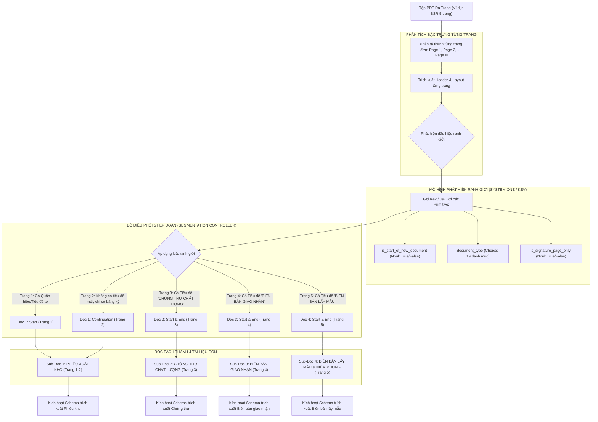

# Chuyên Đề: Xử Lý Tài Liệu Phức Hợp & Bóc Tách Ranh Giới (Composite Document Decomposition)
### Case Study Thực Tế: Phân Tích Bó Hồ Sơ Giao Nhận Xăng Dầu BSR - Dung Quất 5 Trang

---

## 1. Bản chất bài toán "Tài liệu phức hợp" (Composite / Bundled Documents)

Trong thực tế vận hành tại các kho đầu mối xăng dầu và doanh nghiệp Việt Nam, một lần giao nhận hàng (hoặc một bộ hồ sơ nghiệm thu, thanh toán) thường được nhân viên văn phòng/lái xe **kẹp chung tất cả các chứng từ liên quan thành một tệp PDF duy nhất** khi scan từ máy photocopy hoặc gửi qua ứng dụng.

### Ví dụ thực tế từ tệp mẫu:
📂 **`docs/_chot_samples_phanloaitailieu/BSR-2629763-HH 10-06-2026 20-10-37.pdf`** (5 trang scan, ~1.5 MB).

Nếu một hệ thống AI coi cả file PDF này là "một loại tài liệu duy nhất", hệ thống sẽ bị sai bản chất, vì bên trong thực chất bao gồm **4 loại chứng từ pháp lý độc lập** với các chức năng kế toán hoàn toàn khác nhau:

```text
BSR-2629763-HH...pdf (5 trang)
├── [Trang 1 - 2]: PHIẾU XUẤT KHO THÀNH PHẨM (BSR) ──> Tài liệu đa trang (Multi-page)
│   ├── Trang 1: Bảng dữ liệu hàng hóa, bồn xuất TK-5207B, lệnh xuất hàng 7309...
│   └── Trang 2: Bảng chữ ký (Người lập phiếu, Đại diện bên giao, Đại diện bên nhận)
├── [Trang 3]    : CHỨNG THƯ CHẤT LƯỢNG (Certificate of Quality) ──> Đơn trang
│   └── Ký hiệu lô DLO-TK5207B, Tiêu chuẩn nhiên liệu Điêzen DO 0.05S Mức 2
├── [Trang 4]    : BIÊN BẢN GIAO NHẬN HÀNG HÓA (MIPEC - Hóa dầu Quân đội) ──> Đơn trang
│   └── Chi nhánh Đà Nẵng, giao nhận tại trạm xe bồn NMLD Dung Quất
└── [Trang 5]    : BIÊN BẢN LẤY MẪU, NIÊM PHONG VÀ CAM KẾT CHẤT LƯỢNG ──> Đơn trang
    └── Mẫu 1.BBLM theo TT 15/2015/TT-BKHCN, niêm chì, kiểm nghiệm mẫu
```

---

## 2. Kiến trúc Phát hiện Ranh giới & Tách tài liệu (Document Splitting Architecture)

Hệ thống cần tiếp cận file PDF đa trang như một **Luồng các trang (Stream of Pages)** thay vì một văn bản đơn lẻ:



---

## 3. Các đặc trưng nhận dạng ranh giới tài liệu trong nghiệp vụ Việt Nam

Để xác định chính xác một trang là **Bắt đầu tài liệu mới (FIRST)** hay **Trang kế tiếp (CONTINUATION)**:

| Dấu hiệu | Nhận biết trang BẮT ĐẦU (FIRST PAGE) | Nhận biết trang KẾ TIẾP (CONTINUATION PAGE) |
| :--- | :--- | :--- |
| **Quốc hiệu / Tiêu ngữ** | Thường xuất hiện ở đầu trang: *"CỘNG HÒA XÃ HỘI CHỦ NGHĨA VIỆT NAM"*, *"Độc lập - Tự do - Hạnh phúc"*. | Không có Quốc hiệu tiêu ngữ (hoặc chỉ có header lặp lại mờ). |
| **Tên đơn vị & Logo** | Logo lớn, Tên công ty phát hành, Tiêu chuẩn ISO, Địa chỉ trụ sở. | Không có logo hoặc chỉ là số trang nhỏ ở chân trang. |
| **Tiêu đề văn bản** | Chữ in hoa lớn ở 1/3 trên cùng: *"PHIẾU XUẤT KHO"*, *"BIÊN BẢN..."*, *"CHỨNG THƯ..."*. | Bắt đầu bằng các điều khoản tiếp diễn (*"Điều 3: Quyền và nghĩa vụ..."*, *"Bảng kê tiếp theo..."*). |
| **Chữ ký & Con dấu** | Rất ít khi trang đầu có chữ ký kết luận (trừ văn bản 1 trang). | Bảng chữ ký của các bên (*"Đại diện bên giao"*, *"Đại diện bên nhận"*, *"Kế toán trưởng"*, *"Thủ trưởng đơn vị"* đóng dấu đỏ) thường nằm ở trang cuối. |
| **Đánh số trang** | *"Trang 1/2"*, *"Trang 1/3"*, hoặc không đánh số. | *"Trang 2/2"*, *"Trang 3/3"*. |

---

## 4. Cấu trúc dữ liệu đầu ra của bộ Document Splitter

Sau khi phân đoạn, bộ tách tài liệu trả về siêu dữ liệu (metadata) có cấu trúc để các module tiếp theo xử lý song song:

```json
{
  "source_file": "BSR-2629763-HH 10-06-2026 20-10-37.pdf",
  "total_pages": 5,
  "detected_documents": [
    {
      "doc_id": "doc_001",
      "pages": [1, 2],
      "document_type": "phieu_xuat_kho",
      "category_label": "_PHIẾU XUẤT KHO MUA HÀNG 2026",
      "confidence": 0.96,
      "page_count": 2,
      "is_multi_page": true,
      "metadata": {
        "so_phieu": "2629763",
        "ky_hieu": "BSR/PXK/DO",
        "don_vi_phat_hanh": "Công ty Cổ phần Lọc hóa dầu Bình Sơn (BSR)"
      }
    },
    {
      "doc_id": "doc_002",
      "pages": [3],
      "document_type": "chung_thu_chat_luong",
      "category_label": "CHỨNG THƯ CHẤT LƯỢNG",
      "confidence": 0.98,
      "page_count": 1,
      "is_multi_page": false,
      "metadata": {
        "so_lo": "DLO-TK5207B-204-261005",
        "san_pham": "Nhiên liệu Điêzen DO 0,05S Mức 2"
      }
    },
    {
      "doc_id": "doc_003",
      "pages": [4],
      "document_type": "bien_ban_giao_nhan",
      "category_label": "_Biên bản giao nhận 2026",
      "confidence": 0.94,
      "page_count": 1,
      "is_multi_page": false,
      "metadata": {
        "bieu_mau": "BM08C-QD06-XD",
        "don_vi": "Công ty Cổ phần Hóa dầu Quân đội (MIPEC)"
      }
    },
    {
      "doc_id": "doc_004",
      "pages": [5],
      "document_type": "bien_ban_lay_mau",
      "category_label": "6. CUA HANG - BB MAU- VÂN",
      "confidence": 0.95,
      "page_count": 1,
      "is_multi_page": false,
      "metadata": {
        "bieu_mau": "15/2015/TT-BKHCN",
        "tieu_de": "Biên bản lấy mẫu, niêm phong, bàn giao mẫu và cam kết chất lượng"
      }
    }
  ]
}
```
