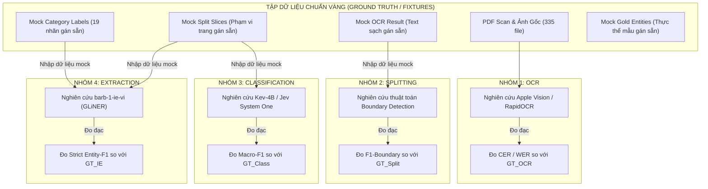

# Phương Pháp Luận Nghiên Cứu Song Song Độc Lập (Decoupled Parallel Research Methodology)
### Giải Quyết Triệt Để Bài Toán Phụ Thuộc Dữ Liệu Giữa Các Nhóm (Pipeline Dependency Trap)

---

## 1. Cảnh báo: Cái bẫy "Lỗi Phụ Thuộc Dây Chuyền" (Pipeline Dependency Trap)

Nếu tổ chức nghiên cứu theo tư duy tuần tự truyền thống:
```text
[Nhóm 1: OCR] ──(phải chờ có kết quả)──> [Nhóm 2: Tách file] ──(phải chờ)──> [Nhóm 3: Phân loại] ──(phải chờ)──> [Nhóm 4: Bóc tách]
```
Mô hình này sẽ dẫn đến 3 thảm họa quản lý dự án:
1. **Tắc nghẽn tiến độ (Waterfall Bottleneck)**: Nhóm 2, 3, 4 phải "ngồi chơi xơi nước" trong khi Nhóm 1 đang loay hoay cài đặt và tối ưu OCR.
2. **Lỗi cộng dồn (Error Propagation)**: Khi Nhóm 4 chạy mô hình bóc tách bị sai, ta không thể biết là do mô hình trích xuất kém, hay do Nhóm 3 phân loại nhầm danh mục, hay do Nhóm 1 OCR bị mất chữ.
3. **Mất khả năng đo lường độc lập**: Không đánh giá được năng lực thực tế của từng mô hình AI.

---

## 2. Giải Pháp Chuẩn Công Nghiệp: "Độc Lập Hóa Bằng Tập Chuẩn Vàng & Mock Fixtures"

Để 4 nhóm **bắt đầu code cùng 1 ngày, cùng 1 giờ** và đạt hiệu quả tối đa, ta áp dụng nguyên tắc: **Contract-Driven Development & Ground Truth Decoupling (Phát triển theo Hợp đồng & Tách rời bằng Chuẩn vàng)**.



### Cách thức vận hành cụ thể từ Ngày đầu tiên (Day 1):

| Nhóm | Dữ liệu đầu vào sử dụng để code | Tiêu chuẩn bàn giao đầu ra | Cách thức làm việc độc lập 100% |
| :--- | :--- | :--- | :--- |
| **Nhóm 1 (OCR)** | Lấy các tệp PDF/ảnh thực tế trong `docs/_chot_samples_phanloaitailieu/`. | Trả về đối tượng `OCRDocumentResult` tuân thủ [`contracts.py`](../src/common/contracts.py). | Tập trung 100% vào việc tinh chỉnh Apple Vision, RapidOCR, và Crop-Correction LLM. |
| **Nhóm 2 (Splitting)** | Không đợi Nhóm 1! Dùng `MOCK_OCR_DOCUMENT_BSR` từ [`sample_pipeline_fixtures.py`](../tests/fixtures/sample_pipeline_fixtures.py). | Trả về đối tượng `SplitResult` gồm các `DocumentSlice`. | Tập trung 100% vào thuật toán nhận diện Quốc hiệu, Header, Chữ ký cuối để tách trang. |
| **Nhóm 3 (Classification)** | Nhận **OCR Text** từ `MOCK_SPLIT_RESULT_BSR` (hoặc text từ 335 file). Nhận kèm ảnh PDF để làm fallback khi tự tin thấp. | Trả về đối tượng `ClassificationResult` (19 danh mục + Confidence + Probabilities). | Tập trung vào luật Fast Header, prompt và fine-tune mô hình **Kev-4B** (System One) trên OCR Text. Fallback VLM trên ảnh khi cần. |
| **Nhóm 4 (Extraction)** | Không đợi Nhóm 3! Lấy trực tiếp văn bản của từng loại đã biết trước nhãn (ví dụ: lấy file HĐ kinh tế). | Trả về đối tượng `ExtractionResult` (thực thể, bảng biểu JSON). | Tập trung 100% vào việc fine-tune `barb-1-ie-vi` và rule bóc tách các trường ERP. |

---

## 3. Kiến Trúc Hợp Đồng Dữ Liệu (Contract-Driven Integration)

Cả 4 nhóm được ràng buộc bởi một file mã nguồn duy nhất:
👉 **[`src/common/contracts.py`](../src/common/contracts.py)** (được định nghĩa bằng **Pydantic v2 / Dataclass**).

### Lợi ích cốt lõi:
1. **Type Safety & Tự động kiểm tra tính hợp lệ**: Mọi đầu ra của bất kỳ nhóm nào đều được validate tự động bằng Pydantic. Nếu Nhóm 1 trả về thiếu tọa độ bounding box hoặc sai kiểu dữ liệu, hệ thống báo lỗi ngay tại Unit Test.
2. **Thay thế lõi không ảnh hưởng bên ngoài (Hot-swapping)**: Nhóm 1 hôm nay dùng RapidOCR, ngày mai đổi sang `iOS-OCR-Server` (Apple Vision) mà không làm Nhóm 2 bị gãy code, vì cả 2 đều xuất ra cùng một kiểu `OCRDocumentResult`.

---

## 4. Phân Biệt: Đánh Giá Độc Lập vs Đánh Giá Toàn Trình (Two-Phase Evaluation)

Để báo cáo khoa học và kết quả nghiên cứu có giá trị thực tiễn cao nhất, việc đánh giá bắt buộc phải chia làm **2 giai đoạn**:

### Giai đoạn 1: Đánh giá Đơn thành phần (Component-level Evaluation)
- Mỗi nhóm được chấm điểm trên **Ground Truth sạch** (đầu vào hoàn hảo).
- **Mục đích**: Tìm ra giới hạn trần lý thuyết (upper-bound capacity) của từng mô hình:
  - Nhóm 1: Độ chính xác ký tự OCR đạt bao nhiêu %?
  - Nhóm 2: Tỷ lệ nhận diện đúng ranh giới tách trang đạt bao nhiêu %?
  - Nhóm 3: Khi có text sạch, Kev-4B phân loại đúng 19 lớp bao nhiêu %?
  - Nhóm 4: Khi text sạch và biết đúng loại tài liệu, `barb-1-ie-vi` bóc tách thực thể đúng bao nhiêu %?

### Giai đoạn 2: Đánh giá Toàn trình (End-to-End Pipeline Evaluation)
- Ghép nối cả 4 module thực tế lại thành luồng duy nhất:
  $$\text{PDF Input} \xrightarrow{\text{Model 1}} \text{Model 2} \xrightarrow{\text{Model 3}} \text{Model 4} \rightarrow \text{ERP Output}$$
- So sánh sự sụt giảm độ chính xác ($\Delta F_1$) giữa Giai đoạn 1 và Giai đoạn 2:
  - Nếu $\Delta F_1$ sụt giảm lớn ở Nhóm 4 $\rightarrow$ Chứng tỏ chất lượng OCR của Nhóm 1 đang làm hỏng bài toán bóc tách của Nhóm 4.
  - Từ đó xác định chính xác điểm nghẽn (bottleneck) cần tập trung nguồn lực giải quyết.

---

## 5. Quy Trình "Ngày Ghép Nối" (Integration Sprint)

1. **Tuần 1 - 3**: Mỗi nhóm phát triển và hoàn thiện Unit Test độc lập dựa trên `tests/fixtures/sample_pipeline_fixtures.py`.
2. **Tuần 4 (Integration Week)**:
   - Viết module điều phối chung: `src/pipeline/document_processor.py`.
   - Chạy thử nghiệm trên 20 file phức hợp thực tế (trong đó có file `BSR-2629763-HH 10-06-2026 20-10-37.pdf`).
   - Xuất bảng báo cáo so sánh chi phí, độ trễ và độ chính xác toàn trình.
