# Cẩm Nang Nghiên Cứu & Phát Triển (Handbook For Researchers)
### Ban Điều Phối Dự Án `sdh-phanloaitailieu` | Smart Document Hub

> [!IMPORTANT]
> **THÔNG BÁO TỪ BAN ĐIỀU PHỐI**:
> Các nhóm nghiên cứu sinh không cần (và không được cấp quyền) truy cập trực tiếp vào kho thử nghiệm nội bộ `Z:\projects\vocvach`.
> Toàn bộ các mô hình, thuật toán, module tiền xử lý và nhãn bảo vệ tốt nhất đã được **chuyển giao và chuẩn hóa 100% vào repository này**.
> Bất kỳ nhóm nào cũng có thể **bắt đầu nghiên cứu độc lập ngay hôm nay** dựa trên các công cụ và dữ liệu mẫu đã chuẩn bị sẵn dưới đây.

---

## 1. Sơ Đồ Cấu Trúc Mã Nguồn Sau Khi Chuyển Giao

Toàn bộ hệ thống đã được tổ chức lại theo mô hình module hóa sạch (Modular Monorepo):

```text
sdh-phanloaitailieu/
├── data/
│   └── baseline_ocr_335.jsonl          # [SẴN CÓ] Tập dữ liệu OCR text tiền trích xuất của 335 tệp
├── docs/
│   ├── _chot_samples_phanloaitailieu/  # [SẴN CÓ] 335 tệp PDF scan gốc (19 danh mục)
│   ├── HANDBOOK_FOR_RESEARCHERS.md     # [CẨM NANG NÀY] Hướng dẫn xuất phát điểm cho các nhóm
│   ├── VISUAL_ARCHITECTURE.md          # Bản đồ trực quan hóa toàn bộ hệ thống (Mermaid)
│   ├── COMPOSITE_DOCUMENTS_AND_SPLITTING.md # Case study tài liệu phức hợp BSR 5 trang
│   ├── PARALLEL_RESEARCH_PLAN.md       # Kế hoạch phân công 4 nhánh nghiên cứu
│   └── DECOUPLED_PARALLEL_METHODOLOGY.md # Phương pháp luận nghiên cứu không phụ thuộc dữ liệu
├── src/
│   ├── common/
│   │   └── contracts.py                # [QUAN TRỌNG] Hợp đồng dữ liệu Pydantic v2 giữa 4 nhóm
│   ├── ocr/
│   │   ├── rapid_ocr.py                # Engine OCR cục bộ (PyMuPDF + RapidOCR ONNX)
│   │   └── ios_ocr_client.py           # Client kết nối Apple Vision OCR Server (iPhone/Mac)
│   ├── splitting/
│   │   └── boundary_detector.py        # Thuật toán phát hiện ranh giới & tách sub-documents
│   ├── classification/
│   │   └── system_one_classifier.py    # Bộ phân loại đa tầng (Fast Header + Kev-4B / Jev)
│   └── extraction/
│       ├── barb_labels.py              # Guardrails nhãn tiếng Việt có dấu cho GLiNER
│       └── barb_extractor.py           # Mô hình trích xuất thực thể chưa cần train (barb-1-ie-vi)
├── tests/
│   └── fixtures/
│       └── sample_pipeline_fixtures.py # [SẴN CÓ] Bộ dữ liệu giả lập chuẩn của cả 4 khâu
└── scripts/
    └── generate_baseline_ocr.py        # Script sinh dữ liệu baseline OCR
```

---

## 2. Hướng Dẫn Hành Động Cụ Thể Từng Nhóm (Bắt Đầu Ngay Hôm Nay)

```mermaid
flowchart TD
    subgraph T1["NHÓM 1: OCR & HANDWRITING"]
        N1_Start["File khởi động:<br/>src/ocr/ios_ocr_client.py<br/>src/ocr/rapid_ocr.py"]
        N1_Input["Đầu vào:<br/>335 tệp PDF trong docs/"]
        N1_Goal["Mục tiêu:<br/>Tối ưu CER/WER chữ in > 99%<br/>Chữ viết tay > 92%"]
        N1_Start --> N1_Input --> N1_Goal
    end

    subgraph T2["NHÓM 2: DOCUMENT SPLITTING"]
        N2_Start["File khởi động:<br/>src/splitting/boundary_detector.py"]
        N2_Input["Đầu vào:<br/>MOCK_OCR_DOCUMENT_BSR<br/>(sample_pipeline_fixtures.py)"]
        N2_Goal["Mục tiêu:<br/>Tách chính xác 4 chứng từ<br/>trong tệp BSR 5 trang (F1 > 95%)"]
        N2_Start --> N2_Input --> N2_Goal
    end

    subgraph T3["NHÓM 3: CLASSIFICATION"]
        N3_Start["File khởi động:<br/>src/classification/system_one_classifier.py"]
        N3_Input["Đầu vào:<br/>data/baseline_ocr_335.jsonl<br/>(335 mẫu text gán nhãn 19 lớp)"]
        N3_Goal["Mục tiêu:<br/>Fast Header (<10ms)<br/>Kev-4B Choice (Macro-F1 > 97%)"]
        N3_Start --> N3_Input --> N3_Goal
    end

    subgraph T4["NHÓM 4: INFORMATION EXTRACTION"]
        N4_Start["File khởi động:<br/>src/extraction/barb_extractor.py<br/>src/extraction/barb_labels.py"]
        N4_Input["Đầu vào:<br/>Text mẫu từ fixture hoặc baseline<br/>(đã biết loại tài liệu)"]
        N4_Goal["Mục tiêu:<br/>Trích xuất 100% Bên A, Bên B,<br/>MST, Số bồn, Số lượng lít"]
        N4_Start --> N4_Input --> N4_Goal
    end
```



---

### 🚀 DÀNH CHO NHÓM 1: OCR & CHỮ VIẾT TAY
- **Công cụ đã chuyển giao**:
  - `src/ocr/rapid_ocr.py`: Đã hỗ trợ đọc digital text trước, fallback sang RapidOCR ONNX.
  - `src/ocr/ios_ocr_client.py`: Đã viết sẵn client gọi Apple Vision OCR (`/upload`).
- **Nhiệm vụ nghiên cứu**:
  1. Thử nghiệm kết nối với iPhone/Mac qua `iOS-OCR-Server` (cổng 8000). So sánh chất lượng nhận diện chữ viết tay trên các tệp `_Biên bản giao nhận 2026` giữa Apple Vision và RapidOCR.
  2. Xây dựng cơ chế cắt (crop) bounding box cho các ô số lượng/chữ ký để gửi vào Small Vision LLM hiệu đính.
- **Lệnh chạy thử nghiệm ngay**:
  ```powershell
  python -c "from src.ocr.rapid_ocr import extract_document; res = extract_document('docs/_chot_samples_phanloaitailieu/10. GCN VC HNH/15. GCN VC HNH Dong (12-5-24).pdf'); print('Trang 1 text:', res.pages[0].full_text[:200])"
  ```

---

### 🚀 DÀNH CHO NHÓM 2: DOCUMENT SPLITTING (PHÂN ĐOẠN TÀI LIỆU BÓ)
- **Công cụ đã chuyển giao**:
  - `src/splitting/boundary_detector.py`: Đã dựng sẵn khung nhận biết Quốc hiệu, Tiêu đề chứng từ, và chữ ký kết thúc.
  - `tests/fixtures/sample_pipeline_fixtures.py`: Chứa sẵn `MOCK_OCR_DOCUMENT_BSR` (5 trang thực tế của ca giao nhận xăng dầu BSR Dung Quất).
- **Nhiệm vụ nghiên cứu**:
  1. Chạy thuật toán phát hiện ranh giới trên `MOCK_OCR_DOCUMENT_BSR` để chứng minh có thể tách chính xác thành 4 tài liệu con:
     - Lát cắt 1: Trang 1-2 (Phiếu xuất kho BSR).
     - Lát cắt 2: Trang 3 (Chứng thư chất lượng).
     - Lát cắt 3: Trang 4 (Biên bản giao nhận MIPEC).
     - Lát cắt 4: Trang 5 (Biên bản lấy mẫu).
  2. Nâng cấp thuật toán kết hợp đặc trưng hình thái (Visual layout: có con dấu đỏ ở chân trang) với System One (`Noul` primitive).
- **Lệnh chạy thử nghiệm ngay**:
  ```powershell
  python -c "from src.splitting.boundary_detector import split_document; from tests.fixtures.sample_pipeline_fixtures import MOCK_OCR_DOCUMENT_BSR; res = split_document(MOCK_OCR_DOCUMENT_BSR); print('So lát cắt tách được:', len(res.slices))"
  ```

---

### 🚀 DÀNH CHO NHÓM 3: CLASSIFICATION (PHÂN LOẠI 19 DANH MỤC)
- **Công cụ & Dữ liệu đã chuyển giao**:
  - `data/baseline_ocr_335.jsonl`: **335 mẫu văn bản OCR thực tế kèm nhãn 19 danh mục chuẩn** (không cần đợi Nhóm 1 và Nhóm 2!).
  - `src/classification/system_one_classifier.py`: Đã cấu hình Lớp 1 (Fast Header Gate) và Lớp 2 (Kev-4B / Jev `Choice` prompt).
- **Nhiệm vụ nghiên cứu**:
  1. Viết script đọc `data/baseline_ocr_335.jsonl`, chia Stratified 5-Fold.
  2. Đo đạc độ chính xác của Lớp 1 (Fast Header Gate) xem bắt được bao nhiêu % tài liệu trong thời gian <10ms.
  3. Với các tài liệu họ Hợp đồng (HĐ đại lý, HĐ kinh tế, HĐ vận chuyển, HĐ mượn bồn, HĐ thuê kho, HĐ đầu vào), đưa vào mô hình **Kev-4B** (hoặc Jev API) để đo Macro-F1 và vẽ ma trận nhầm lẫn (Confusion Matrix).
- **Lệnh chạy thử nghiệm ngay**:
  ```powershell
  python -c "from src.classification.system_one_classifier import CascadedClassifier; from src.common.contracts import DocumentSlice; clf = CascadedClassifier(); s = DocumentSlice(slice_id='s1', start_page=1, end_page=1, page_count=1, combined_text='CỘNG HÒA XÃ HỘI CHỦ NGHĨA VIỆT NAM\nCÔNG TY PETROLIMEX\nHỢP ĐỒNG ĐẠI LÝ BÁN LẺ XĂNG DẦU...'); res = clf.classify_slice(s); print('Dự đoán:', res.predicted_category, '| Confidence:', res.confidence)"
  ```

---

### 🚀 DÀNH CHO NHÓM 4: INFORMATION EXTRACTION (TRÍCH XUẤT THỰC THỂ ERP)
- **Công cụ đã chuyển giao**:
  - `src/extraction/barb_labels.py`: Bộ kiểm tra nhãn tiếng Việt có dấu (bảo đảm GLiNER không bị tụt 35 điểm F1 do nhãn không dấu).
  - `src/extraction/barb_extractor.py`: Đã tích hợp mô hình `belumind/barb-1-ie-vi` (chạy mượt trên GPU/CPU).
- **Nhiệm vụ nghiên cứu**:
  1. Lấy trực tiếp văn bản từ `data/baseline_ocr_335.jsonl` thuộc các nhóm Hợp đồng (`_2. HOP DONG KINH TE`, `_1. HOP DONG DAI LY NHUONG QUYEN`).
  2. Chạy mô hình `barb_extractor` để trích xuất các thực thể: `tổ chức`, `người`, `chức vụ`, `mã số thuế`, `số tài khoản`, `xăng dầu`, `số lượng`.
  3. Xây dựng thêm bộ trích xuất bảng biểu (Table Extractor) cho Phiếu xuất kho BSR và Biên bản giao nhận hàng.
- **Lệnh chạy thử nghiệm ngay**:
  ```powershell
  python -c "from src.extraction.barb_extractor import BarbEntityExtractor; from src.common.contracts import DocumentSlice; ext = BarbEntityExtractor(); s = DocumentSlice(slice_id='s1', start_page=1, end_page=1, page_count=1, combined_text='BÊN BÁN: CÔNG TY TNHH MTV PETROLIMEX GIA LAI. Mã số thuế: 4100259821. Đại diện: Ông Nguyễn Văn Thắng - Phó Giám đốc.'); res = ext.extract(s, '_2. HOP DONG KINH TE'); print('Thực thể trích xuất:', res.entity_dict)"
  ```

---

## 3. Quy Định Bắt Buộc Về Hợp Đồng Dữ Liệu (Interface Enforcement)

Mọi thành viên trong cả 4 nhóm **tuyệt đối không tự ý thay đổi chữ ký hàm hoặc định dạng dữ liệu đầu ra**.
Mọi dữ liệu trao đổi giữa các khâu **bắt buộc phải kế thừa từ các Pydantic class trong [`src/common/contracts.py`](../src/common/contracts.py)**:
- Nhóm 1 xuất ra `OCRDocumentResult`
- Nhóm 2 xuất ra `SplitResult`
- Nhóm 3 xuất ra `ClassificationResult`
- Nhóm 4 xuất ra `ExtractionResult`

Việc tuân thủ hợp đồng này đảm bảo đến **Tuần thứ 4 (Integration Week)**, Ban Điều Phối chỉ cần 1 lệnh duy nhất là ghép nối thành công toàn bộ hệ thống thành sản phẩm hoàn chỉnh mà không gặp bất kỳ lỗi xung đột nào!
