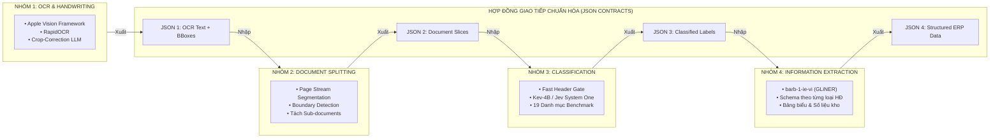

# Kế Hoạch Nghiên Cứu Song Song & Phân Công Nhiệm Vụ Đề Tài
### Chiến Lược Tổ Chức 4 Nhánh Nghiên Cứu Độc Lập & Giao Tiếp Chuẩn Hóa (Parallel Research Tracks)

---

## 1. Nguyên tắc tổ chức nghiên cứu song song

Để nhiều nhóm nghiên cứu sinh hoặc kỹ sư AI có thể làm việc **đồng thời (in parallel)** mà:
- **Không phụ thuộc vào tiến độ của nhau**: Mỗi nhóm có thể dùng dữ liệu giả lập (mock data) hoặc đầu vào chuẩn để hoàn thành mục tiêu riêng.
- **Không bị xung đột mã nguồn**: Mỗi nhóm làm việc trên thư mục module riêng biệt (`src/ocr/`, `src/splitting/`, `src/classification/`, `src/extraction/`).
- **Ghép nối được tức thì (Plug-and-Play)**: Các nhóm thống nhất một **Hợp đồng giao tiếp trung gian (Interface Contract)** bằng cấu trúc JSON chuẩn trước khi bắt đầu viết code.



---

## 2. Phân công 4 Nhánh Nghiên Cứu Chuyên Sâu (4 Research Tracks)

### 📌 Nhánh 1: OCR & Chữ Viết Tay (Workstream OCR & Handwriting)
- **Thư mục phụ trách**: `src/ocr/` và `experiments/ocr_eval/`
- **Mục tiêu**: Đạt độ chính xác nhận diện chữ in > 99% và chữ viết tay > 92% trên tài liệu tiếng Việt.
- **Nhiệm vụ cụ thể**:
  1. Đóng gói microservice `iOS-OCR-Server` (Apple Vision) và tích hợp client Python gọi API `/upload`.
  2. Đo lường tỷ lệ lỗi ký tự (CER) và tỷ lệ lỗi từ (WER) trên tập 20 Biên bản giao nhận và Phiếu xuất kho có chữ viết tay.
  3. Xây dựng module tự động cắt (crop) bounding box cho các ô nghi vấn và gọi Small Vision LLM (Gemini Flash / Qwen2.5-VL) để hiệu đính chính tả và chữ số.
- **Sản phẩm bàn giao**: Module `HybridOCREngine` nhận vào file PDF/ảnh, xuất ra đối tượng `OCRResult` gồm toàn văn bản và danh sách các hộp tọa độ `ocr_boxes`.

---

### 📌 Nhánh 2: Phân Đoạn & Bóc Tách Bó Hồ Sơ (Workstream Document Splitting)
- **Thư mục phụ trách**: `src/splitting/` và `experiments/splitting_eval/`
- **Mục tiêu**: Tự động nhận diện ranh giới và phân tách một file PDF tổng hợp (như file BSR 5 trang) thành các chứng từ thành phần với độ chính xác F1-boundary > 95%.
- **Nhiệm vụ cụ thể**:
  1. Phân loại từng trang theo 2 nhãn logic: `FIRST_PAGE` (Trang bắt đầu tài liệu) và `CONTINUATION_PAGE` (Trang tiếp theo).
  2. Kết hợp đặc trưng thị giác (Quốc hiệu tiêu ngữ, Logo đơn vị, Bảng chữ ký cuối trang) với System One Model (`Noul` primitive).
  3. Xây dựng logic gom nhóm các trang liên tiếp thành từng `DocumentSlice`.
- **Sản phẩm bàn giao**: Module `DocumentSplitter` nhận vào PDF đa trang, xuất ra danh sách các lát cắt tài liệu kèm phạm vi trang (ví dụ: `[Trang 1-2]`, `[Trang 3]`, `[Trang 4]`, `[Trang 5]`).

---

### 📌 Nhánh 3: Động Cơ Phân Loại 19 Danh Mục (Workstream Classification Engine)
- **Thư mục phụ trách**: `src/classification/` và `experiments/classification_eval/`
- **Bản chất đầu vào (Văn bản OCR hay File PDF?)**:
  - **Trụ cột chính (85% khối lượng)**: Phân loại trên **OCR Text** (văn bản được cung cấp bởi Nhóm 1 và Nhóm 2).
    * *Lý do*: Trong 19 danh mục thực tế của đề tài, có tới 7 loại Hợp đồng & Thanh lý (`HĐ đại lý`, `HĐ kinh tế`, `HĐ đầu vào`, `HĐ vận chuyển`, `HĐ thuê kho`, `HĐ mượn bồn`, `Thanh lý HĐ`). Về mặt thị giác (ảnh PDF), tất cả các văn bản này đều là trang giấy in đen trắng có Quốc hiệu tiêu ngữ và bố cục Điều 1, Điều 2 giống hệt nhau! **Mô hình nhìn ảnh sẽ không thể phân biệt được, bắt buộc phải đọc ngữ nghĩa văn bản (OCR Text) để nhận diện tên gọi và bản chất pháp lý**.
  - **Tầng phụ trợ (15% khối lượng - Fallback trên Ảnh PDF)**: Khi bản scan quá mờ, bị rách, hoặc nhiều chữ viết tay khiến OCR ra text bị nhiễu (garbled text) và mô hình text trả về điểm tin cậy thấp (`confidence < 0.65`), hệ thống mới kích hoạt Vision Model (Qwen2.5-VL / Gemini Flash) đọc trực tiếp ảnh trang 1 để nhận diện theo bố cục hoa văn, con dấu và biểu tượng.
- **Kiến trúc phân loại 3 lớp của Nhóm 3**:
  1. **Lớp 1 (Fast Header Gate - < 10ms, 0đ)**: Quét chuỗi regex/từ khóa tiêu đề trên dòng đầu của OCR Text. Bắt nhanh các loại form cố định (*"GIẤY CHỨNG NHẬN ĐĂNG KÝ DOANH NGHIỆP"*, *"PHIẾU XUẤT KHO"*, *"GIẤY ĐỦ ĐIỀU KIỆN"*).
  2. **Lớp 2 (Kev-4B System One trên OCR Text - 150ms)**: Với các loại Hợp đồng và Biên bản phức tạp, đưa 1.000 - 2.000 ký tự đầu vào **Kev-4B** (hoặc TypeSafe Jev) với câu hỏi `Choice` để nhận nhãn và xác suất chuẩn hóa (`probabilities`).
  3. **Lớp 3 (Visual Fallback - Chỉ khi cần)**: Đọc ảnh PDF khi Lớp 2 có độ tự tin thấp.
- **Mục tiêu KPI**: Phân loại chuẩn xác 19 danh mục với Macro-F1 > 97%, độ trễ trung bình < 200ms/tài liệu.
- **Sản phẩm bàn giao**: Module `CascadedClassifier` nhận vào `DocumentSlice` (chứa `combined_text` và danh sách ảnh trang), trả về `ClassificationResult` (`predicted_category`, `confidence`, `probabilities`).

---

### 📌 Nhánh 4: Bóc Tách Thông Tin Nghiệp Vụ Cấu Trúc (Workstream Information Extraction)
- **Thư mục phụ trách**: `src/extraction/` và `experiments/extraction_eval/`
- **Mục tiêu**: Trích xuất chính xác 100% các thực thể then chốt (Bên A, Bên B, MST, Đại diện, Sản phẩm, Sản lượng) phục vụ hạch toán ERP.
- **Nhiệm vụ cụ thể**:
  1. Tích hợp và đánh giá mô hình `belumind/barb-1-ie-vi` (GLiNER) từ dự án `Z:\projects\vocvach\barb-1-ie-vi`.
  2. Thiết kế schema trích xuất riêng biệt cho từng loại chứng từ:
     - *Hợp đồng kinh tế*: Bên mua, bên bán, số HĐ, thời hạn, chủng loại xăng dầu, hạn mức tín dụng.
     - *Phiếu xuất kho BSR*: Số phiếu, bồn xuất, số lượng nhiệt độ thực tế, tỷ trọng, lái xe.
     - *Chứng thư chất lượng*: Ký hiệu lô hàng, chỉ tiêu RON, hàm lượng lưu huỳnh.
  3. Định dạng dữ liệu đầu ra chuẩn JSON tương thích với Smart Document Hub / phần mềm ERP.
- **Sản phẩm bàn giao**: Module `EntityExtractor` nhận vào `(text, document_type)`, xuất ra JSON cấu trúc hoàn chỉnh.

---

## 3. Hợp Đồng Giao Tiếp Trung Gian Giữa Các Nhóm (Interface Contract)

Để các nhóm có thể phát triển song song độc lập mà không cần chờ đợi nhau, 4 giao diện dữ liệu (Data Schemas) sau đây được quy định chuẩn hóa:

### Schema 1: Đầu ra Nhóm 1 $\rightarrow$ Đầu vào Nhóm 2 & 3
```python
class OCRPageResult:
    page_number: int
    full_text: str
    ocr_boxes: list[dict]  # [{"text": str, "x": float, "y": float, "w": float, "h": float, "confidence": float}]
    has_header_seal: bool
    has_signature_box: bool
```

### Schema 2: Đầu ra Nhóm 2 $\rightarrow$ Đầu vào Nhóm 3
```python
class DocumentSlice:
    doc_id: str
    start_page: int
    end_page: int
    page_count: int
    combined_text: str
    pages: list[OCRPageResult]
```

### Schema 3: Đầu ra Nhóm 3 $\rightarrow$ Đầu vào Nhóm 4
```python
class ClassificationResult:
    doc_id: str
    predicted_category: str  # 1 trong 19 nhãn chuẩn
    confidence: float        # Calibrated probability (0.0 -> 1.0)
    requires_human_review: bool
    text_content: str
```

### Schema 4: Đầu ra Nhóm 4 $\rightarrow$ Hệ thống ERP
```python
class ExtractionResult:
    doc_id: str
    document_type: str
    confidence: float
    entities: dict           # {"ben_a": "...", "ben_b": "...", "mst_ben_a": "...", ...}
    tables: list[dict]       # Danh sách các dòng hàng hóa chi tiết
    audit_trail: dict        # Tọa độ bounding box của các trường để đối soát
```

---

## 4. Lộ Trình Triển Khai Thực Nghiệm 4 Tuần (4-Week Sprint Plan)

| Tuần | Nhóm 1 (OCR & Viết tay) | Nhóm 2 (Doc Splitting) | Nhóm 3 (Classification) | Nhóm 4 (Information Extraction) |
| :---: | :--- | :--- | :--- | :--- |
| **Tuần 1** | Dựng iOS-OCR-Server & đo baseline CER trên 20 bản scan | Phân tích 335 files, lọc ra tập PDF đa tài liệu (như BSR) | Thiết lập môi trường Kev-4B local, test TypeSafe SDK | Chạy thử nghiệm barb-1-ie-vi trên 10 Hợp đồng mẫu |
| **Tuần 2** | Thử nghiệm Crop-Correction với Small Vision LLM | Viết rule nhận biết Quốc hiệu, Header, Chữ ký cuối trang | Chạy Benchmark 19 lớp trên 335 files, vẽ Confusion Matrix | Xây dựng Schema thực thể chi tiết cho 5 loại HĐ chính |
| **Tuần 3** | Tối ưu hóa tốc độ & bộ nhớ cache | Kết hợp Kev Noul/Choice để phát hiện ranh giới tự động | Tinh chỉnh nhiệt độ (Temperature fitting) cho Kev-4B | Xây dựng bộ trích xuất bảng biểu cho Phiếu kho & Biên bản |
| **Tuần 4** | **TÍCH HỢP TOÀN TRÌNH**: Ghép 4 module vào Pipeline Cascaded hoàn chỉnh, đo End-to-End Latency, F1 & Cost |
