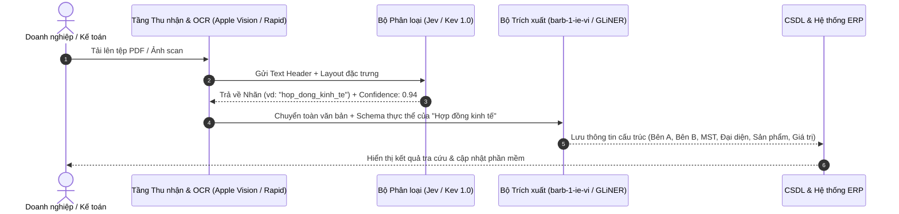

# Nghiên Cứu Phân Loại & Trích Xuất Thông Tin Tài Liệu Doanh Nghiệp (Vietnam Enterprise Document AI)
### Ứng Dụng Fast Decision Models (Jev / Kev - System One), Vision-Language Models & Hybrid OCR Pipeline

[](#2-bộ-dữ-liệu-mẫu-thực-nghiệm-benchmark-dataset)
[](#danh-mục-19-loại-tài-liệu-nghiệp-vụ)
[-orange.svg)](#3-định-hướng-công-nghệ-cốt-lõi-system-one-models-jev--kev)
[](#4-chiến-lược-hybrid-ocr--tối-ưu-chữ-in-và-chữ-viết-tay)
[-teal.svg)](#5-chuỗi-xử-lý-liên-kết-phân-loại--trích-xuất-thực-thể-ie)
[](./docs/VISUAL_ARCHITECTURE.md)

---

## 1. Giới thiệu bài toán (Executive Summary)

Dự án **`sdh-phanloaitailieu`** (nằm trong hệ sinh thái **Smart Document Hub**) tập trung giải quyết bài toán cốt lõi trong chuyển đổi số doanh nghiệp Việt Nam: **Tự động nhận diện, phân loại chính xác và trích xuất thông tin nghiệp vụ từ các chứng từ, hồ sơ hỗn hợp** (tài liệu điện tử, văn bản in scan, chứng từ đóng dấu, chữ viết tay).

### Thách thức thực tế tại doanh nghiệp:
1. **Dữ liệu phức tạp**: Tồn tại đồng thời chữ in máy vi tính, con dấu tròn/vuông, chữ ký tươi và **ghi chú viết tay** (chữ số, biển số xe, số lượng hàng, biên nhận).
2. **Chi phí và độ trễ**: Sử dụng LLM tổng quát (GPT-4o, Claude 3.5 Sonnet) để đọc và phân loại toàn bộ từng trang tài liệu gây tốn kém chi phí token rất lớn và độ trễ cao (vài giây/tài liệu).
3. **Bảo mật On-Premise**: Nhiều tài liệu chứa thông tin kinh doanh nhạy cảm (hợp đồng kinh tế, mã số thuế, số tài khoản, biên bản giao nhận xăng dầu) đòi hỏi khả năng chạy hoàn toàn offline / local.

---

## 2. Bộ dữ liệu mẫu thực nghiệm (Benchmark Dataset)

Bộ dữ liệu chuẩn hóa gồm **335 tệp PDF** nghiệp vụ thực tế được phân bố thành **19 danh mục**, lưu trữ tại:
📂 [`docs/_chot_samples_phanloaitailieu/`](./docs/_chot_samples_phanloaitailieu/)

### Danh mục 19 loại tài liệu nghiệp vụ:

| STT | Danh mục / Nhãn phân loại | Số lượng | Đặc thù nhận dạng |
| :---: | :--- | :---: | :--- |
| 1 | `10. GCN VC HNH` | 20 | Giấy chứng nhận vận chuyển hàng nguy hiểm (biểu trưng cảnh báo, form chuẩn) |
| 2 | `5. TỔNG HỢP HỒ SƠ XE` | 20 | Đăng kiểm, bảo hiểm xe, hồ sơ kỹ thuật phương tiện |
| 3 | `6. CUA HANG - BB MAU- VÂN` | 10 | Biên bản lấy mẫu, kiểm định, bàn giao tại cửa hàng |
| 4 | `6. HOP DONG MUON BON` | 7 | Hợp đồng mượn bồn / bể chứa xăng dầu |
| 5 | `6. HOP DONG THUE KHO- Vi` | 6 | Hợp đồng thuê kho bãi lưu trữ hàng hóa |
| 6 | `8. CUA HANG - TU K.TRA PCCC- VÂN` | 5 | Biên bản tự kiểm tra an toàn PCCC định kỳ |
| 7 | `8. GCN Lop dao tao van chuyen hang chay no` | 20 | Chứng chỉ đào tạo an toàn phòng chống cháy nổ |
| 8 | `9. TỔNG HỢP HỒ SƠ CỬA HÀNG` | 25 | Bộ hồ sơ pháp lý, giấy phép kinh doanh cửa hàng bán lẻ |
| 9 | `TU K.TRA PCCC- VÂN` | 5 | Hồ sơ tự kiểm tra PCCC (mẫu tổng hợp) |
| 10 | `_1. Giay DKKD khach hang` | 23 | Giấy chứng nhận đăng ký kinh doanh (ĐKKD) của đối tác |
| 11 | `_1. HOP DONG DAI LY NHUONG QUYEN` | 25 | Hợp đồng đại lý / nhượng quyền thương mại |
| 12 | `_2. Giay Du Dieu Kien Khach hang` | 25 | Giấy xác nhận đủ điều kiện kinh doanh xăng dầu |
| 13 | `_2. HOP DONG KINH TE` | 25 | Hợp đồng mua bán / thương mại xăng dầu |
| 14 | `_3. HOP DONG DAU VAO-Diem` | 20 | Hợp đồng cung cấp hàng hóa / dịch vụ đầu vào |
| 15 | `_4. THANH LÝ HỢP ĐỒNG` | 14 | Biên bản thanh lý và quyết toán hợp đồng |
| 16 | `_5. HOP DONG VAN CHUYEN` | 24 | Hợp đồng dịch vụ vận tải hàng hóa |
| 17 | `_Biên bản giao nhận 2026` | 20 | Biên bản giao nhận hàng hóa (nhiều chữ viết tay & chữ ký) |
| 18 | `_PHIẾU XUẤT KHO MUA HÀNG 2026` | 20 | Phiếu xuất kho / xuất hàng kiêm vận chuyển nội bộ |
| 19 | `_Đơn đặt hàng - mua vào 2026` | 20 | Đơn đặt hàng mua vào (Purchase Order) |
| **Tổng** | **19 danh mục** | **335 PDF** | **Dung lượng: ~360 MB** |

---

## 3. Định hướng công nghệ cốt lõi: System One Models (Jev / Kev)

Dự án tiếp cận hướng đi tiên phong về **System One Models** thay vì dùng LLM sinh văn bản truyền thống:

### 3.1. Jev & Kev là gì?
- **Jev ([TypeSafe AI](https://typesafe.ai/blog/introducing-system-one-models-and-jev))**: Lớp mô hình chuyên biệt cho việc ra quyết định trực tiếp (*Fast Thinking* - System One theo Daniel Kahneman). Thay vì sinh từng từ (text generation), Jev nhận đầu vào văn bản và danh sách các câu hỏi định kiểu (`Choice`, `Noul`, `Score`), lập tức trả về nhãn kèm **phân phối xác suất được chuẩn hóa (calibrated probabilities)**.
- **Kev ([jaredpalmer/kev](https://github.com/jaredpalmer/kev))**: Dòng mô hình mã nguồn mở Jev-like xây dựng trên nền **Qwen3.5 / Qwen3.8** (từ 0.8B, 4B, 9B đến 27B params), tương thích hoàn toàn API `/v1/systemone` của TypeSafe. Có thể chạy local qua CUDA hoặc Apple Silicon (MLX), cho phép fine-tune trực tiếp trên dữ liệu doanh nghiệp với chi phí cực thấp.

### 3.2. Ứng dụng Jev / Kev trong phân loại tài liệu:
```python
# Ví dụ cấu hình phân loại tài liệu với TypeSafe SDK / Kev Endpoint
from typesafe_sdk import TypeSafeClient, Choice, Noul

client = TypeSafeClient(base_url="http://localhost:8009", api_key="local")

response = client.system_one(
    state=document_extracted_text[:2000],  # Header & nội dung trang 1
    questions={
        "document_type": Choice(
            instructions="Xác định loại tài liệu này thuộc danh mục nào?",
            criteria={
                "hop_dong_kinh_te": "Hợp đồng kinh tế, mua bán thương mại",
                "hop_dong_van_chuyen": "Hợp đồng vận chuyển, chuyên chở hàng hóa",
                "bien_ban_giao_nhan": "Biên bản giao nhận hàng hóa xăng dầu",
                "phieu_xuat_kho": "Phiếu xuất kho kiêm vận chuyển",
                "gcn_van_chuyen_hang_nguy_hiem": "Giấy chứng nhận vận chuyển hàng nguy hiểm",
                "dang_ky_kinh_doanh": "Giấy chứng nhận đăng ký kinh doanh doanh nghiệp",
                # ... 19 danh mục
            }
        ),
        "is_signed_or_sealed": Noul(instructions="Văn bản này đã có chữ ký hoặc con dấu xác thực chưa?")
    }
)
```
- **Lợi thế vượt trội**:
  - **Calibrated Probabilities**: Có xác suất tin cậy của từng danh mục. Nếu `confidence >= 0.85`, hệ thống tự động gán nhãn lưu kho; nếu `confidence < 0.60`, tự động định tuyến sang nhân viên thẩm định (Human-in-the-Loop).
  - **Tốc độ**: Trả về kết quả trong 100 - 300ms.
  - **Không bịa đặt (No Hallucination)**: Đầu ra bị khống chế hoàn toàn bởi tập tiêu chí đã định nghĩa trước.

---

## 4. Chiến lược Hybrid OCR – Tối ưu chữ in và chữ viết tay

Chất lượng phân loại và trích xuất phụ thuộc chặt chẽ vào tầng OCR. Để cân bằng giữa **độ chính xác**, **tốc độ** và **chi phí 0 đồng**, hệ thống triển khai kiến trúc **3 tầng (Tiered Hybrid OCR)**:

```mermaid
flowchart TD
    Doc[Tài liệu PDF / Ảnh đầu vào] --> CheckLayer{Kiểm tra Text Layer số?}
    
    CheckLayer -->|Có text layer chuẩn| FastText[PyMuPDF: Trích xuất trực tiếp<br/><b>0ms, 100% chính xác, 0 VNĐ</b>]
    
    CheckLayer -->|PDF Scan / File ảnh| OCRTier{Lựa chọn hạ tầng OCR}
    
    OCRTier -->|Hạ tầng Apple Hardware| AppleVision[<b>iOS-OCR-Server / Mac Vision</b><br/>• Nhận diện cực tốt Tiếng Việt<br/>• Bắt trọn chữ viết tay & chữ ký<br/>• Miễn phí, Offline 100%]
    
    OCRTier -->|Hạ tầng Local CPU/GPU| Rapid[<b>RapidOCR / PaddleOCR ONNX</b><br/>• Tốc độ cao trên CPU/GPU<br/>• Chuyên trị chữ in]
    
    AppleVision --> Review{Có vùng chữ viết tay phức tạp / nghi ngờ?}
    Rapid --> Review
    
    Review -->|Confidence cao| FinalText[Văn bản sạch hoàn chỉnh]
    Review -->|Chữ viết tay mờ / Lỗi| LLMFix[<b>Crop Bounding Box + Vision LLM (Gemini / Qwen-VL)</b><br/>Hiệu đính & giải mã chữ viết tay ngữ cảnh]
    LLMFix --> FinalText
```

### 4.1. Tận dụng Apple Vision Framework ([iOS-OCR-Server](https://github.com/riddleling/iOS-OCR-Server))
- **Tại sao Apple Vision?**: Apple Vision (`VNRecognizeTextRequest`) là một trong những công nghệ OCR trên thiết bị mạnh nhất hiện nay cho tiếng Việt. Đặc biệt, khả năng giải mã **chữ viết tay (Handwriting)** và định vị **bounding boxes** đa góc độ vượt trội hơn hẳn Tesseract hay PaddleOCR thông thường.
- **Mô hình triển khai**:
  - Có thể biến một thiết bị iOS (iPhone/iPad) cắm mạng nội bộ hoặc một chiếc Mac Mini M-series thành **OCR Server nội bộ** qua API HTTP REST:
    ```bash
    curl -H "Accept: application/json" -X POST http://<IP_SERVER>:8000/upload -F "file=@bien_ban_giao_nhan.png"
    ```
  - Trả về `ocr_result` và danh sách chi tiết từng `ocr_boxes` (tọa độ pixel, góc xoay).

### 4.2. Hiệu đính chữ viết tay bằng Vision LLM (Context-Aware Handwriting Correction)
- Với các vị trí biên lai, biên bản kiểm tra PCCC có chữ viết tay nguệch ngoạc:
  - Cắt (crop) khu vực bounding box theo tọa độ của Apple Vision / RapidOCR.
  - Gửi ảnh crop cục bộ kèm ngữ cảnh văn bản xung quanh vào mô hình Vision LLM cỡ nhỏ (như `Qwen2.5-VL-7B` hoặc `Gemini Flash API`) để giải mã ngữ nghĩa. Cách làm này tiết kiệm 95% chi phí token so với gửi toàn bộ trang A4.

---

## 5. Phân loại trên Ảnh (Visual/Layout) vs Sau khi OCR (Post-OCR): Lựa chọn nào tối ưu?

| Tiêu chí | Phân loại trực tiếp trên Ảnh (Vision / Layout-first) | Phân loại sau khi OCR (Post-OCR Text) | Giải pháp tối ưu: **Kiến trúc Lai Cascaded** |
| :--- | :--- | :--- | :--- |
| **Cơ chế** | Đưa ảnh trang 1 vào ViT / LayoutLM / VLM / ColPali | Chạy OCR toàn bộ văn bản $\rightarrow$ đưa text vào Classifier | **Lọc nhanh Layout trang 1 $\rightarrow$ Đọc Header $\rightarrow$ OCR sâu** |
| **Tốc độ** | Rất nhanh (50 - 150ms) | Chậm hơn (phải chờ chạy xong OCR) | **Cực nhanh với 70% tài liệu form chuẩn** |
| **Điểm mạnh** | Nhận diện tức thì tài liệu có bố cục đặc trưng (ĐKKD, Giấy PCCC, Phiếu xuất kho có bảng) | Phân biệt chính xác các hợp đồng có hình thức giống hệt nhau | Phân biệt được cả hình thức lẫn nội dung pháp lý sâu |
| **Điểm yếu** | Dễ nhầm giữa các văn bản cùng mẫu giấy A4 (Hợp đồng kinh tế vs Hợp đồng đại lý) | Tốn chi phí OCR nếu tài liệu dài nhiều trang | Tự động thích ứng, chỉ OCR sâu khi cần thiết |

### Đề xuất kiến trúc Cascaded (Phân tầng tối ưu chi phí & tài nguyên):
1. **Tầng 1 (Visual / Fast-Header Gate)**:
   - Đọc 1/3 trang đầu tiên. Nếu phát hiện tiêu đề chuẩn rõ ràng (*"PHIẾU XUẤT KHO"*, *"GIẤY CHỨNG NHẬN ĐĂNG KÝ KINH DOANH"*, *"GIẤY ĐỦ ĐIỀU KIỆN"*), phân loại ngay lập tức trong **< 50ms** mà không cần OCR toàn văn bản.
2. **Tầng 2 (Fast Decision Model - Jev / Kev)**:
   - Với các tài liệu dạng văn bản hành chính (họ hàng hợp đồng, thanh lý, biên bản): Trích xuất 1000 - 2000 ký tự đầu tiên $\rightarrow$ gọi **Jev / Kev-4B** để phân loại chuẩn xác theo ngữ nghĩa và nhận xác suất tin cậy.
3. **Tầng 3 (LLM Reasoning Triage)**:
   - Chỉ kích hoạt khi Kev trả về `confidence < 0.65` (ca nhập nhằng).

---

## 6. Chuỗi xử lý liên kết: Phân loại $\rightarrow$ Trích xuất thực thể (IE)

Sau khi tài liệu đã được phân loại chính xác vào 1 trong 19 danh mục, hệ thống sẽ kích hoạt bộ trích xuất thông tin (Information Extraction) chuyên biệt cho từng loại văn bản:



Dự án tái sử dụng và tích hợp kết quả nghiên cứu từ:
- **`Z:\projects\vocvach\jev`**: Code client mẫu kiểm thử `typesafe-sdk`, `Choice`, `Noul`.
- **`Z:\projects\vocvach\barb-1-ie-vi`**: Mô hình trích xuất thực thể và quan hệ tiếng Việt dựa trên GLiNER (`belumind/barb-1-ie-vi`), hỗ trợ trích xuất chính xác: *tổ chức, người, chức vụ, địa điểm, ngày, mã số thuế, số tài khoản, số điện thoại, quan hệ ký kết, đại diện...*

---

## 7. Tài liệu chi tiết & Bản đồ Kiến trúc Thị giác

1. 🧭 **Cẩm Nang Nghiên Cứu & Phát Triển (Bắt Đầu Tại Đây)**: 👉 **[`docs/HANDBOOK_FOR_RESEARCHERS.md`](./docs/HANDBOOK_FOR_RESEARCHERS.md)**
   - *Kim chỉ nam cho 4 nhóm: phân chia thư mục, code mẫu khởi động, lệnh test nhanh từng nhóm mà không cần truy cập vocvach.*
2. 🗺️ **Bản đồ Kiến trúc Thị giác & Sơ đồ Luồng**: 👉 **[`docs/VISUAL_ARCHITECTURE.md`](./docs/VISUAL_ARCHITECTURE.md)**
   - *Visual diagrams: Pipeline toàn trình, so sánh Cascaded Early-Exit vs Post-OCR, sơ đồ Hybrid OCR chữ viết tay, ma trận phân tuyến 19 danh mục.*
3. 🔄 **Phương pháp luận Nghiên cứu Song song Độc lập (Không bị phụ thuộc dữ liệu)**: 👉 **[`docs/DECOUPLED_PARALLEL_METHODOLOGY.md`](./docs/DECOUPLED_PARALLEL_METHODOLOGY.md)**
   - *Giải quyết bài toán phụ thuộc dây chuyền (Pipeline Dependency Trap) bằng Golden Dataset Fixtures & Contract-Driven Development.*
4. 📑 **Xử lý Tài liệu Phức hợp & Bóc tách Ranh giới (Doc Splitting)**: 👉 **[`docs/COMPOSITE_DOCUMENTS_AND_SPLITTING.md`](./docs/COMPOSITE_DOCUMENTS_AND_SPLITTING.md)**
   - *Phân tích chi tiết Case Study thực tế từ tệp BSR 5 trang: bóc tách Phiếu xuất kho BSR (trang 1-2), Chứng thư chất lượng (trang 3), Biên bản giao nhận MIPEC (trang 4), Biên bản lấy mẫu (trang 5).*
5. 👥 **Kế hoạch Nghiên cứu Song song 4 Nhóm**: 👉 **[`docs/PARALLEL_RESEARCH_PLAN.md`](./docs/PARALLEL_RESEARCH_PLAN.md)**
   - *Phân công 4 Workstreams độc lập (OCR & Viết tay, Doc Splitting, Classification, Information Extraction) cùng Interface Contracts trung gian chuẩn hóa.*
6. 📖 **Sổ tay Thiết lập Môi trường & Quy trình Benchmark**: 👉 **[`docs/RESEARCH_GUIDE.md`](./docs/RESEARCH_GUIDE.md)**
   - *Thiết lập môi trường Kev-4B / Kev-9B, kết nối iOS-OCR-Server, quy trình benchmark Stratified 5-Fold.*
