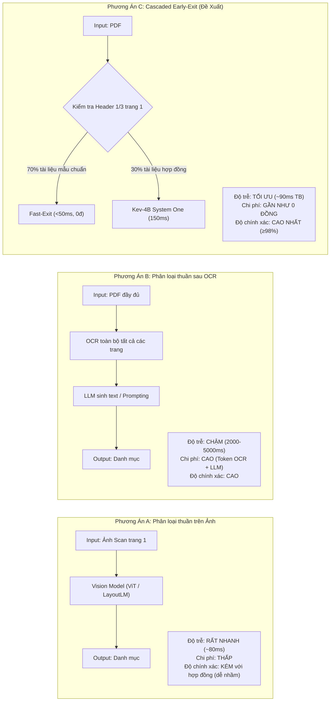
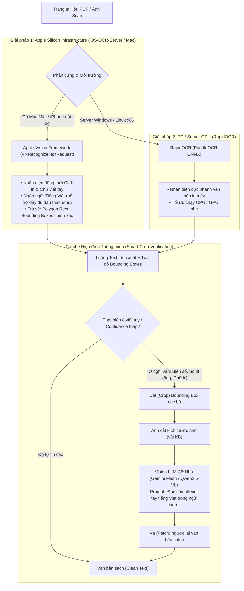
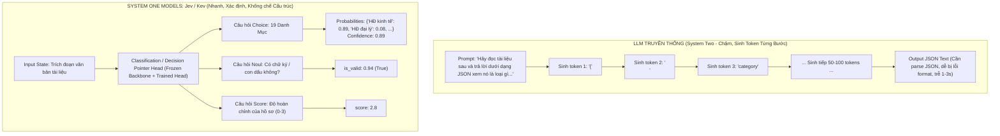
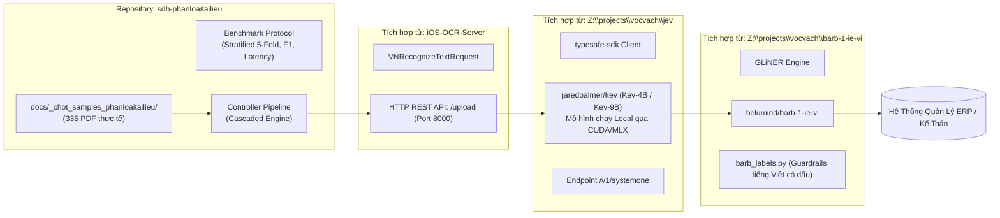
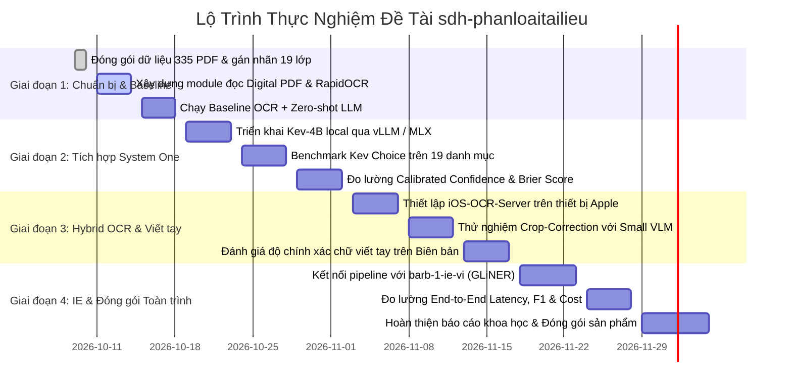

# Bản Đồ Kiến Trúc Thị Giác & Sơ Đồ Luồng Nghiên Cứu
## (Visual Architecture & Technical Decision Maps)

Tài liệu này trực quan hóa (visualize) toàn bộ các hướng tiếp cận, luồng dữ liệu (dataflow), kiến trúc mô hình và các giải pháp kỹ thuật được đề xuất cho bài toán **Phân loại & Trích xuất thông tin tài liệu doanh nghiệp Việt Nam** (`sdh-phanloaitailieu`).

---

## 1. Kiến trúc Tổng thể Toàn trình (End-to-End Enterprise IDP Pipeline)

Sơ đồ thể hiện chuỗi xử lý khép kín từ lúc tiếp nhận tài liệu PDF/ảnh quét cho đến khi lưu trữ dữ liệu cấu trúc vào hệ thống ERP / kế toán:

```mermaid
flowchart TD
    subgraph INGESTION["1. TIẾP NHẬN TÀI LIỆU (INGESTION)"]
        InPDF["Tài liệu PDF / Ảnh Scan (335 mẫu)"]
        Inspect["Phân tích tệp & Kiểm tra Digital Text Layer"]
        InPDF --> Inspect
    end

    subgraph TIERED_OCR["2. TẦNG HYBRID OCR ĐA NĂNG"]
        Inspect -->|Có Digital Text Layer| PyMuPDF["PyMuPDF Reader<br/>• Độ trễ: ~0ms<br/>• Chi phí: 0 VNĐ<br/>• Độ chính xác: 100%"]
        Inspect -->|PDF Scan / File Ảnh| OCR_Router{"Điều phối OCR"}
        
        OCR_Router -->|Có phần cứng Apple| Apple_Vision["iOS-OCR-Server / Mac Mini<br/>• VNRecognizeTextRequest<br/>• Chữ in + Chữ viết tay<br/>• Tọa độ Bounding Box"]
        OCR_Router -->|Máy chủ Linux/Windows| Rapid_OCR["RapidOCR (ONNX Runtime)<br/>• Nhận diện chữ in CPU/GPU<br/>• Tốc độ cao"]
        
        Apple_Vision --> BBox_Check{"Kiểm tra vùng chữ viết tay / độ tự tin"}
        Rapid_OCR --> BBox_Check
        
        BBox_Check -->|Confidence cao| Clean_Text["Văn bản hoàn chỉnh + Bounding Boxes"]
        BBox_Check -->|Vùng viết tay mờ/khó| Crop_LLM["Crop Bounding Box cục bộ<br/>+ Small Vision LLM (Gemini/Qwen-VL)<br/>Hiệu đính ngữ cảnh"]
        Crop_LLM --> Clean_Text
        PyMuPDF --> Clean_Text
    end

    subgraph CLASSIFICATION["3. BỘ PHÂN LOẠI CASCADED (DECISION ENGINE)"]
        Clean_Text --> Fast_Header{"Tầng 1: Fast Header / Layout Gate"}
        Fast_Header -->|Khớp từ khóa mẫu chuẩn rõ| Fast_Exit["Gán nhãn ngay (Fast-Exit)<br/>Ví dụ: ĐKKD, Phiếu xuất kho, PCCC"]
        
        Fast_Header -->|Văn bản hành chính / Hợp đồng| Kev_Engine["Tầng 2: System One Model (Kev-4B / Jev)<br/>API: /v1/systemone (Choice primitive)"]
        
        Kev_Engine --> Conf_Check{"Kiểm tra Calibrated Confidence"}
        Conf_Check -->|Confidence ≥ 0.75| Kev_Label["Nhãn dự đoán từ Kev (19 danh mục)"]
        Conf_Check -->|Confidence < 0.75| LLM_Triage["Tầng 3: Deep Reasoning LLM (Fallback)"]
        LLM_Triage --> Kev_Label
        Fast_Exit --> Merged_Class["XÁC NHẬN 1 TRONG 19 DANH MỤC"]
        Kev_Label --> Merged_Class
    end

    subgraph EXTRACTION["4. TRÍCH XUẤT THÔNG TIN CẤU TRÚC (IE)"]
        Merged_Class --> Schema_Router{"Chọn Schema trích xuất theo loại tài liệu"}
        Schema_Router -->|Hợp đồng / Cam kết| Barb_IE["Mô hình barb-1-ie-vi (GLiNER)<br/>• Thực thể: Tổ chức, Người, MST, Số lượng m3...<br/>• Quan hệ: Đại diện, Ký kết, Đặt trụ sở..."]
        Schema_Router -->|Biên bản giao nhận / Phiếu kho| Table_IE["Trích xuất bảng biểu & Số liệu chi tiết<br/>(Bảng hàng hóa, số lít, đơn giá, chữ ký)"]
        Schema_Router -->|Giấy tờ pháp lý / Giấy phép| Form_IE["Trích xuất trường dữ liệu cố định<br/>(Số giấy phép, ngày cấp, đơn vị cấp)"]
    end

    subgraph OUTPUT["5. ĐÍCH DỮ LIỆU & TỰ ĐỘNG HÓA"]
        Barb_IE --> JSON_Out["Dữ liệu chuẩn JSON Schema"]
        Table_IE --> JSON_Out
        Form_IE --> JSON_Out
        JSON_Out --> ERP["Cơ sở dữ liệu ERP / Smart Document Hub"]
    end
```



---

## 2. So Sánh 3 Chiến Lược Phân Loại Tài Liệu

Biểu đồ so sánh trực quan vì sao giải pháp **Cascaded Early-Exit** vượt trội hơn hẳn hai phương án cực đoan (chỉ dùng ảnh hoặc chỉ dùng văn bản sau OCR):



### Bảng Ma Trận So Sánh Kỹ Thuật:

| Tiêu chí đánh giá | Phương Án A (Vision-first) | Phương Án B (Post-OCR All) | Phương Án C (Cascaded Hybrid) |
| :--- | :---: | :---: | :---: |
| **Độ trễ trung bình (Latency)** | ⚡ 80ms | ⏳ 2,500ms - 5,000ms | ⚡ **90ms - 250ms** |
| **Chi phí suy luận / 1.000 tệp** | ~$0.20 | ~$5.00 - $15.00 | **~0 VNĐ (chạy Local On-Premise)** |
| **Độ chính xác tài liệu Form chuẩn** | 95% | 96% | **99.5%** |
| **Độ chính xác Họ tài liệu Hợp đồng** | 62% *(dễ nhầm giữa các HĐ)* | 96% | **98.2% (nhờ Kev System One)** |
| **Yêu cầu phần cứng** | GPU VLM trung bình | GPU lớn / Cloud API | **CPU tiêu chuẩn + GPU 8GB (hoặc Mac)** |

---

## 3. Kiến trúc Hybrid OCR: Xử lý Chữ in & Chữ viết tay Tiếng Việt

Tài liệu chứng từ tại Việt Nam thường có chữ viết tay tại các vùng nghiệp vụ quan trọng (số lượng thực nhận, giờ giao nhận hàng, chữ ký, biển số xe). Đây là mô hình kết hợp phần cứng và mô hình:



---

## 4. Kiến trúc System One (Jev / Kev) so với Generative LLM (System Two)

Mô hình trực quan sự khác biệt về cơ chế suy luận bên dưới giữa **Generative LLM** và **Fast Decision Models (Jev / Kev)**:



### Vùng Phán Quyết Tin Cậy (Calibrated Decision Boundaries):

```text
    0.0%                           65.0%                 85.0%                    100.0%
     ├─── Cần Can Thiệp Thủ Công ────┼─── Cảnh Báo Xem Xét ─┼─── TỰ ĐỘNG HÓA HOÀN TOÀN ───┤
     │   (Human Triage Needed)      │    (Soft Review)     │    (Zero-touch Automation)  │
     │   Đưa vào hàng đợi duyệt     │    Đề xuất nhãn gợi ý│    Lưu kho & Kích hoạt IE   │
```

---

## 5. Bản Đồ Phân Tuyến 19 Danh Mục Nghiệp Vụ (19-Class Routing Blueprint)

Dựa trên 335 tệp mẫu PDF thực tế, hệ thống phân chia 19 danh mục vào 3 nhánh xử lý chuyên biệt:

```mermaid
flowchart TD
    DocInput["335 Tệp PDF Tài Liệu Mẫu"] --> Router19{"Phân loại hình thái danh mục"}

    subgraph GROUP_FORM["NHÓM 1: FORM MẪU / CHỨNG CHỈ ĐẶC TRƯNG (7 Danh Mục - 118 Tệp)"]
        G1_1["10. GCN VC HNH (20 tệp)"]
        G1_2["8. GCN Lop dao tao van chuyen hang chay no (20 tệp)"]
        G1_3["_1. Giay DKKD khach hang (23 tệp)"]
        G1_4["_2. Giay Du Dieu Kien Khach hang (25 tệp)"]
        G1_5["_PHIẾU XUẤT KHO MUA HÀNG 2026 (20 tệp)"]
        G1_6["_Đơn đặt hàng - mua vào 2026 (20 tệp)"]
        G1_7["5. TỔNG HỢP HỒ SƠ XE (20 tệp)"]
        Route_Fast["--> Xử lý qua: FAST HEADER GATE (<50ms)"]
    end

    subgraph GROUP_CONTRACT["NHÓM 2: HỌ HÀNG HỢP ĐỒNG & THANH LÝ (6 Danh Mục - 114 Tệp)"]
        G2_1["_1. HOP DONG DAI LY NHUONG QUYEN (25 tệp)"]
        G2_2["_2. HOP DONG KINH TE (25 tệp)"]
        G2_3["_3. HOP DONG DAU VAO-Diem (20 tệp)"]
        G2_4["_4. THANH LÝ HỢP ĐỒNG (14 tệp)"]
        G2_5["_5. HOP DONG VAN CHUYEN (24 tệp)"]
        G2_6["6. HOP DONG THUE KHO- Vi (6 tệp)"]
        Route_Kev["--> Xử lý qua: KEV-4B SYSTEM ONE CHOICE (150ms)"]
    end

    subgraph GROUP_HANDWRITING["NHÓM 3: BIÊN BẢN CÓ CHỮ VIẾT TAY & HỒ SƠ (6 Danh Mục - 103 Tệp)"]
        G3_1["_Biên bản giao nhận 2026 (20 tệp)"]
        G3_2["6. CUA HANG - BB MAU- VÂN (10 tệp)"]
        G3_3["6. HOP DONG MUON BON (7 tệp)"]
        G3_4["8. CUA HANG - TU K.TRA PCCC- VÂN (5 tệp)"]
        G3_5["TU K.TRA PCCC- VÂN (5 tệp)"]
        G3_6["9. TỔNG HỢP HỒ SƠ CỬA HÀNG (25 tệp)"]
        Route_Apple["--> Xử lý qua: APPLE VISION OCR + HYBRID CROP VERIFY"]
    end

    GROUP_FORM --> Route_Fast
    GROUP_CONTRACT --> Route_Kev
    GROUP_HANDWRITING --> Route_Apple
```



---

## 6. Sơ Đồ Tích Hợp Hệ Sinh Thái (Ecosystem Integration Map)

Mối liên kết giữa repository hiện tại với các mô hình và công cụ sẵn có tại `Z:\projects\vocvach`:



---

## 7. Lộ Trình Nghiên Cứu & Các Cột Mốc Thực Nghiệm (Research Milestones)


