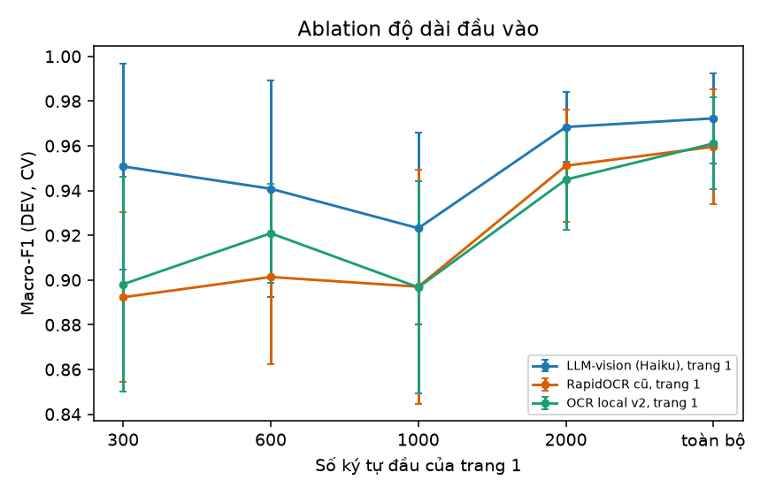
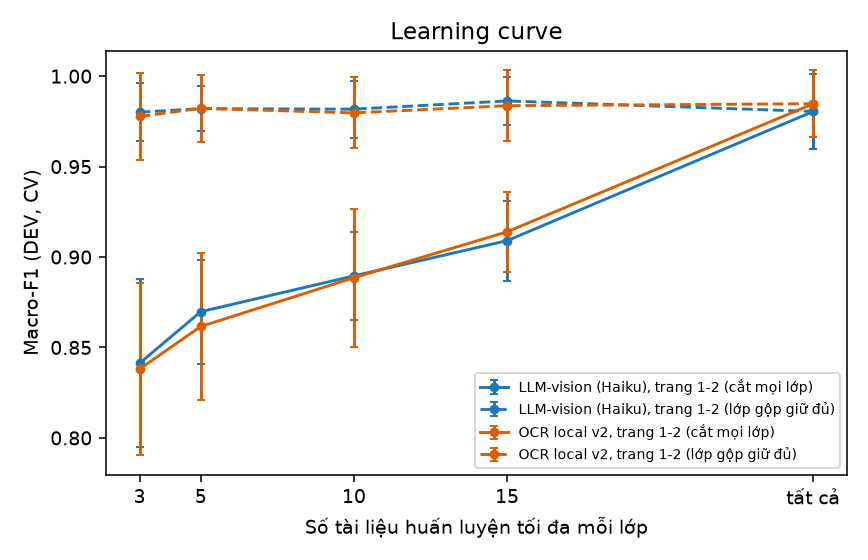
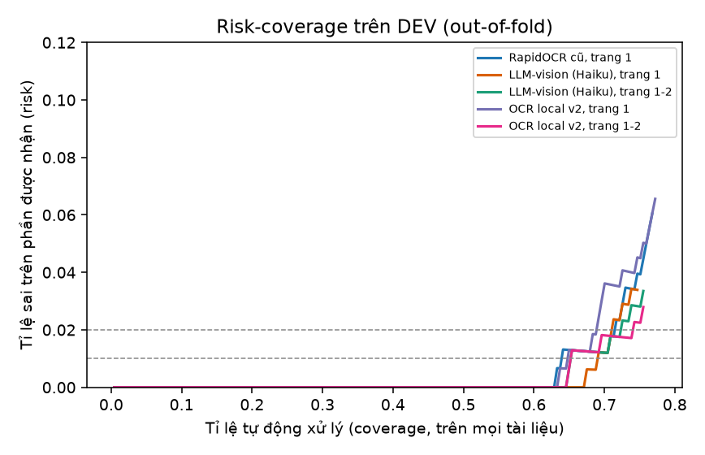

# Thí nghiệm 01 - Baseline phân loại cổ điển (CPU): TF-IDF + mô hình tuyến tính, cổng luật, baseline ảnh

> **Lưu ý về nhãn.** Mọi số liệu dưới đây dùng `data/labels_v2.csv`: nhãn do **hai lượt gán nhãn độc lập của các mô hình AI** (annotator A nhìn ảnh trang,
> annotator B chỉ đọc văn bản Haiku, không thấy nhãn của A và không thấy thư mục cũ) cho 304 tài liệu duy nhất; hai lượt trùng nhau 304/304 (Cohen kappa = 1.0 trên `doc_type`).
> **Chưa được nhân viên công ty kiểm chứng.** Hai annotator là mô hình cùng họ, cùng làm theo một hướng dẫn gán nhãn, nên **lỗi hệ thống chung vẫn có thể tồn tại**;
> độ đồng thuận hoàn hảo không chứng minh nhãn đúng. Khi nhãn đổi, chạy lại hai lệnh ở mục 3 là có toàn bộ bảng mới.
>
> **Lưu ý về cách đọc.** Các bảng nằm giữa các dấu `<!-- BEGIN:... -->` được `run_all.py` tự sinh lại. Các đoạn "Đọc kết quả" do người viết dựa trên lần chạy ngày 2026-10-11
> (nhãn `labels_v2.csv`, sha1[:10] = `eb3348713a`); sau khi chạy lại với nhãn khác phải rà lại các con số trong các đoạn đó.
> Các nguồn văn bản đã đo: RapidOCR cũ (trang 1), LLM-vision Haiku (trang 1 và 1-2) và **OCR local v2 (VietOCR, `data/ocr_v2.jsonl`; trang 1 và 1-2)**. Nguồn `ocr_v2_*` được thêm
> vào ở một lượt chạy bổ sung (mục 0) khi file `ocr_v2.jsonl` đã hoàn tất; các số của ba nguồn cũ **không đổi** (DEV tái lập đến sai số máy; TEST không chấm lại). LLM-vision **không dùng được on-premise**,
> nên cột Haiku là *cận trên* của điều kiện "OCR gần hoàn hảo"; cột `ocr_v2_*` mới là **con số gần điều kiện triển khai on-premise**.

## 0. Cập nhật: nguồn `ocr_v2` (OCR local VietOCR) - lượt chạy bổ sung

Lệnh đã chạy (cùng nhãn `labels_v2.csv`, sha `eb3348713a`; thêm ba cờ vào `run_all.py` để KHÔNG ghi đè `data/splits/` và KHÔNG chấm lại TEST của nguồn cũ):

```
# DEV: chạy lại toàn bộ lưới (nguồn ocr_v2_* tự được thêm); chỉ ghi vào results_table.csv các dòng ocr_v2_*
.venv\Scripts\python.exe -X utf8 teams\team3_classification\experiments\01_classical_baselines\run_all.py --labels data\labels_v2.csv --jobs 24 --keep-splits --results-sources ocr_v2_p1 ocr_v2_p12
# TEST: chỉ chấm hai nguồn mới (nguồn cũ bị từ chối chấm lại; dự đoán cũ chỉ được ĐỌC lại từ errors_test_*.csv để ghép cặp)
.venv\Scripts\python.exe -X utf8 teams\team3_classification\experiments\01_classical_baselines\run_all.py --labels data\labels_v2.csv --final-test --final-sources ocr_v2_p1 ocr_v2_p12 --results-sources ocr_v2_p1 ocr_v2_p12
```

Kiểm tra dữ liệu `ocr_v2.jsonl`: 336 tài liệu, 1084 trang, **0 trang lỗi** (trường `error` rỗng ở mọi trang), nguồn trang `ocr` 1020 / `text_layer` 61 / `embedded_ocr_layer+ocr` 3, không tài liệu nào rỗng
(ít nhất 549 ký tự/tài liệu cho trang 1-2; trang 1 trung vị 1493 ký tự, ngắn nhất 38). Chi tiết ở `teams/team1_ocr/experiments/02_dataset_v2/RESULTS.md`. Lần chạy DEV đầu tiên của lượt bổ sung bị sập ở bước ablation độ dài
(`ValueError: After pruning, no terms remain`) và **không tái hiện được** khi chạy lại từng tác vụ riêng lẻ lẫn toàn bộ; lần chạy lại thứ hai hoàn tất bình thường (không rõ nguyên nhân; nghi do chạy song song 28 tiến trình trong lúc máy bận) -
mọi số trong tệp này lấy từ lần chạy thành công.

Đã đo (DEV, macro-F1 trung bình ± std, 3 seed x 5 fold): `ocr_v2_p12` + ComplementNB **0.977 ± 0.019** (Haiku trang 1-2: 0.976 ± 0.018; RapidOCR cũ trang 1: 0.960 ± 0.026); `ocr_v2_p1` 0.961 ± 0.021. Chênh lệch ghép cặp theo fold
`haiku_p12 - ocr_v2_p12` = -0.001 (std 0.007; 1 fold hơn, 13 hòa, 1 kém): **không phân biệt được**. TEST (chấm một lần): cấu hình xếp hạng 1 trên DEV cho `ocr_v2_p12` đạt macro-F1 **0.946 [0.847; 1.000]**,
accuracy 0.949 [0.881; 1.000]; "á quân" (biến thể có bỏ dấu của cùng mô hình) 0.974 [0.928; 1.000]; `ocr_v2_p1` 0.938 [0.847; 0.990]. Hiệu ghép cặp Haiku trang 1-2 - ocr_v2 trang 1-2 = +0.028 [0.000; 0.109], p = 0.74: **không tách được**.
Auto-file TEST với ngưỡng DEV, `ocr_v2_p12`: ở mức sai <= 1% là 61.0% [49.2; 72.9] (0 lỗi trong 36 tài liệu được nhận); ở <= 2% là 78.0% [67.8; 88.1] với **1 lỗi** trong 46 (2.2%).
Cổng luật (Track Z, trên `ocr_v2_p12`): coverage 0.764 (DEV) / 0.847 (TEST), accuracy-on-covered 1.000 ở cả hai (coverage hơi thấp hơn RapidOCR cũ, 0.80 trên DEV). Độ trễ phân loại TF-IDF trên ocr_v2_p12: median 2.8 ms, p95 4.5 ms.
Kết luận (đo được): **văn bản OCR local VietOCR cho cùng chất lượng phân loại mười lớp như cận trên Haiku, trong khoảng nhiễu**; các kết luận ở mục 7a vẫn đứng vững, và nay có thêm bằng chứng trực tiếp cho điều kiện on-premise.
Lưu ý: các hình/bảng "learning curve" và "đo độ trễ" ở dưới được chạy lại với cặp nguồn (haiku_p12, ocr_v2_p12); các dòng RapidOCR cũ của learning curve được giữ nguyên từ lần chạy trước.

## 1. Mục tiêu

Trả lời bằng phép đo (không bằng cảm tính) cho nhóm sinh viên tiếp tục đề tài và cho ban điều hành quyết định triển khai:

1. Một baseline rẻ (TF-IDF + mô hình tuyến tính, chạy CPU vài mili-giây) phân loại được bao nhiêu phần tài liệu, và đáng tin đến đâu?
2. Chất lượng OCR có quan trọng cho **phân loại** không, hay chỉ quan trọng cho **trích xuất**?
3. Cần bao nhiêu tài liệu mẫu cho một loại tài liệu **mới**?
4. Có thể **tự động xếp hồ sơ** (không cần người) cho bao nhiêu phần trăm tài liệu với tỉ lệ sai <= 1% / <= 2%? (KPI nghiệp vụ)
5. Ảnh trang giấy có thay được văn bản không?

## 2. Giao thức bằng lời thường (bản quy chuẩn: `teams/00_data_and_eval/reports/03_evaluation_protocol.md`)

- **Đơn vị chấm là tài liệu duy nhất.** 336 file PDF chứa 304 tài liệu duy nhất (32 file là bản sao byte-giống-hệt). Nếu tính cả bản sao, cùng một tờ giấy vừa nằm trong tập huấn luyện vừa
  nằm trong tập kiểm tra và điểm số bị thổi phồng. Các bản sao phải cùng nhãn (đã kiểm tra: 0 xung đột). 8 file gồm **nhiều loại tài liệu khác nhau trong một PDF** (composite hỗn hợp)
  không có một nhãn duy nhất nên bị loại khỏi benchmark và chuyển cho nhóm tách trang (`data/splits/excluded_composites.csv`).
- **Hai track nhãn.** Track S (có huấn luyện): chỉ ~10 loại có >= 10 tài liệu mới đủ dữ liệu để học; mọi loại hiếm còn lại gộp thành `RARE_OR_OTHER` - đây là lớp "hãy đưa cho người",
  một hệ thống thực tế phải biết nhận ra tài liệu lạ thay vì ép vào loại sai. Track Z (zero-shot): toàn bộ 34 loại cho phương pháp không cần dữ liệu huấn luyện (cổng luật hôm nay; LLM sau này).
- **Chia theo nhóm biểu mẫu.** Nhiều tài liệu là *cùng một mẫu biểu* điền cho khách hàng/ngày khác nhau. Nếu mẫu đó xuất hiện cả ở train lẫn test, mô hình chỉ cần "nhớ mẫu" và điểm cao giả tạo.
  Vì vậy các tài liệu cùng `template_group` luôn đi cùng một phía (`StratifiedGroupKFold`).
- **Tập TEST khóa (~20%).** Mọi lựa chọn (đặc trưng, siêu tham số, ngưỡng) chỉ dùng CV 5-fold trên DEV (~80%), lặp 3 seed. TEST chỉ mở bằng một lệnh riêng `--final-test`, **mỗi cấu hình đã chốt đúng một lần**;
  nhìn TEST rồi chỉnh tiếp là tự lừa mình. Script từ chối chạy lại nếu TEST đã được chấm cho bộ nhãn đó.
- **Nhóm biểu mẫu quá lớn.** Một mẫu chiếm 23/24 chứng chỉ tập huấn (CC_TAP_HUAN_VC_HNH) và một mẫu chiếm 15/15 phiếu xuất kho. Chia nghiêm ngặt thì cả lớp rơi vào một phía (thấy rõ ở mục 6).
  Chia **chính thức** (`splits.csv`) cắt nhóm > 5 tài liệu thành các nhóm con <= 5, chấp nhận một chút rò rỉ biểu mẫu để lớp đó có mặt cả hai phía; biến thể nghiêm ngặt (`splits_strict.csv`) được dùng để đo riêng.
  *Điều này lệch khỏi chữ "group = template_group" của đề bài, vì làm đúng chữ thì không đánh giá được hai lớp lớn; xem `data/splits/README.md`.*
- **Độ bất định.** DEV: trung bình ± độ lệch chuẩn của 15 điểm (3 seed x 5 fold). TEST: khoảng tin cậy 95% bootstrap percentile (2000 lần lấy mẫu lại theo tài liệu) và bootstrap ghép cặp để so hai phương pháp.
  TEST chỉ có **59 tài liệu**, nên khoảng tin cậy rộng; khi nó chứa 0 ta nói "không tách được", không nói "hơn".

## 3. Lệnh chạy chính xác

```
# (1) giai đoạn DEV: sinh splits, mọi bảng, biểu đồ, cấu hình đã chốt (khoảng 8 phút với --jobs 28)
.venv\Scripts\python.exe -X utf8 teams\team3_classification\experiments\01_classical_baselines\run_all.py --labels data\labels_v2.csv --jobs 16

# (2) giai đoạn TEST: chấm đúng 1 lần các cấu hình đã chốt ở bước (1) (tự từ chối nếu nhãn đổi hoặc TEST đã chấm)
.venv\Scripts\python.exe -X utf8 teams\team3_classification\experiments\01_classical_baselines\run_all.py --labels data\labels_v2.csv --final-test

# vẽ lại các bảng trong tệp này từ CSV đã lưu (không tính lại): thêm --render-dev-only hoặc --render-test-only
# kiểm thử harness (chia không rò rỉ, TEST bị khóa, chỉ số, tất định)
.venv\Scripts\python.exe -X utf8 -m pytest teams/00_data_and_eval/tests -q
```

Đầu ra: `teams/team3_classification/results/01_classical_baselines/{tables,figs}/` (CSV từng bảng, ma trận nhầm lẫn, per-class, danh sách lỗi - **có tên file, đừng đưa ra ngoài**) và các dòng thêm vào
`teams/team3_classification/results/results_table.csv` (bảng chung, xem quy tắc trong `03_evaluation_protocol.md` mục 9).

## 4. Dữ liệu sau khi lọc

<!-- BEGIN:dataset -->
- File PDF: 336; tài liệu duy nhất: 304; loại bỏ composite hỗn hợp: 8; **benchmark: 296 tài liệu** (34 loại, trước khi loại composite).
- Track S: 10 lớp có >= 10 tài liệu + lớp gộp `RARE_OR_OTHER` (24 loại, 74 tài liệu).
- DEV = 237 tài liệu, TEST (khóa) = 59 tài liệu. Xung đột nhãn giữa các bản sao: 0.
- Nhãn: `labels_v2.csv` (sha1[:10] = `eb3348713a`).

| lớp (Track S) | DEV | TEST | tổng |
|---|---|---|---|
| GCN_DKDN | 28 | 7 | 35 |
| HD_MUA_BAN | 26 | 6 | 32 |
| GCN_DDK_BAN_LE_XD | 21 | 6 | 27 |
| HD_VAN_CHUYEN | 20 | 5 | 25 |
| CC_TAP_HUAN_VC_HNH | 19 | 5 | 24 |
| BB_GIAO_NHAN_HANG_HOA | 16 | 4 | 20 |
| DON_DAT_HANG | 16 | 4 | 20 |
| PHIEU_XUAT_KHO | 10 | 5 | 15 |
| BB_THANH_LY_HD | 11 | 3 | 14 |
| BB_LAY_MAU | 7 | 3 | 10 |
| RARE_OR_OTHER | 63 | 11 | 74 |
<!-- END:dataset -->

Phần "RARE_OR_OTHER" chiếm khoảng một phần tư tài liệu và rất không đồng nhất (24 loại khác nhau): đó là lý do macro-F1 và các số "tự động xếp hồ sơ" phải đọc cùng nhau.

## 5. Kết quả DEV (CV 5-fold x 3 seed, mean ± std của macro-F1, Track S)

Mỗi ô là cấu hình C tốt nhất trong lưới nhỏ (LR: C in {1,10,100}; LinearSVC: {0.1,1}; ComplementNB alpha in {0.1,0.5}) *chọn trong chính DEV*, nên số DEV hơi lạc quan; TEST (mục 6) không bị lỗi này.

<!-- BEGIN:dev_main -->
| method | legacy_p1 | haiku_p1 | haiku_p12 | ocr_v2_p1 | ocr_v2_p12 |
|---|---|---|---|---|---|
| majority | 0.041 ± 0.006 | 0.041 ± 0.006 | 0.041 ± 0.006 | 0.041 ± 0.006 | 0.041 ± 0.006 |
| rule gate -> Track S (không huấn luyện) | 0.809 ± 0.084 | 0.775 ± 0.069 | 0.768 ± 0.068 | 0.787 ± 0.066 | 0.779 ± 0.066 |
| TF-IDF từ 1-2 + LogisticRegression [bỏ dấu] | 0.944 ± 0.057 (C=100) | 0.972 ± 0.020 (C=1) | 0.963 ± 0.049 (C=10) | 0.957 ± 0.041 (C=1) | 0.968 ± 0.044 (C=100) |
| TF-IDF từ 1-2 + LogisticRegression [giữ dấu] | 0.942 ± 0.058 (C=100) | 0.963 ± 0.040 (C=1) | 0.960 ± 0.044 (C=100) | 0.952 ± 0.052 (C=1) | 0.962 ± 0.048 (C=10) |
| TF-IDF ký tự 2-5 + LogisticRegression [bỏ dấu] | 0.935 ± 0.055 (C=10) | 0.941 ± 0.049 (C=100) | 0.960 ± 0.048 (C=10) | 0.943 ± 0.054 (C=10) | 0.957 ± 0.049 (C=10) |
| TF-IDF ký tự 2-5 + LogisticRegression [giữ dấu] | 0.935 ± 0.053 (C=100) | 0.947 ± 0.048 (C=100) | 0.959 ± 0.046 (C=100) | 0.946 ± 0.054 (C=10) | 0.960 ± 0.048 (C=10) |
| TF-IDF ký tự 2-5 + LinearSVC (hiệu chỉnh) [bỏ dấu] | 0.934 ± 0.060 (C=1) | 0.937 ± 0.051 (C=1) | 0.961 ± 0.049 (C=1) | 0.942 ± 0.058 (C=1) | 0.956 ± 0.053 (C=1) |
| TF-IDF ký tự 2-5 + LinearSVC (hiệu chỉnh) [giữ dấu] | 0.935 ± 0.058 (C=1) | 0.943 ± 0.052 (C=1) | 0.963 ± 0.045 (C=1) | 0.943 ± 0.055 (C=1) | 0.956 ± 0.051 (C=1) |
| TF-IDF từ 1-2 + ComplementNB [bỏ dấu] | 0.960 ± 0.026 (C=0.1) | 0.958 ± 0.023 (C=0.5) | 0.976 ± 0.018 (C=0.1) | 0.961 ± 0.021 (C=0.5) | 0.976 ± 0.018 (C=0.1) |
| TF-IDF từ 1-2 + ComplementNB [giữ dấu] | 0.941 ± 0.051 (C=0.1) | 0.954 ± 0.023 (C=0.1) | 0.974 ± 0.020 (C=0.1) | 0.957 ± 0.023 (C=0.1) | 0.977 ± 0.019 (C=0.1) |
| ảnh trang 1: visual_hog_lr_C10 | - | - | 0.814 ± 0.086 | - | - |
| ảnh trang 1: visual_hog_lr_C1 | - | - | 0.803 ± 0.090 | - | - |
| ảnh trang 1: visual_thumb_lr_C1 | - | - | 0.704 ± 0.086 | - | - |
| ảnh trang 1: visual_thumb_lr_C10 | - | - | 0.694 ± 0.087 | - | - |
<!-- END:dev_main -->

Chi tiết cấu hình tốt nhất (kèm accuracy, ECE, Brier trên dự đoán out-of-fold của seed 0):

<!-- BEGIN:best_c -->
| source | config | macro_f1_mean | macro_f1_std | accuracy_mean | ece_oof_seed0 | brier_oof_seed0 |
|---|---|---|---|---|---|---|
| haiku_p1 | tfidf_char_lr_raw_C100 | 0.947 | 0.048 | 0.973 | 0.051 | 0.042 |
| haiku_p1 | tfidf_char_lr_fold_C100 | 0.941 | 0.049 | 0.968 | 0.053 | 0.047 |
| haiku_p1 | tfidf_char_svc_raw_C1 | 0.943 | 0.052 | 0.965 | 0.202 | 0.083 |
| haiku_p1 | tfidf_char_svc_fold_C1 | 0.937 | 0.051 | 0.961 | 0.190 | 0.086 |
| haiku_p1 | tfidf_word_cnb_raw_C0.1 | 0.954 | 0.023 | 0.941 | 0.048 | 0.092 |
| haiku_p1 | tfidf_word_cnb_fold_C0.5 | 0.958 | 0.023 | 0.945 | 0.178 | 0.176 |
| haiku_p1 | tfidf_word_lr_raw_C1 | 0.963 | 0.040 | 0.961 | 0.433 | 0.297 |
| haiku_p1 | tfidf_word_lr_fold_C1 | 0.972 | 0.020 | 0.966 | 0.446 | 0.302 |
| haiku_p12 | tfidf_char_lr_raw_C100 | 0.959 | 0.046 | 0.971 | 0.050 | 0.041 |
| haiku_p12 | tfidf_char_lr_fold_C10 | 0.960 | 0.048 | 0.969 | 0.162 | 0.089 |
| haiku_p12 | tfidf_char_svc_raw_C1 | 0.963 | 0.045 | 0.975 | 0.198 | 0.078 |
| haiku_p12 | tfidf_char_svc_fold_C1 | 0.961 | 0.049 | 0.972 | 0.196 | 0.081 |
| haiku_p12 | tfidf_word_cnb_raw_C0.1 | 0.974 | 0.020 | 0.966 | 0.069 | 0.076 |
| haiku_p12 | tfidf_word_cnb_fold_C0.1 | 0.976 | 0.018 | 0.969 | 0.077 | 0.081 |
| haiku_p12 | tfidf_word_lr_raw_C100 | 0.960 | 0.044 | 0.968 | 0.039 | 0.036 |
| haiku_p12 | tfidf_word_lr_fold_C10 | 0.963 | 0.049 | 0.972 | 0.135 | 0.072 |
| legacy_p1 | tfidf_char_lr_raw_C100 | 0.935 | 0.053 | 0.959 | 0.075 | 0.060 |
| legacy_p1 | tfidf_char_lr_fold_C10 | 0.935 | 0.055 | 0.961 | 0.204 | 0.122 |
| legacy_p1 | tfidf_char_svc_raw_C1 | 0.935 | 0.058 | 0.961 | 0.206 | 0.097 |
| legacy_p1 | tfidf_char_svc_fold_C1 | 0.934 | 0.060 | 0.959 | 0.201 | 0.094 |
| legacy_p1 | tfidf_word_cnb_raw_C0.1 | 0.941 | 0.051 | 0.944 | 0.087 | 0.123 |
| legacy_p1 | tfidf_word_cnb_fold_C0.1 | 0.960 | 0.026 | 0.948 | 0.097 | 0.119 |
| legacy_p1 | tfidf_word_lr_raw_C100 | 0.942 | 0.058 | 0.965 | 0.067 | 0.055 |
| legacy_p1 | tfidf_word_lr_fold_C100 | 0.944 | 0.057 | 0.969 | 0.066 | 0.049 |
| ocr_v2_p1 | tfidf_char_lr_raw_C10 | 0.946 | 0.054 | 0.971 | 0.184 | 0.099 |
| ocr_v2_p1 | tfidf_char_lr_fold_C10 | 0.943 | 0.054 | 0.968 | 0.189 | 0.106 |
| ocr_v2_p1 | tfidf_char_svc_raw_C1 | 0.943 | 0.055 | 0.966 | 0.199 | 0.083 |
| ocr_v2_p1 | tfidf_char_svc_fold_C1 | 0.942 | 0.058 | 0.966 | 0.197 | 0.086 |
| ocr_v2_p1 | tfidf_word_cnb_raw_C0.1 | 0.957 | 0.023 | 0.944 | 0.072 | 0.103 |
| ocr_v2_p1 | tfidf_word_cnb_fold_C0.5 | 0.961 | 0.021 | 0.951 | 0.202 | 0.184 |
| ocr_v2_p1 | tfidf_word_lr_raw_C1 | 0.952 | 0.052 | 0.952 | 0.462 | 0.327 |
| ocr_v2_p1 | tfidf_word_lr_fold_C1 | 0.957 | 0.041 | 0.956 | 0.450 | 0.315 |
| ocr_v2_p12 | tfidf_char_lr_raw_C10 | 0.960 | 0.048 | 0.971 | 0.175 | 0.094 |
| ocr_v2_p12 | tfidf_char_lr_fold_C10 | 0.957 | 0.049 | 0.969 | 0.185 | 0.101 |
| ocr_v2_p12 | tfidf_char_svc_raw_C1 | 0.956 | 0.051 | 0.966 | 0.192 | 0.078 |
| ocr_v2_p12 | tfidf_char_svc_fold_C1 | 0.956 | 0.053 | 0.968 | 0.192 | 0.081 |
| ocr_v2_p12 | tfidf_word_cnb_raw_C0.1 | 0.977 | 0.019 | 0.969 | 0.091 | 0.087 |
| ocr_v2_p12 | tfidf_word_cnb_fold_C0.1 | 0.976 | 0.018 | 0.969 | 0.084 | 0.085 |
| ocr_v2_p12 | tfidf_word_lr_raw_C10 | 0.962 | 0.048 | 0.971 | 0.151 | 0.080 |
| ocr_v2_p12 | tfidf_word_lr_fold_C100 | 0.968 | 0.044 | 0.973 | 0.051 | 0.036 |
<!-- END:best_c -->

**Đọc kết quả.**
- Đã đo: các phương pháp TF-IDF nằm trong dải 0.93-0.98 macro-F1 và chênh nhau thường **< 0.02, trong khi độ lệch chuẩn giữa các fold là 0.02-0.06**. Nghĩa là trên DEV **không thể xếp hạng** các họ
  mô hình (từ/ký tự, LR/SVC/NB, có/không bỏ dấu); `ComplementNB` đứng đầu ở hai nguồn chỉ vì trung bình nhỉnh hơn một chút. Bỏ dấu không gây hại ở đâu, và chỉ có ý nghĩa rõ với văn bản OCR cũ
  (CNB: 0.941 -> 0.960), điều hợp lý vì OCR cũ lẫn chữ có dấu và không dấu.
- Baseline "majority" chỉ 0.04 macro-F1; cổng luật quy về Track S đạt 0.77-0.81 (không huấn luyện, độ chính xác trên phần nó quyết định là 100% - xem mục 9); baseline ảnh tốt nhất (HOG) 0.81; mọi mô hình văn bản cao hơn rõ rệt.
- Suy luận (chưa chứng minh): mười loại lớn gần như tự nhận ra qua **tiêu đề**, nên bài toán này dễ với mô hình văn bản đơn giản; phần khó thật sự là nhận ra tài liệu *không thuộc* mười loại đó (mục 10).

## 6. Kết quả TEST (khóa; chấm đúng 1 lần, cấu hình chốt trên DEV)

Với mỗi nguồn văn bản: hai cấu hình đứng đầu theo macro-F1 DEV (cột `rank` 1 và 2), cộng cổng luật (quy về Track S); với nguồn Haiku trang 1-2 có thêm majority và baseline ảnh.
Lưu ý: "á quân" theo DEV thường chỉ là biến thể giữ dấu/bỏ dấu của cùng một mô hình nên hai dòng gần như trùng nhau; so sánh có ích hơn là giữa nguồn, với cổng luật và với ảnh (bảng ghép cặp).

<!-- BEGIN:test_main -->
| source | config | rank | n | macro_f1 [CI 95%] | accuracy | weighted_f1 | ece | brier |
|---|---|---|---|---|---|---|---|---|
| legacy_p1 | tfidf_word_cnb_fold_C0.1 | 1 | 59 | 0.918 [0.831; 0.991] | 0.932 [0.864; 0.983] | 0.925 | 0.077 | 0.126 |
| legacy_p1 | tfidf_word_cnb_fold_C0.5 | 2 | 59 | 0.908 [0.821; 0.982] | 0.915 [0.831; 0.983] | 0.908 | 0.190 | 0.210 |
| legacy_p1 | rule_gate_mapped_to_S |  | 59 | 0.841 [0.758; 0.925] | 0.864 [0.780; 0.949] | 0.851 |  |  |
| haiku_p1 | tfidf_word_lr_fold_C1 | 1 | 59 | 0.963 [0.905; 1.000] | 0.949 [0.881; 1.000] | 0.948 | 0.385 | 0.277 |
| haiku_p1 | tfidf_word_lr_raw_C1 | 2 | 59 | 0.963 [0.905; 1.000] | 0.949 [0.881; 1.000] | 0.948 | 0.386 | 0.270 |
| haiku_p1 | rule_gate_mapped_to_S |  | 59 | 0.875 [0.827; 0.975] | 0.915 [0.847; 0.983] | 0.896 |  |  |
| haiku_p12 | tfidf_word_cnb_fold_C0.1 | 1 | 59 | 0.974 [0.928; 1.000] | 0.966 [0.915; 1.000] | 0.967 | 0.074 | 0.092 |
| haiku_p12 | tfidf_word_cnb_raw_C0.1 | 2 | 59 | 0.974 [0.928; 1.000] | 0.966 [0.915; 1.000] | 0.967 | 0.075 | 0.080 |
| haiku_p12 | rule_gate_mapped_to_S |  | 59 | 0.854 [0.790; 0.945] | 0.881 [0.797; 0.966] | 0.866 |  |  |
| haiku_p12 | majority |  | 59 | 0.029 [0.014; 0.041] | 0.186 [0.085; 0.288] | 0.059 | 0.079 | 0.903 |
| image_p1 | visual_hog_lr_C10 |  | 59 | 0.706 [0.610; 0.794] | 0.729 [0.610; 0.847] | 0.703 | 0.072 | 0.379 |
| ocr_v2_p1 | tfidf_word_cnb_fold_C0.5 | 1 | 59 | 0.938 [0.847; 0.990] | 0.932 [0.864; 0.983] | 0.930 | 0.175 | 0.185 |
| ocr_v2_p1 | tfidf_word_cnb_fold_C0.1 | 2 | 59 | 0.945 [0.856; 1.000] | 0.949 [0.881; 1.000] | 0.949 | 0.079 | 0.108 |
| ocr_v2_p1 | rule_gate_mapped_to_S |  | 59 | 0.875 [0.827; 0.975] | 0.915 [0.847; 0.983] | 0.896 |  |  |
| ocr_v2_p12 | tfidf_word_cnb_raw_C0.1 | 1 | 59 | 0.946 [0.847; 1.000] | 0.949 [0.881; 1.000] | 0.950 | 0.075 | 0.094 |
| ocr_v2_p12 | tfidf_word_cnb_fold_C0.1 | 2 | 59 | 0.974 [0.928; 1.000] | 0.966 [0.915; 1.000] | 0.967 | 0.090 | 0.102 |
| ocr_v2_p12 | rule_gate_mapped_to_S |  | 59 | 0.854 [0.790; 0.945] | 0.881 [0.797; 0.966] | 0.866 |  |  |
<!-- END:test_main -->

So sánh ghép cặp trên TEST (A trừ B, bootstrap ghép cặp 2000 lần; `separable = True` khi CI 95% không chứa 0):

<!-- BEGIN:test_pairs -->
| comparison | Δ macro-F1 [CI] | macro_f1_p_value | macro_f1_separable | Δ accuracy [CI] | accuracy_p_value | accuracy_separable |
|---|---|---|---|---|---|---|
| legacy_p1: top1 vs top2 (DEV) | 0.010 [-0.010; 0.047] | 0.720 | False | 0.017 [0.000; 0.051] | 0.727 | False |
| legacy_p1: top1 vs rule gate | 0.077 [-0.023; 0.176] | 0.163 | False | 0.068 [-0.017; 0.169] | 0.221 | False |
| nguồn haiku_p12 vs legacy_p1 (top1 mỗi nguồn) | 0.056 [-0.004; 0.122] | 0.251 | False | 0.034 [0.000; 0.085] | 0.281 | False |
| haiku_p1: top1 vs top2 (DEV) | 0.000 [0.000; 0.000] | 1.000 | False | 0.000 [0.000; 0.000] | 1.000 | False |
| haiku_p1: top1 vs rule gate | 0.088 [-0.009; 0.146] | 0.072 | False | 0.034 [-0.051; 0.119] | 0.625 | False |
| nguồn haiku_p12 vs haiku_p1 (top1 mỗi nguồn) | 0.011 [-0.009; 0.052] | 0.676 | False | 0.017 [0.000; 0.051] | 0.727 | False |
| haiku_p12: top1 vs top2 (DEV) | 0.000 [0.000; 0.000] | 1.000 | False | 0.000 [0.000; 0.000] | 1.000 | False |
| haiku_p12: top1 vs rule gate | 0.121 [0.025; 0.195] | 0.022 | True | 0.085 [-0.017; 0.186] | 0.123 | False |
| văn bản vs ảnh (nguồn chính) | 0.269 [0.184; 0.360] | 0.000 | True | 0.237 [0.136; 0.356] | 0.000 | True |
| ocr_v2_p1: top1 vs top2 (DEV) | -0.007 [-0.047; 0.026] | 0.849 | False | -0.017 [-0.051; 0.000] | 0.727 | False |
| ocr_v2_p1: top1 vs rule gate | 0.063 [-0.040; 0.132] | 0.242 | False | 0.017 [-0.068; 0.102] | 0.864 | False |
| nguồn haiku_p12 vs ocr_v2_p1 (top1 mỗi nguồn) | 0.036 [-0.005; 0.123] | 0.257 | False | 0.034 [0.000; 0.085] | 0.278 | False |
| ocr_v2_p12: top1 vs top2 (DEV) | -0.028 [-0.109; 0.000] | 0.744 | False | -0.017 [-0.051; 0.000] | 0.744 | False |
| ocr_v2_p12: top1 vs rule gate | 0.093 [-0.016; 0.178] | 0.098 | False | 0.068 [-0.017; 0.169] | 0.201 | False |
| nguồn haiku_p12 vs ocr_v2_p12 (top1 mỗi nguồn) | 0.028 [0.000; 0.109] | 0.744 | False | 0.017 [0.000; 0.051] | 0.744 | False |
<!-- END:test_pairs -->

**Đọc kết quả.**
- Đã đo: nguồn Haiku trang 1-2 + ComplementNB đạt macro-F1 **0.974 [0.928; 1.000]**, accuracy 0.966 trên 59 tài liệu; Haiku trang 1 + LR 0.963; RapidOCR cũ 0.918 [0.831; 0.991]. Các khoảng tin cậy **chồng lên nhau gần hết**.
- **Không tách được** Haiku trang 1-2 với RapidOCR cũ (Δ macro-F1 = +0.056, CI [-0.004; 0.122], p = 0.25) và không tách được "á quân" với "quán quân". Nói "OCR tốt hơn cho điểm cao hơn" chỉ là *xu hướng* (DEV cũng cho +0.017 với 8/15 fold hơn, 4 hòa, 3 kém), chưa phải kết luận.
- **Tách được**: mô hình văn bản tốt hơn cổng luật (Δ macro-F1 +0.121, CI [0.025; 0.195], p = 0.022) và tốt hơn hẳn baseline ảnh (Δ +0.269, CI [0.184; 0.360], p < 0.001). Với cổng luật trên nguồn RapidOCR cũ hay Haiku trang 1 thì chưa tách được (CI chạm 0).
- Phần đứng đầu bị trần bởi mẫu nhỏ: CI trên chạm 1.000, mỗi lớp chỉ 3-7 tài liệu TEST (BB_LAY_MAU 3, BB_THANH_LY_HD 3) nên một lỗi làm tụt F1 lớp đó rất mạnh (RapidOCR cũ: BB_THANH_LY_HD recall 0.33).

## 7. Ablation (chỉ trên DEV)

### 7a. Nguồn văn bản: chất lượng OCR có quan trọng cho phân loại không?

<!-- BEGIN:ablation_source -->
| source | mo_ta | best_config | macro_f1 | accuracy | rule_gate_acc_Z | rule_gate_coverage |
|---|---|---|---|---|---|---|
| legacy_p1 | RapidOCR cũ, trang 1 | tfidf_word_cnb_fold_C0.1 | 0.960 ± 0.026 | 0.948 ± 0.032 | 0.802 | 0.802 |
| haiku_p1 | LLM-vision (Haiku), trang 1 | tfidf_word_lr_fold_C1 | 0.972 ± 0.020 | 0.966 ± 0.021 | 0.785 | 0.785 |
| haiku_p12 | LLM-vision (Haiku), trang 1-2 | tfidf_word_cnb_fold_C0.1 | 0.976 ± 0.018 | 0.969 ± 0.024 | 0.781 | 0.781 |
| ocr_v2_p1 | OCR local v2, trang 1 | tfidf_word_cnb_fold_C0.5 | 0.961 ± 0.021 | 0.951 ± 0.025 | 0.764 | 0.764 |
| ocr_v2_p12 | OCR local v2, trang 1-2 | tfidf_word_cnb_raw_C0.1 | 0.977 ± 0.019 | 0.969 ± 0.024 | 0.764 | 0.764 |
<!-- END:ablation_source -->

Chênh lệch ghép cặp theo fold trên DEV (cùng fold, cùng mô hình tốt nhất của mỗi nguồn; `std_diff` là độ lệch chuẩn của hiệu qua 15 điểm, các điểm này **không độc lập** nên đừng chia căn n để tạo CI):

<!-- BEGIN:paired_dev -->
| comparison | mean_diff_macro_f1 | std_diff | folds_A_better | folds_tie | folds_B_better |
|---|---|---|---|---|---|
| haiku_p12 vs legacy_p1 | 0.017 | 0.024 | 8 | 4 | 3 |
| haiku_p12 vs haiku_p1 | 0.004 | 0.022 | 7 | 2 | 6 |
| haiku_p12 vs ocr_v2_p1 | 0.015 | 0.018 | 9 | 4 | 2 |
| haiku_p12 vs ocr_v2_p12 | -0.001 | 0.007 | 1 | 13 | 1 |
| haiku_p12 vs ảnh trang 1 | 0.162 | 0.082 | 15 | 0 | 0 |
<!-- END:paired_dev -->

**Đọc kết quả.** Đã đo: chuyển từ OCR cũ (mất dấu, chữ dính; chỉ ~29% từ đúng) sang văn bản gần hoàn hảo chỉ tăng macro-F1 DEV khoảng **0.016-0.02** (0.960 -> 0.976), nhỏ hơn độ lệch chuẩn giữa các fold,
và trên TEST không tách được. Thêm trang 2 cho Haiku gần như không đổi (+0.004). Suy luận: với mười loại hiện có, phân loại chỉ cần *vài từ tiêu đề đúng*, nên OCR kém vẫn đủ; **chất lượng OCR quan trọng hơn nhiều cho
trích xuất trường dữ liệu (số tiền, ngày, tên)** - điều này chưa được đo ở đây. Hai điểm cần nhớ: (i) OCR local VietOCR (`ocr_v2_p12`, 0.977 ± 0.019) ngang Haiku (0.976 ± 0.018) trên DEV - chênh ghép cặp -0.001, 13/15 fold hòa; (ii) cổng luật lại *không* hưởng lợi từ OCR tốt hơn
(độ chính xác Track Z 0.80 với RapidOCR cũ so với 0.78 với Haiku, vì luật so khớp không dấu và chịu được chữ dính; trang 2 làm cửa sổ 1500 ký tự bắt thêm từ khóa gây mơ hồ), tức là kết luận phụ thuộc phương pháp.

### 7b. Độ dài đầu vào (n ký tự đầu của trang 1; mô hình tốt nhất của mỗi nguồn, macro-F1 DEV mean ± std)

<!-- BEGIN:ablation_length -->
| source | 300 | 600 | 1000 | 2000 | full |
|---|---|---|---|---|---|
| haiku_p1 | 0.951 ± 0.046 | 0.941 ± 0.048 | 0.923 ± 0.043 | 0.968 ± 0.016 | 0.972 ± 0.020 |
| legacy_p1 | 0.892 ± 0.038 | 0.901 ± 0.039 | 0.897 ± 0.052 | 0.951 ± 0.025 | 0.960 ± 0.026 |
| ocr_v2_p1 | 0.898 ± 0.048 | 0.921 ± 0.022 | 0.897 ± 0.047 | 0.945 ± 0.022 | 0.961 ± 0.021 |
<!-- END:ablation_length -->



**Đọc kết quả.** Đã đo: với văn bản sạch, 300 ký tự đầu (khoảng phần tiêu đề) đã cho 0.95; với OCR cũ chỉ 0.89 và phải đến >= 2000 ký tự (gần cả trang) mới đạt 0.95-0.96. Đường cong **không đơn điệu**
(Haiku: 1000 ký tự thấp hơn 300 ký tự, 0.923 so với 0.951) nhưng chênh lệch này nhỏ hơn độ lệch chuẩn (~0.04-0.05); chúng tôi **không** rút kết luận về điểm lõm này. Điều chắc chắn hơn: OCR kém cần nhiều văn bản hơn để bù.
Cấu hình mô hình được cố định theo mô hình tốt nhất ở độ dài đầy đủ (không chọn lại cho từng độ dài).

### 7c. Learning curve: cần bao nhiêu mẫu cho một loại mới?

Huấn luyện với tối đa k tài liệu mỗi lớp (k = 3, 5, 10, 15, tất cả; 3 lần lấy mẫu con x 5 fold; fold của seed 0). Hai biến thể: `cap_all` (cắt cả `RARE_OR_OTHER`) và `pool_full` (lớp gộp giữ đủ, chỉ cắt các loại đã biết).
Cắt cả lớp gộp trộn hai việc khác nhau, nên biến thể `pool_full` mới trả lời câu hỏi "một loại *đã biết* mới cần bao nhiêu mẫu".

<!-- BEGIN:learning_curve -->
| source | variant | 3 | 5 | 10 | 15 | all |
|---|---|---|---|---|---|---|
| haiku_p12 | cap_all | 0.841 ± 0.047 | 0.870 ± 0.029 | 0.890 ± 0.024 | 0.909 ± 0.022 | 0.980 ± 0.021 |
| haiku_p12 | pool_full | 0.980 ± 0.016 | 0.982 ± 0.013 | 0.982 ± 0.016 | 0.986 ± 0.013 | 0.980 ± 0.021 |
| ocr_v2_p12 | cap_all | 0.838 ± 0.048 | 0.862 ± 0.041 | 0.889 ± 0.038 | 0.914 ± 0.022 | 0.985 ± 0.019 |
| ocr_v2_p12 | pool_full | 0.978 ± 0.024 | 0.982 ± 0.019 | 0.980 ± 0.020 | 0.984 ± 0.020 | 0.985 ± 0.019 |
<!-- END:learning_curve -->



Recall từng lớp (nguồn Haiku trang 1-2, biến thể `pool_full`):

<!-- BEGIN:learning_curve_recall -->
| lớp | 3 | 5 | 10 | 15 | all |
|---|---|---|---|---|---|
| GCN_DKDN | 1.000 | 1.000 | 1.000 | 1.000 | 1.000 |
| HD_MUA_BAN | 0.898 | 0.911 | 0.947 | 0.987 | 1.000 |
| GCN_DDK_BAN_LE_XD | 1.000 | 1.000 | 1.000 | 1.000 | 1.000 |
| HD_VAN_CHUYEN | 1.000 | 0.983 | 1.000 | 1.000 | 0.950 |
| CC_TAP_HUAN_VC_HNH | 1.000 | 1.000 | 1.000 | 1.000 | 1.000 |
| BB_GIAO_NHAN_HANG_HOA | 1.000 | 1.000 | 1.000 | 1.000 | 1.000 |
| DON_DAT_HANG | 1.000 | 1.000 | 1.000 | 1.000 | 1.000 |
| PHIEU_XUAT_KHO | 1.000 | 1.000 | 1.000 | 1.000 | 1.000 |
| BB_THANH_LY_HD | 0.967 | 1.000 | 1.000 | 1.000 | 1.000 |
| BB_LAY_MAU | 1.000 | 1.000 | 1.000 | 1.000 | 1.000 |
| RARE_OR_OTHER | 0.949 | 0.949 | 0.931 | 0.931 | 0.916 |
<!-- END:learning_curve_recall -->

**Đọc kết quả.** Đã đo: với văn bản sạch, một loại đã biết đạt recall ~1.0 chỉ với **3-5 tài liệu** (macro-F1 0.980 ở k=3); HD_MUA_BAN, loại đa dạng nhất, cần ~15 mẫu mới đạt 0.99.
Với OCR cũ cần ~10 mẫu mỗi loại để ổn định (0.967), k=3 cho 0.940 ± 0.070. Ngược lại `RARE_OR_OTHER` (hỗn hợp 24 loại) là lớp tốn dữ liệu: khi bị cắt còn 3/lớp recall của nó chỉ 0.30 và tăng dần đến 0.92 khi dùng hết.
**Cảnh báo quan trọng:** đường cong này đo trên chia chính thức (có rò rỉ biểu mẫu nhẹ), nên mức "3-5 mẫu" đúng cho *cùng một mẫu biểu*; một loại mới có nhiều mẫu biểu khác nhau cần nhiều mẫu hơn (mục 8 cho thấy điều gì xảy ra khi cả mẫu biểu bị giữ lại).
Khuyến nghị tạm thời (suy luận từ các số trên, chưa kiểm chứng trên loại mới thật): thu thập >= 5 tài liệu cho mỗi *mẫu biểu* của loại mới, rồi đo lại bằng bộ TEST có biểu mẫu chưa từng thấy.

## 8. Rò rỉ khi chia ngây thơ so với chia theo nhóm (DEV, cùng mô hình tốt nhất của mỗi nguồn)

`naive_files`: chia ngẫu nhiên theo **file** (cả bản sao, đúng như kế hoạch cũ); `naive_unique`: ngẫu nhiên theo tài liệu duy nhất; `grouped_capped`: chia chính thức; `grouped_strict`: nhóm biểu mẫu nguyên khối.

<!-- BEGIN:leakage -->
| source | naive_files | naive_unique | grouped_capped | grouped_strict |
|---|---|---|---|---|
| haiku_p12 | 0.980 ± 0.017 | 0.976 ± 0.014 | 0.976 ± 0.018 | 0.899 ± 0.089 |
| legacy_p1 | 0.966 ± 0.023 | 0.965 ± 0.024 | 0.960 ± 0.026 | 0.882 ± 0.095 |
| ocr_v2_p12 | 0.975 ± 0.019 | 0.970 ± 0.018 | 0.977 ± 0.019 | 0.901 ± 0.080 |
<!-- END:leakage -->

Recall từng lớp (nguồn Haiku trang 1-2, một lần chạy seed 0, dự đoán out-of-fold):

<!-- BEGIN:leakage_per_class -->
| class | naive_files | naive_unique | grouped_capped | grouped_strict |
|---|---|---|---|---|
| BB_GIAO_NHAN_HANG_HOA | 1.000 | 1.000 | 1.000 | 1.000 |
| BB_LAY_MAU | 1.000 | 1.000 | 1.000 | 1.000 |
| BB_THANH_LY_HD | 1.000 | 1.000 | 1.000 | 1.000 |
| CC_TAP_HUAN_VC_HNH | 1.000 | 1.000 | 1.000 | 0.053 |
| DON_DAT_HANG | 1.000 | 1.000 | 1.000 | 1.000 |
| GCN_DDK_BAN_LE_XD | 1.000 | 1.000 | 1.000 | 1.000 |
| GCN_DKDN | 1.000 | 1.000 | 1.000 | 1.000 |
| HD_MUA_BAN | 1.000 | 1.000 | 1.000 | 1.000 |
| HD_VAN_CHUYEN | 0.950 | 0.950 | 0.950 | 0.900 |
| PHIEU_XUAT_KHO | 1.000 | 1.000 | 1.000 | 0.000 |
| RARE_OR_OTHER | 0.925 | 0.889 | 0.921 | 0.905 |
<!-- END:leakage_per_class -->

**Đọc kết quả.** Đã đo, và hơi khác dự đoán ban đầu: chia ngẫu nhiên theo file chỉ phồng điểm **+0.004** (Haiku: 0.980 so với 0.976) đến **+0.006** (RapidOCR: 0.966 so với 0.960) so với chia chính thức.
Bản sao riêng nó không tạo chênh lệch lớn vì tập này chỉ có 32 bản sao. Nhưng chia chính thức *vẫn còn rò rỉ biểu mẫu nhẹ* (do cắt nhóm), nên 0.004-0.006 là *cận dưới* của mức phồng.
Chia nghiêm ngặt hạ macro-F1 xuống **0.899 ± 0.089** (Haiku) và 0.882 (RapidOCR), gần như toàn bộ do hai loại bị mất hết dữ liệu huấn luyện khi cả mẫu biểu của chúng nằm ở fold kiểm tra: CC_TAP_HUAN_VC_HNH recall 0.05 và PHIEU_XUAT_KHO recall 0.00;
các loại còn lại vẫn 0.90-1.00. Đây là hệ quả của dữ liệu (một loại ≈ một mẫu biểu), **không** phải bằng chứng mô hình kém ở loại có nhiều mẫu biểu; nhưng nó nói rõ rằng *mô hình chưa được chứng minh tổng quát hóa sang biểu mẫu chưa từng thấy* ở hai loại này.

## 9. Dự đoán có chọn lọc: tỉ lệ tự động xếp hồ sơ (auto-file rate)

Quy tắc: tài liệu được nhận tự động khi độ tin cậy (xác suất lớp dự đoán) >= ngưỡng **và** lớp dự đoán không phải `RARE_OR_OTHER` (dự đoán lớp gộp luôn đưa cho người). Ngưỡng chọn trên dự đoán out-of-fold của DEV (seed 0) sao cho tỉ lệ sai trên phần được nhận
<= 1% (hoặc <= 2%) và coverage lớn nhất. `ceiling_non_pool` = tỉ lệ tài liệu thuộc các loại Track S (trần lý thuyết, vì tài liệu loại hiếm luôn cần người).

DEV:

<!-- BEGIN:selective_dev -->
| source | config | max_error | threshold | dev_auto_file_rate | dev_error_on_accepted | n_accepted | errors | ceiling_non_pool | accuracy_all |
|---|---|---|---|---|---|---|---|---|---|
| legacy_p1 | tfidf_word_cnb_fold_C0.1 | 0.010 | 0.942 | 0.637 | 0.007 | 151.000 | 1.000 | 0.734 | 0.954 |
| legacy_p1 | tfidf_word_cnb_fold_C0.1 | 0.020 | 0.460 | 0.713 | 0.018 | 169.000 | 3.000 | 0.734 | 0.954 |
| haiku_p1 | tfidf_word_lr_fold_C1 | 0.010 | 0.348 | 0.688 | 0.006 | 163.000 | 1.000 | 0.734 | 0.966 |
| haiku_p1 | tfidf_word_lr_fold_C1 | 0.020 | 0.227 | 0.709 | 0.018 | 168.000 | 3.000 | 0.734 | 0.966 |
| haiku_p12 | tfidf_word_cnb_fold_C0.1 | 0.010 | 0.992 | 0.650 | 0.006 | 154.000 | 1.000 | 0.734 | 0.975 |
| haiku_p12 | tfidf_word_cnb_fold_C0.1 | 0.020 | 0.483 | 0.722 | 0.018 | 171.000 | 3.000 | 0.734 | 0.975 |
| ocr_v2_p1 | tfidf_word_cnb_fold_C0.5 | 0.010 | 0.775 | 0.646 | 0.007 | 153.000 | 1.000 | 0.734 | 0.949 |
| ocr_v2_p1 | tfidf_word_cnb_fold_C0.5 | 0.020 | 0.351 | 0.688 | 0.018 | 163.000 | 3.000 | 0.734 | 0.949 |
| ocr_v2_p12 | tfidf_word_cnb_raw_C0.1 | 0.010 | 0.988 | 0.650 | 0.006 | 154.000 | 1.000 | 0.734 | 0.979 |
| ocr_v2_p12 | tfidf_word_cnb_raw_C0.1 | 0.020 | 0.356 | 0.738 | 0.017 | 175.000 | 3.000 | 0.734 | 0.979 |
<!-- END:selective_dev -->

TEST (áp nguyên ngưỡng từ DEV; `test_risk_upper95_exact` là cận trên 95% Clopper-Pearson của tỉ lệ sai, cần vì bootstrap trả CI [0; 0] khi không có lỗi nào):

<!-- BEGIN:selective_test -->
| source | config | max_error | dev_threshold | dev_auto_file_rate | test_n_accepted | test_errors | test_auto_file [CI] | test_error_on_accepted [CI bootstrap] | test_risk_upper95_exact | test_ceiling_non_pool |
|---|---|---|---|---|---|---|---|---|---|---|
| legacy_p1 | tfidf_word_cnb_fold_C0.1 | 0.010 | 0.942 | 0.637 | 39 | 0 | 0.661 [0.542; 0.780] | 0.000 [0.000; 0.000] |  | 0.814 |
| legacy_p1 | tfidf_word_cnb_fold_C0.1 | 0.020 | 0.460 | 0.713 | 43 | 0 | 0.729 [0.610; 0.847] | 0.000 [0.000; 0.000] |  | 0.814 |
| legacy_p1 | tfidf_word_cnb_fold_C0.5 | 0.010 | 0.569 | 0.624 | 38 | 0 | 0.644 [0.525; 0.763] | 0.000 [0.000; 0.000] |  | 0.814 |
| legacy_p1 | tfidf_word_cnb_fold_C0.5 | 0.020 | 0.389 | 0.671 | 40 | 0 | 0.678 [0.559; 0.797] | 0.000 [0.000; 0.000] |  | 0.814 |
| haiku_p1 | tfidf_word_lr_fold_C1 | 0.010 | 0.348 | 0.688 | 41 | 0 | 0.695 [0.576; 0.814] | 0.000 [0.000; 0.000] |  | 0.814 |
| haiku_p1 | tfidf_word_lr_fold_C1 | 0.020 | 0.227 | 0.709 | 41 | 0 | 0.695 [0.576; 0.814] | 0.000 [0.000; 0.000] |  | 0.814 |
| haiku_p1 | tfidf_word_lr_raw_C1 | 0.010 | 0.339 | 0.688 | 41 | 0 | 0.695 [0.576; 0.814] | 0.000 [0.000; 0.000] |  | 0.814 |
| haiku_p1 | tfidf_word_lr_raw_C1 | 0.020 | 0.230 | 0.709 | 41 | 0 | 0.695 [0.576; 0.814] | 0.000 [0.000; 0.000] |  | 0.814 |
| haiku_p12 | tfidf_word_cnb_fold_C0.1 | 0.010 | 0.992 | 0.650 | 38 | 0 | 0.644 [0.525; 0.763] | 0.000 [0.000; 0.000] |  | 0.814 |
| haiku_p12 | tfidf_word_cnb_fold_C0.1 | 0.020 | 0.483 | 0.722 | 43 | 0 | 0.729 [0.610; 0.831] | 0.000 [0.000; 0.000] |  | 0.814 |
| haiku_p12 | tfidf_word_cnb_raw_C0.1 | 0.010 | 0.993 | 0.650 | 38 | 0 | 0.644 [0.525; 0.763] | 0.000 [0.000; 0.000] |  | 0.814 |
| haiku_p12 | tfidf_word_cnb_raw_C0.1 | 0.020 | 0.398 | 0.726 | 47 | 1 | 0.797 [0.695; 0.898] | 0.021 [0.000; 0.070] |  | 0.814 |
| ocr_v2_p1 | tfidf_word_cnb_fold_C0.5 | 0.010 | 0.775 | 0.646 | 38 | 0 | 0.644 [0.525; 0.763] | 0.000 [0.000; 0.000] | 0.076 | 0.814 |
| ocr_v2_p1 | tfidf_word_cnb_fold_C0.5 | 0.020 | 0.351 | 0.688 | 40 | 0 | 0.678 [0.559; 0.797] | 0.000 [0.000; 0.000] | 0.072 | 0.814 |
| ocr_v2_p1 | tfidf_word_cnb_fold_C0.1 | 0.010 | 0.973 | 0.662 | 39 | 0 | 0.661 [0.542; 0.780] | 0.000 [0.000; 0.000] | 0.074 | 0.814 |
| ocr_v2_p1 | tfidf_word_cnb_fold_C0.1 | 0.020 | 0.584 | 0.722 | 40 | 0 | 0.678 [0.559; 0.797] | 0.000 [0.000; 0.000] | 0.072 | 0.814 |
| ocr_v2_p12 | tfidf_word_cnb_raw_C0.1 | 0.010 | 0.988 | 0.650 | 36 | 0 | 0.610 [0.492; 0.729] | 0.000 [0.000; 0.000] | 0.080 | 0.814 |
| ocr_v2_p12 | tfidf_word_cnb_raw_C0.1 | 0.020 | 0.356 | 0.738 | 46 | 1 | 0.780 [0.678; 0.881] | 0.022 [0.000; 0.071] | 0.099 | 0.814 |
| ocr_v2_p12 | tfidf_word_cnb_fold_C0.1 | 0.010 | 0.991 | 0.650 | 37 | 0 | 0.627 [0.508; 0.746] | 0.000 [0.000; 0.000] | 0.078 | 0.814 |
| ocr_v2_p12 | tfidf_word_cnb_fold_C0.1 | 0.020 | 0.458 | 0.717 | 43 | 0 | 0.729 [0.610; 0.847] | 0.000 [0.000; 0.000] | 0.067 | 0.814 |
<!-- END:selective_test -->



**Đọc kết quả.** Đã đo (mô hình tốt nhất, Haiku trang 1-2): ở mức sai <= 1% có thể tự động xếp **65.0%** tài liệu trên DEV (trần 73.4%), ở <= 2% là **72.2%**; trên TEST là **64.4% [52.5; 76.3]** và **72.9% [61.0; 83.1]**
(trần 81.4%), **0 lỗi** trong phần được nhận. Với RapidOCR cũ: DEV 63.7% / 71.3%, TEST 66.1% / 72.9%, cũng 0 lỗi. Gần như mọi tài liệu thuộc mười loại lớn đều tự động được; phần còn lại cho người là tài liệu hiếm.
**Nhưng "0 lỗi" trên TEST chưa chứng minh được mục tiêu 1%:** 0 lỗi trong 38 tài liệu chỉ cho cận trên 95% là ~7.6% (quy tắc ba ≈ 3/n); muốn chứng minh sai < 1% cần ~300 tài liệu được nhận liên tiếp không lỗi.
Dòng á quân (biến thể giữ dấu của cùng mô hình) cho thấy ngưỡng mong manh: ngưỡng 2% của nó nhận 47 tài liệu và có **1 lỗi** (2.1%, cận trên 9.7%) - chỉ vì một tài liệu nằm sát ngưỡng.
Lỗi nguy hiểm duy nhất cần canh là **tài liệu hiếm bị ép vào loại đã biết với độ tin cậy cao** (mục 11). Xác suất của ComplementNB hiệu chỉnh khá (ECE ≈ 0.07), còn LR với C=1 *dưới tự tin* (ECE ≈ 0.4, ngưỡng chọn chỉ ~0.35 nhưng thứ tự xếp hạng vẫn dùng được).
Ngưỡng nhạy với mẫu nhỏ: chọn trên 237 tài liệu thì chỉ 1-3 lỗi quyết định ngưỡng.

## 10. Track Z: cổng luật từ khóa (không tinh chỉnh, Kev tắt) trên toàn taxonomy

Báo cáo: accuracy (abstain tính là sai), macro-F1 trên các loại có >= 3 tài liệu, coverage (tỉ lệ không abstain) và accuracy-on-covered. DEV:

<!-- BEGIN:rule_gate_z -->
| source | z_n | z_accuracy | z_macro_f1_types_ge3 | z_types_scored | z_coverage | z_accuracy_on_covered |
|---|---|---|---|---|---|---|
| legacy_p1 | 237 | 0.802 | 0.844 | 20 | 0.802 | 1.000 |
| haiku_p1 | 237 | 0.785 | 0.844 | 20 | 0.785 | 1.000 |
| haiku_p12 | 237 | 0.781 | 0.853 | 20 | 0.781 | 1.000 |
| ocr_v2_p1 | 237 | 0.764 | 0.827 | 20 | 0.764 | 1.000 |
| ocr_v2_p12 | 237 | 0.764 | 0.845 | 20 | 0.764 | 1.000 |
<!-- END:rule_gate_z -->

TEST:

<!-- BEGIN:rule_gate_z_test -->
| source | n | accuracy | macro_f1_types_ge3 | types_scored | coverage | accuracy_on_covered |
|---|---|---|---|---|---|---|
| legacy_p1 | 59 | 0.847 | 0.852 | 10 | 0.847 | 1.000 |
| haiku_p1 | 59 | 0.898 | 0.881 | 10 | 0.898 | 1.000 |
| haiku_p12 | 59 | 0.864 | 0.863 | 10 | 0.864 | 1.000 |
| ocr_v2_p1 | 59 | 0.881 | 0.881 | 10 | 0.881 | 1.000 |
| ocr_v2_p12 | 59 | 0.847 | 0.863 | 10 | 0.847 | 1.000 |
<!-- END:rule_gate_z_test -->

**Đọc kết quả.** Đã đo: cổng luật quyết định được ~78-90% tài liệu và **mọi quyết định đều đúng** (accuracy-on-covered = 1.000 ở mọi nguồn, DEV và TEST); phần sai là abstain (chuyển cho người), không phải đoán sai - đúng thiết kế "thà từ chối còn hơn đoán bậy".
Cẩn trọng: từ khóa của taxonomy được viết khi người thiết kế đã xem chính các tài liệu mẫu này, nên con số 100% **lạc quan** và không chứng minh luật tổng quát hóa sang tài liệu của khách hàng khác.
Cổng luật không có xác suất nên không vẽ được risk-coverage, nhưng về thực chất nó đã là một bộ lọc "sai ≈ 0, coverage ≈ 80%" - tương đương mô hình học máy ở bài toán tự động xếp hồ sơ, chỉ kém ở chỗ không xử lý được phần còn lại.

## 11. Phân tích lỗi

File lỗi đầy đủ (DEV out-of-fold và TEST; `doc_id`, tên file, nhãn thật/dự đoán, confidence, 150 ký tự đầu đã che chữ số): `teams/team3_classification/results/01_classical_baselines/tables/errors_dev_oof_*.csv`, `errors_test_*.csv`.
Mẫu lỗi (DEV out-of-fold, mô hình tốt nhất của hai nguồn chính):

<!-- BEGIN:error_patterns -->
**haiku_p12** (`tfidf_word_cnb_fold_C0.1`)

Theo loại thật:

| true_type | n | errors | err_rate |
|---|---|---|---|
| GXN_THUONG_NHAN_XD | 2 | 2 | 1.000 |
| CONG_VAN_THONG_BAO | 2 | 1 | 0.500 |
| HD_VAN_CHUYEN | 20 | 1 | 0.050 |
| HOA_DON | 1 | 1 | 1.000 |
| OTHER | 1 | 1 | 1.000 |

Bản quét (1) / số hóa (0):

| is_scanned | n | errors | err_rate |
|---|---|---|---|
| 0.000 | 27.000 | 1.000 | 0.037 |
| 1.000 | 210.000 | 5.000 | 0.024 |

Theo độ dài văn bản:

| len_bucket | n | errors | err_rate |
|---|---|---|---|
| 201-800 | 36 | 1 | 0.028 |
| 801-1600 | 59 | 0 | 0.000 |
| >1600 | 142 | 5 | 0.035 |

Có biểu mẫu chung (1) hay không (0):

| has_template_group | n | errors | err_rate |
|---|---|---|---|
| 0.000 | 138.000 | 6.000 | 0.043 |
| 1.000 | 99.000 | 0.000 | 0.000 |

**ocr_v2_p12** (`tfidf_word_cnb_raw_C0.1`)

Theo loại thật:

| true_type | n | errors | err_rate |
|---|---|---|---|
| GXN_THUONG_NHAN_XD | 2 | 2 | 1.000 |
| CONG_VAN_THONG_BAO | 2 | 1 | 0.500 |
| HOA_DON | 1 | 1 | 1.000 |
| OTHER | 1 | 1 | 1.000 |

Bản quét (1) / số hóa (0):

| is_scanned | n | errors | err_rate |
|---|---|---|---|
| 0.000 | 27.000 | 1.000 | 0.037 |
| 1.000 | 210.000 | 4.000 | 0.019 |

Theo độ dài văn bản:

| len_bucket | n | errors | err_rate |
|---|---|---|---|
| 201-800 | 35 | 1 | 0.029 |
| 801-1600 | 58 | 0 | 0.000 |
| >1600 | 144 | 4 | 0.028 |

Có biểu mẫu chung (1) hay không (0):

| has_template_group | n | errors | err_rate |
|---|---|---|---|
| 0.000 | 138.000 | 5.000 | 0.036 |
| 1.000 | 99.000 | 0.000 | 0.000 |
<!-- END:error_patterns -->

**Đọc kết quả.** Đã đo: với Haiku trang 1-2 chỉ có 6/237 lỗi DEV, trong đó **5 lỗi là tài liệu thuộc loại hiếm bị xếp vào loại đã biết** (3 xếp vào GCN_DDK_BAN_LE_XD - một giấy chứng nhận có dạng tương tự; các loại hiếm: giấy xác nhận thương nhân, công văn, hóa đơn, `OTHER`)
và 1 lỗi giữa hai loại hợp đồng (HD_VAN_CHUYEN -> HD_MUA_BAN). Mười loại lớn gần như không nhầm với nhau. Với RapidOCR cũ có 11 lỗi, thêm 2 lỗi HD_MUA_BAN -> GCN_DDK_BAN_LE_XD và các văn bản rất ngắn/rỗng (0-15 ký tự).
Lỗi không phân bố theo bản quét/số hóa (2.4% so với 3.7%, quá ít mẫu) hay độ dài rõ rệt; nhưng **tất cả lỗi nằm ở tài liệu không có mẫu biểu chung** (0/99 lỗi ở nhóm có `template_group`, 6/138 ở nhóm còn lại), tức là các tài liệu đơn lẻ / hiếm.
Trên TEST (Haiku trang 1-2) chỉ 2 lỗi: một hợp đồng mua bán bị xếp vào GCN_DDK_BAN_LE_XD và một hợp đồng thuê tài sản (loại hiếm) cũng bị xếp vào GCN_DDK_BAN_LE_XD; cả hai có confidence 0.48 và 0.39 nên **dưới ngưỡng tự động** (ngưỡng 0.99 / 0.48), sẽ được chuyển cho người.
Mẫu số lỗi quá nhỏ để khẳng định nguyên nhân; mô tả trên là quan sát, không phải kiểm định.

## 12. Baseline ảnh so với văn bản

Trang 1 render bằng PyMuPDF -> ảnh xám 64x90 -> PCA(50) -> LR ("thumb"), hoặc HOG trên ảnh 96x128 -> LR ("hog"). Đã đo: HOG đạt macro-F1 DEV **0.814 ± 0.086** (thumbnail 0.70) so với 0.976 của văn bản; trên TEST 0.706 [0.610; 0.794] so với 0.974;
hiệu ghép cặp +0.269 [0.184; 0.360], văn bản tốt hơn ở 15/15 fold DEV. Ảnh thô vẫn bắt được bố cục (0.81 so với majority 0.04) nên *có tín hiệu*, nhưng không thể thay văn bản. Suy luận (chưa đo): ảnh có thể bổ sung cho văn bản ở tài liệu mà OCR rỗng/ngắn (một vài lỗi
của RapidOCR cũ là văn bản 0-15 ký tự) - một thí nghiệm kết hợp muộn (late fusion) chưa làm trong lần này.

## 13. Độ trễ và kích thước mô hình (single-thread, batch = 1, không gồm OCR; huấn luyện lại trên toàn DEV, máy dev)

<!-- BEGIN:latency -->
| config | source | fit_seconds_full_dev | latency_ms_median | latency_ms_p95 | n_timed | model_size_kb |
|---|---|---|---|---|---|---|
| majority | haiku_p12 | 0.000 | 0.001 | 0.002 | 80 | 0.230 |
| rule_gate_Z | haiku_p12 | 0.000 | 1.221 | 1.394 | 80 | 0.000 |
| tfidf_word_cnb_fold_C0.1 | legacy_p1 | 0.107 | 0.917 | 1.245 | 80 | 1337.420 |
| tfidf_word_lr_fold_C1 | haiku_p1 | 0.164 | 0.846 | 1.232 | 80 | 355.548 |
| tfidf_word_cnb_fold_C0.1 | haiku_p12 | 0.166 | 1.220 | 2.063 | 80 | 1584.337 |
| tfidf_word_cnb_fold_C0.5 | ocr_v2_p1 | 0.098 | 0.937 | 1.429 | 80 | 1196.475 |
| tfidf_word_cnb_raw_C0.1 | ocr_v2_p12 | 0.134 | 1.019 | 1.797 | 80 | 1947.756 |
| visual_hog_lr_C10 | image_p1 | 2.264 | 7.543 | 24.846 | 80 | 55.767 |
<!-- END:latency -->

Đã đo: mọi mô hình TF-IDF dự đoán một tài liệu trong **2-3 ms (median)**, p95 3-5 ms, mô hình 0.4-1.6 MB, huấn luyện lại < 0.5 s. Cổng luật median ~3 ms (p95 từ 3.5 đến 9 ms giữa các lần chạy: máy dùng chung nên đuôi nhiễu). Baseline ảnh chậm hơn (median ~19 ms, p95 ~75 ms) chủ yếu do render PDF. Mọi thứ đều rẻ hơn OCR (giây trên mỗi trang) nhiều bậc;
nút cổ chai của hệ thống là OCR, không phải phân loại.

## 14. Hạn chế (đọc trước khi trích dẫn bất kỳ con số nào)

1. **Cỡ mẫu nhỏ.** 296 tài liệu, TEST 59 (mỗi lớp 3-7 tài liệu, lớp gộp 11). CI rộng; chênh lệch dưới ~0.05 macro-F1 không phân biệt được. Không thể chứng minh tỉ lệ sai < 1% (xem mục 9).
2. **Nhãn chưa kiểm chứng.** Hai lượt gán nhãn của mô hình cùng họ, cùng hướng dẫn; kappa = 1.0 không loại trừ lỗi hệ thống chung. Cần nhân viên công ty rà ít nhất các loại hiếm và các loại dễ nhầm.
3. **Lớp gộp.** 74/296 tài liệu (25%, 24 loại) nằm trong `RARE_OR_OTHER`; hệ thống chưa học được cách từ chối tài liệu lạ một cách đáng tin (đa số lỗi nằm ở đây). Hệ thống thật sẽ gặp loại mới chưa có trong 34 loại.
4. **Mẫu biểu chi phối.** Hai loại gần như một mẫu biểu duy nhất; khả năng tổng quát hóa sang mẫu biểu mới của chúng **chưa được đo được** (mục 8). Chia chính thức là thỏa hiệp có rò rỉ nhẹ.
5. **Nguồn văn bản.** Haiku không có on-premise; RapidOCR cũ chỉ có trang 1; OCR local v2 (VietOCR) đã đo ở mục 0 và là điều kiện gần triển khai nhất (chưa có OCR gold nên chất lượng chữ chỉ kiểm chứng gián tiếp). Văn bản Haiku là bản phiên âm của mô hình, có thể "sửa" lỗi chính tả của bản gốc.
6. **Chọn mô hình.** 24 cấu hình x 3 nguồn trên một DEV nhỏ: người chiến thắng trên DEV có thể chỉ là may mắn; vì vậy báo cáo cả "á quân" và coi các họ mô hình là ngang nhau.
7. **Một công ty, một giai đoạn.** Khách hàng, biểu mẫu và định dạng quét cụ thể; chưa có kiểm tra trôi dạt theo thời gian.
8. **Ngưỡng tự động** chọn trên dự đoán out-of-fold của mô hình huấn luyện trên 80% DEV, áp cho mô hình huấn luyện trên 100% DEV; xác suất hơi khác nhau giữa hai mô hình.
9. **Lần chấm TEST:** TEST được chấm đúng một lần cho các cấu hình đã chốt. Cận trên chính xác của tỉ lệ sai (Clopper-Pearson) được tính sau từ số đếm đã lưu (`n_accepted`, `errors`), không chấm lại.

## 15. Việc tiếp theo cho nhóm 3

1. ~~Chạy lại khi có `data/ocr_v2.jsonl`~~ - **đã làm** (mục 0).
2. ~~Cắm phương pháp LLM / embedding~~ - **đã làm ở thí nghiệm 02** (`../02_llm_and_cascade/RESULTS.md`). Cách làm: cắm qua `teams/00_data_and_eval/eval/harness.py` (viết `Predictor.fit/predict`, dùng `cross_validate`, `score_predictions`, `append_result_row`). Ưu tiên: (a) zero-shot trên Track Z với các loại hiếm; (b) embedding + kNN/LR;
   (c) đo xem phương pháp nào **nhận ra tài liệu lạ** (`RARE_OR_OTHER`) tốt hơn - đó là nơi còn lỗi.
3. **Cải thiện từ chối (open-set):** ngưỡng khoảng cách/độ tin cậy để đẩy tài liệu lạ sang người, hiệu chỉnh xác suất (nhiệt độ/isotonic) và đo lại risk-coverage; mục tiêu là giữ auto-file rate ~65-70% nhưng bảo đảm sai < 1% bằng đủ mẫu.
4. **Thu thêm dữ liệu có chủ đích:** biểu mẫu mới của CC_TAP_HUAN_VC_HNH / PHIEU_XUAT_KHO (để đo tổng quát hóa sang mẫu biểu mới), thêm ví dụ cho các loại hiếm, và một tập TEST lớn hơn (mục tiêu >= 300 tài liệu được nhận tự động để kiểm chứng sai < 1%).
5. **Nhờ nhân viên công ty rà nhãn** các loại hiếm và composite; chạy lại `run_all.py` trên `labels_v2.csv` đã sửa.
6. **Thử kết hợp ảnh + văn bản** (late fusion) cho các tài liệu OCR kém/rỗng; **làm việc với Nhóm 2** để các PDF composite hỗn hợp (8 file) được tách thành từng tài liệu rồi mới phân loại.
7. Phân loại theo **nhóm 8 loại lớn** (group trong taxonomy) làm phương án dự phòng khi loại cụ thể không chắc chắn.
